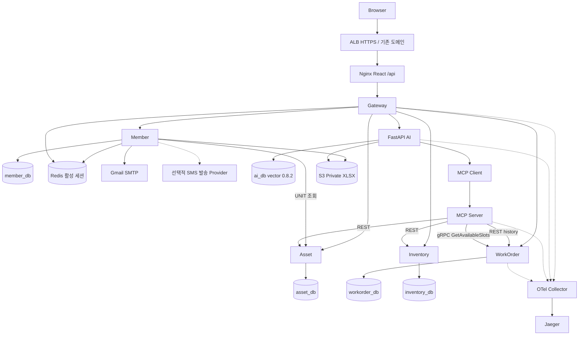

# FixOps — 통합 시스템 설계 v1.0

> **상태:** v1.0 설계 승인 후보 — 사용자 승인 정책 24개 및 권장 추가 쟁점 6개 반영. 실행·통합 테스트 전이며 코드 반영을 의미하지 않음.  
> **기준:** 2026-11-18 / 최종 발표 2026-12-21 / 5명·20영업일 / `OZA-bot-droid/fixops` main/docs v0.5~v0.5.4  
> **우선순위:** P0=시연 핵심 구현, P1=여력 시, P2=후속 확장.

## 1. 목적과 범위

아파트(BUILDING)·공장(FACTORY)의 위치/설비, 신고·작업·예약, 부품 재고, AI 매뉴얼 질의를 통합하는 **5인·20영업일 MSA**. 2026-12-21 시연을 위한 계약 기반 설계. 모든 팀원 Python AI/MCP 기여 필요.

### 확정 P0 / P1 / P2

| P0 필수 | P1 선택적 고도화 | P2 제외 |
|---|---|---|
| 조직 심사·JWT/RBAC·Redis 세션·K-apt 단지 식별·XLSX 명부·입주민 검증 | XLS·자유 매핑·AI SSE·고급 감사 UI | 사업자등록 검증, RabbitMQ |
| Asset·Location·WorkOrder·단일 예약·Inventory | 관리권 이전 전용 UI·반복 예약·고급 차트 | Kubernetes, 자동 부품 발주 |
| FastAPI·LangChain·MCP·RAG·gRPC 조회 단일 RPC·Jaeger 핵심 Trace | 통계 고도화·모바일 경험 확장 | 다중 AI Agent·IoT 예지보전 |
| Docker Compose AWS 시연, 조직·세대 격리, E2E | ECS 이행 자동화 | 전체 gRPC 전환 |

## 2. 역할·데이터 소유권

| 컴포넌트 | 책임 | DB | 담당 |
|---|---|---|---|
| Gateway :8080 | JWT 및 Redis 활성 SID 검증, 라우팅, 외부 신원 헤더 제거 | 없음 | 오좌언 |
| Member :8081 | Member/Org/Complex/ACL/Roster/Invite/이메일 인증·주민 등록 코드 | member_db | 오좌언 |
| Asset :8082 | Location, Asset, Category | asset_db | 이도형 |
| WorkOrder :8083, gRPC :9093 | 신고/배정/상태/예약/충돌 | workorder_db | 박천보 |
| Inventory :8084 | 부품·잔액·원장·사용 | inventory_db | 이도관 |
| AI :8085 | LLM/RAG/대화 요청/위임 컨텍스트 | ai_db(pgvector) | 하진철 |
| MCP :8090 | Python 조회 Tool·내부 어댑터 | 업무 원본 없음 | 하진철 통합, A/B/C 구현 |

## 3. 조직·단지·계정

- 글로벌 PLATFORM_ADMIN은 제한된 bootstrap으로만 생성하며 신규 조직을 심사한다.
- 신규 조직은 `PENDING_APPROVAL`; 승인 시 신청자 최초 ADMIN 소속을 **같은 DB 트랜잭션**으로 활성화한다.
- 조직 하나가 여러 단지를 관리 가능. 한 단지는 동일 시간에 1개 활성 관리 조직만 보유.
- 사용자 역할은 소속 단위 `ADMIN/TECHNICIAN/USER`, 단지·세대 접근은 별도 스코프. 플랫폼 관리자는 민감 업무 데이터 접근이 자동 허용되지 않음.
- 공장 조직은 K-apt·동/호수·입주민 명부 정책을 강제하지 않음.
- K-apt 단지코드는 신원 증명이 아니라 물리 단지 중복 판별값. API 미조회 단지는 수동 심사.
- 입주민은 관리 단지 ADMIN의 사전 본인 확인 후 발급된 일회용 등록 코드(기본) 또는 활성화된 SMS OTP(선택)로 증명한다. 활성 명부·미연결·Asset UNIT 및 조직 소속 조건 충족 시 자동 연결 가능; 이름·동·호수만으로 자동 승인 금지.
- 이사·퇴거·조직 역할 회수 시 세대 접근 정지, Refresh/Redis 세션 회수 및 민감 API 상태 재검증. 명시적 명부 퇴거는 진행 중 신청과 미사용 코드도 무효화한다.
- 계정 이메일 인증과 주민 거주 확인은 별개이다. Gmail SMTP는 이메일 발송만 담당한다. 상세 정책은 03, 물리 스키마는 02, API는 04 v1.1 참조. Redis 세션은 09/10 참조.

## 4. 업무 생명주기

- 신고: `REPORTED→ASSIGNED→IN_PROGRESS→COMPLETED`, `REJECTED/CANCELLED` 종료. 재작업은 새 WorkOrder 연결.
- 일정: WorkOrder 1:N 이력, 활성 확정 예약 1건, 작업자 시간대 중복은 DB EXCLUDE 제약. 추천 후보는 확정 보장 X.
- 재고: 실제 사용 확정과 재고 원장/잔액 같은 Inventory 트랜잭션; 조정은 역방향 원장. 서비스 간 분산 트랜잭션 X.
- 설비/위치: 이력 참조가 남으면 물리 삭제 대신 `INACTIVE`.
- 개인·조직·단지·세대 접근은 Java 원본 서비스가 최종 결정.

## 5. AI 및 외부 통신

- AI Service FastAPI + LangChain; MCP Server 한 개(Streamable HTTP) 및 도메인별 조회 Tool.
- 문서 업로드/조회·LLM 호출 시 조직·단지·권한 스코프를 포함하여 RAG SQL 단계에서 필터링.
- 예약은 LangChain→MCP→WorkOrder 가용 조회 **gRPC Unary 한 개** → 사용자 UI 확인 → WorkOrder REST 최종 확정.
- gRPC 장애 시 동일한 인증 검증을 수행하는 REST 가용 조회로 fallback. 인증/권한 오류는 fallback 금지.
- `traceparent` 전파 및 Jaeger에서 AI→MCP→WorkOrder 단일 Trace 시연.
- RabbitMQ 미도입. 순서·재시도·멱등성은 동기 서비스 계약으로 해결.

## 6. 기술 버전 정책

- Java 21, Spring Boot **4.0.9 / Spring Cloud 2025.1.3** = 우선 빌드 검증 후보. Boot 3.4.x 예제/Starter 복사 금지.
- Python 3.12, LangChain 1.x, 호환 MCP SDK/Client·FastAPI·Pydantic을 lock 파일로 고정.
- Node 22.x(>=22.12), React 19, Vite 7, Tailwind CSS 4, Axios.
- PostgreSQL 16 및 **RDS 지원 `vector` 0.8.2**. 설치 전 `pg_available_extension_versions` 조회. 기존 0.8.7 확장 다운그레이드는 하지 않음.
- Java Flyway, Python Alembic. 시간: TIMESTAMPTZ ↔ Java Instant ↔ Python aware datetime ↔ ISO 8601 UTC Z.

## 7. 화면 영역

| 구분 | 필수 화면 |
|---|---|
| 공개/계정 | 로그인, 회원가입, 이메일 확인, 조직 검색/가입 요청, 승인대기 |
| PLATFORM_ADMIN | 조직 개설 신청 목록·승인·거절, 중복 단지 심사 |
| 조직 ADMIN | 조직/단지 관리, 팀원 초대·승인, XLSX Import, 주민 등록 코드 발급·회수 및 심사, 설비/위치, 작업 배정, 예약, 재고 |
| TECHNICIAN | 배정 작업, 방문 일정, 작업 상태, 부품 사용, AI |
| USER | 단지·세대 연결(등록 코드 기본, SMS 선택), 본인 신고, 예약 확인/요청, AI 허용 조회 |

- React Router 가드와 화면 숨김은 UX; 실제 권한 검사는 Java API.
- Tailwind CSS4 `@theme` 디자인 토큰, 공통 Button/Modal/Input/Table/Layout만 사용, SCSS/CSS Modules 비도입.

## 8. AWS 시연

- 서울 `ap-northeast-2`, EC2 `m7i.2xlarge` 후보 8vCPU/32GiB, Docker Compose.
- RDS PostgreSQL 16 Single-AZ, ALB + ACM + 기존 도메인, 비공개 S3, Secrets Manager/SSM, CloudWatch, OTel·Jaeger.
- RDS 실제 엔진 마이너의 vector 0.8.2 지원 확인이 배포 진입 조건. 운영예산 USD400.
- 12/15 배포 → 12/18 전체 리허설 → 12/21 발표 → 12/22~23 백업 후 철수. 예산/설정 실측 이전까지 확정 금액 아님.
- 장기 목표 ECS Fargate는 본 시연 범위에 포함되지 않음.

## 9. 5인 업무분장

| 담당 | 주요 책임 | AI Python 기여 |
|---|---|---|
| 오좌언 (팀장) | Member·Organization·JWT·Gateway·K-apt·명부 Import Backend·AWS | 인증·사용자/단지 위임 컨텍스트·MCP 보안 |
| 이도형 (A) | Asset·Location·단지/동/호수, 명부 Import UI 지원 | Asset Tool/Client |
| 박천보 (B) | WorkOrder·예약·gRPC 서버, 예약 트랜잭션 | WorkOrder/Booking Tool |
| 이도관 (C) | Inventory·재고 동시성·원장 | Inventory Tool |
| 하진철 (D) | FastAPI·RAG·LangChain·MCP 서버 통합·Observability | AI Core·Tool registry·Python gRPC Client |

## 10. 20일 핵심 게이트

| 게이트 | 완료 조건 |
|---|---|
| D1~D5 | 서비스 ERD·API·Proto·Tool 및 RBAC 계약 동결, Boot·MCP·gRPC 기술 Spike, OTel trace |
| D6~D10 | 가입·단지·XLSX·설비/신고/재고 각각 독립 동작, AI 독립 RAG/Tool |
| D11~D15 | 세대 격리, 예약 확정·재고 멱등성, RAG/MCP/gRPC 전체 E2E, P0 코드 동결 |
| D16~D20 | 악용/동시성/장애 테스트, Docker 클린 배포, 문서·발표 준비 |
| 12/15~12/18 | AWS 서비스 배포·RDS vector 확인·HTTPS·데모 E2E·리허설 |
| 12/21 | 발표 동결 |

## 11. 구현 및 문서 완료 판정

- 기능 P0와 보안 E2E 테스트가 통과하기 전 기능 완료 선언 금지.
- 각 담당자는 DB Migration/REST·MCP 계약/프론트 Smoke/권한·오류 테스트를 제출.
- 본 문서가 시스템 기준; 상세 규칙은 `02`~`07` 부속 문서가 우선한다.
- **설계 승인 ≠ 기능 구현, 패키지 호환성, AWS 운영 검증 완료**.
