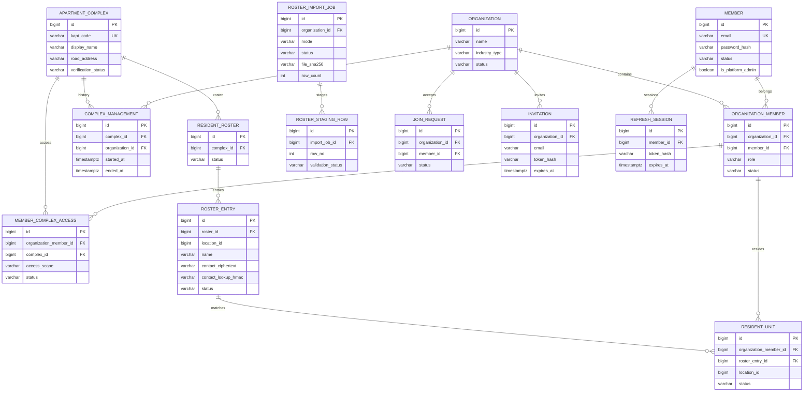
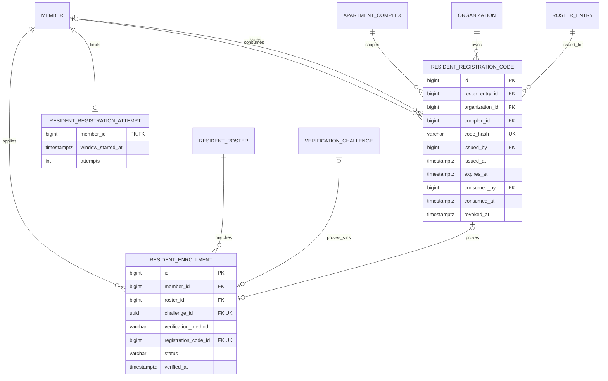
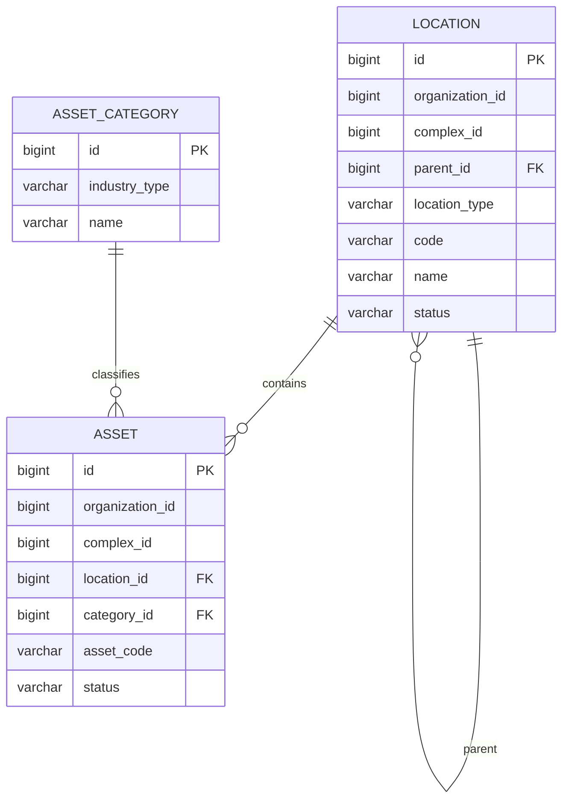
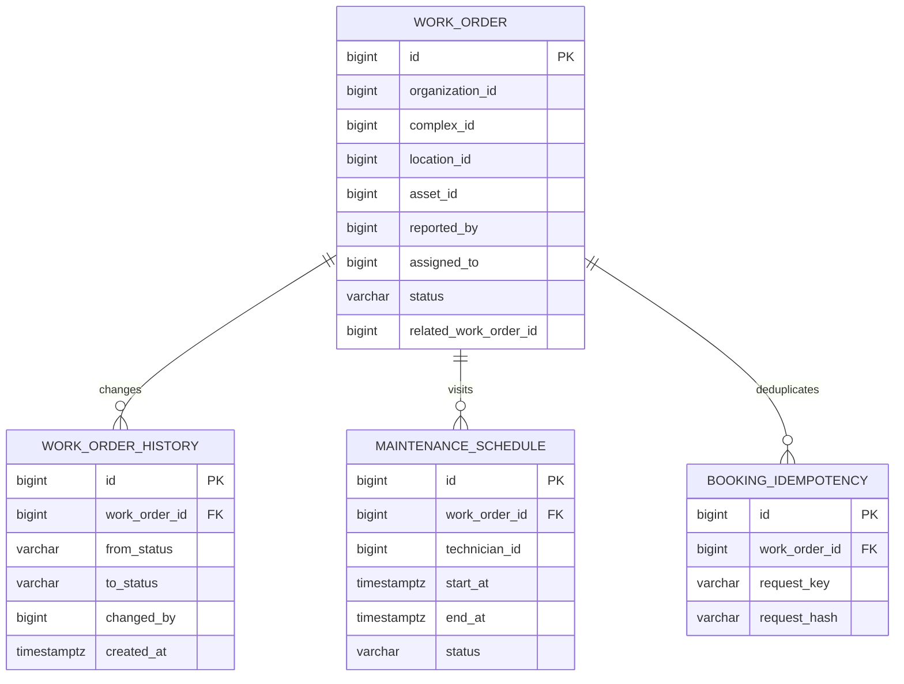
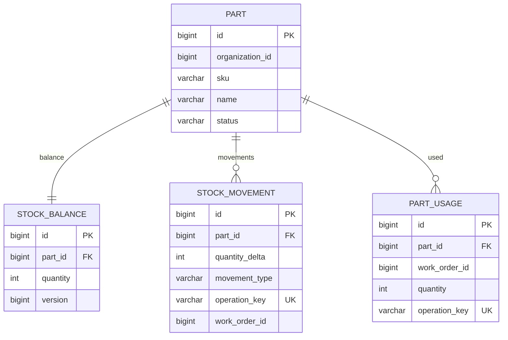
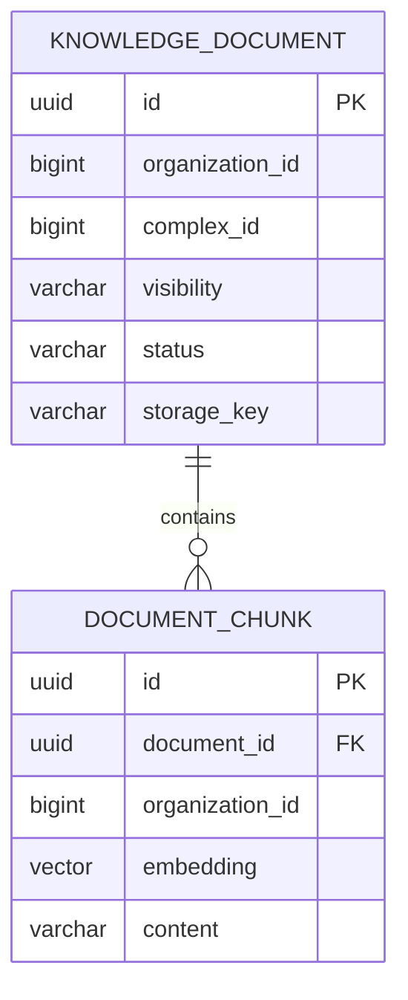

# FixOps v1.0 — 논리 ERD·DB 소유권·데이터 수명주기

> **상태:** v1.0 설계 승인 후보 — 사용자 승인 정책 24개 및 권장 추가 쟁점 6개 반영. 실행·통합 테스트 전이며 코드 반영을 의미하지 않음.  
> **기준:** 2026-11-18 / 최종 발표 2026-12-21 / 5명·20영업일 / `OZA-bot-droid/fixops` main/docs v0.5~v0.5.4  
> **우선순위:** P0=시연 핵심 구현, P1=여력 시, P2=후속 확장.

## 1. 범위·키 계약

- 서비스별 DB: `member_db`, `asset_db`, `workorder_db`, `inventory_db`, `ai_db`.
- 각 서비스 내 물리 FK 가능; **서로 다른 DB 간 FK 금지**. 외부 ID는 명시적 논리 참조 + API 유효성 확인.
- `organization_id`, `complex_id`, `location_id`, `member_id`, `work_order_id`는 **BIGINT**를 기준으로 공유 계약. AI 문서/청크 UUID 별도 사용.
- 모든 다중 테넌트 업무 테이블의 `organization_id` 또는 `complex_id`(필요 시 둘 다)를 강제, 권한 SQL 필터 적용.
- 단지 식별(`complex_id`)은 소유 조직이 변경되어도 보존되는 **물리 자원 ID**; `organization_id`는 운영 책임의 시점별 관계. 변경 이력을 일괄 덮어쓰지 않음.

## 2. Member DB ERD

- `is_platform_admin`은 예시 표현이며 운영 구현에서는 별도 전역 역할·감사 엔티티로 확장 가능. 공개 API로 변경 불가.
- `organization_member(organization_id,member_id)` UNIQUE.
- `apartment_complex.kapt_code` UNIQUE NULL 허용; 수동 등록은 주소 유사 후보 + 플랫폼 관리자 검토.
- `complex_management` 활성 레코드(ended_at IS NULL)는 동일 complex당 **최대 하나**: partial unique index.
- `resident_unit`에 `location_id`는 Asset DB 논리 참조. 조직·단지·`location_type=UNIT` 재확인.
- `roster_staging_row(import_job_id,row_no)` UNIQUE; `commit` 단일 트랜잭션·중복 방지.
- `roster_entry`의 중복 판별은 **동/호수만으로 유일하지 않음**. 명부 소유 주민별 안정적인 key가 없는 경우 관리자 확인 및 연락처 HMAC 등을 보조로 활용.
- 물리 DB 스키마/DDL은 담당자별 Flyway V1/V2에서 확정, 여기에 없는 자동 FK 가정 금지.

### 2.1 주민 등록 인증 — V9 물리 스키마 추가

Member DB 소유. 기존 논리 ERD와 함께 아래 부분 ERD를 적용한다. 기준: `V9__resident_registration_codes.sql`, 2026-11-25 구현 브랜치.

물리 테이블명: `resident_registration_codes`, `resident_registration_attempts`, `resident_enrollments`. 위 신청 엔티티는 인증 관련 컬럼 중심으로 표시한다.

- 코드 해시 VARCHAR(64) UNIQUE, 원문 저장 금지. 발급자·사용자·조직·단지는 Member 내부 FK.
- 만료는 발급 이후, 사용 시각과 사용자는 동시에 존재하거나 동시에 NULL, 사용 완료와 회수는 상호 배타적이다.
- 명부 항목별 미사용·미회수 코드 최대 1개(partial UNIQUE). 만료 여부는 이 인덱스 조건에 포함되지 않으므로 재발급 시 기존 미사용 코드를 회수한다.
- 신청의 challenge_id는 nullable로 변경, verification_method VARCHAR(24) NOT NULL DEFAULT 'SMS_OTP', registration_code_id는 nullable UNIQUE FK.
- SMS_OTP는 challenge_id 필수, registration_code_id NULL. REGISTRATION_CODE는 challenge_id NULL, registration_code_id 및 verified_at 필수, 상태는 PENDING_REVIEW/APPROVED/REJECTED 중 하나.
- 시도 제한은 회원별 PK, 15분 윈도우, attempts 0~5 CHECK. 코드 발급·사용·회수·명부 퇴거는 조직/단지 잠금 기반으로 직렬화한다. 인증 방식 간 중복 심사 제한은 서비스 로직이며 별도 DB UNIQUE 제약으로 보장하지 않는다.
- 퇴거 시 미사용 코드 회수 및 진행 중 신청 반려. 사용 완료 코드는 이력으로 보존. 감사 로그 대상은 resident_registration_code 및 resident_enrollment로 분리한다.
- 실제 물리 스키마는 Flyway V1~V9를 우선하며, 기존 V1~V8 변경 없이 V9를 순차 적용한다. 실제 DB 마이그레이션 및 동시성 검증 필요.

## 3. Asset DB

- BUILDING `COMPLEX→BUILDING→UNIT`, 공용 설비는 `COMMON_AREA` 위치 아래도 가능.
- FACTORY `FACTORY→AREA→LINE→EQUIPMENT_LOCATION` 등 별도 유형.
- 관리권 이전 시 `complex_id` 기준 자원 보존. 현재 운영 조직은 Member API를 통해 확인; `organization_id`의 히스토리 의미와 가변 운영자 의미를 혼합하지 않도록 별도 전략 필요.
- 이미 작업·예약 이력 있는 Location/Asset 삭제는 `INACTIVE`로 처리.

## 4. WorkOrder DB

- `work_order.asset_id` nullable(누수 신고 등), `location_id`는 위치 범위 검증.
- DB EXCLUDE 제약으로 **작업자별 겹치는 활성 예약 금지**. 작업당 활성 확정 예약은 partial unique index 고려.
- `start_at < end_at` CHECK, idempotency key UNIQUE.

## 5. Inventory DB

- 차감과 원장 삽입은 **한 Inventory 트랜잭션**, `quantity>=0` DB CHECK, 재시도 안전한 operation key.
- 타 서비스 WorkOrder ID는 FK 아님. 참조 작업의 조직·작업자 권한은 내부 API로 재검증.

## 6. AI DB

- RDS `ai_db`에 `vector` 0.8.2 사용, HNSW/코사인 검색. 조직·단지·문서 가시성 조건을 **SQL 검색 단계에서** 강제.
- 문서 삭제·권한 회수 시 검색 대상에서 즉시 제외하고 비동기 청크 정리를 수행.

## 7. 공통 데이터 삭제/이전 원칙

1. 물리 단지 식별자는 삭제되지 않으며, 운영 조직 변경시 `complex_management`만 닫고 새 활성 관리관계를 만든다.
2. 과거 작성/접수 시점의 조직 ID를 임의로 바꾸지 않는다. 신규 조직의 과거 자료 접근 정책은 운영자 승인·감사 하에서 별도 부여.
3. 완결 작업·예약·재고 원장은 정정 기록으로 보존.
4. 명부 원본 XLSX는 수집 목적에 필요한 최소 기간 후 S3 삭제; 휴대전화 원문은 암호화.
5. DB 간 참조 미존재/정지/조직 불일치 시 API는 403/404/409 중 계약에 따른 오류 반환.

## 8. DB 마이그레이션 책임

- Member/Asset/WorkOrder/Inventory 각각 Flyway. 한 RDS Postgres 16 인스턴스 내 논리 DB 개별 관리.
- AI DB는 Alembic. `vector` 확장 설치는 프로비저닝 단계에서 단 한 곳이 담당.
- 기존 vector 0.8.7의 다운그레이드를 `ALTER EXTENSION UPDATE`로 처리하지 말 것. 신규 DB 생성+재색인 경로를 사용.

### Member DB: organization_onboarding_invitations (V12)
플랫폼 조직 개설 초대 전용. 기존 invitations(구성원 초대)와 분리. PK id, invitee_email, organization_name, organization_kind, created_by(FK members), created_at, expires_at, accepted_at, accepted_by(FK members), revoked_at, organization_id(UNIQUE FK organizations). 수락 전 동일 이메일/조직명/유형 중복 방지 부분 유니크 인덱스. 수락 시 인증 이메일 일치 및 행 잠금으로 일회성 보장.
