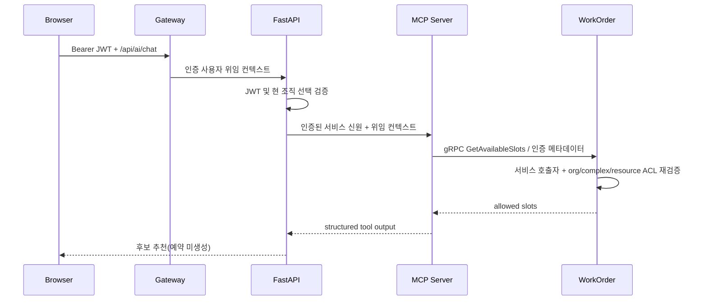
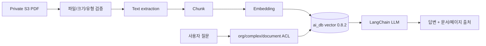

# FixOps v1.0 — AI·MCP·gRPC·RAG 계약

> **상태:** v1.0 설계 승인 후보 — 사용자 승인 정책 24개 및 권장 추가 쟁점 6개 반영. 실행·통합 테스트 전이며 코드 반영을 의미하지 않음.  
> **기준:** 2026-11-18 / 최종 발표 2026-12-21 / 5명·20영업일 / `OZA-bot-droid/fixops` main/docs v0.5~v0.5.4  
> **우선순위:** P0=시연 핵심 구현, P1=여력 시, P2=후속 확장.

## 1. 목표와 경계

- 사용자 → Gateway → FastAPI AI → LangChain → MCP Client → 단일 Python MCP Server → Java 업무 서비스.
- MCP Tool은 **조회 전용**. AI는 예약 후보를 추천하나 예약 확정/재고 차감/작업 배정을 직접 실행하지 않음.
- 사용자 승인 이후 React가 해당 **Java REST API**를 호출하고 원본 서비스가 트랜잭션을 책임짐.
- Tool 실패·RAG 자료 부족 시 근거 없는 사실을 만들어내지 않음.

## 2. 담당·Tool 계약

| Tool | 담당 | 인자 개요 | 응답 | 원본 |
|---|---|---|---|---|
| `get_asset_info` | 이도형 | `assetId` | 허용된 설비 상세 | Asset REST |
| `search_assets` | 이도형 | `query,complexId?,limit` | 설비 목록 | Asset REST |
| `get_workorder_history` | 박천보 | `assetId?,locationId?,limit` | 허용된 작업 이력 | WorkOrder REST |
| `get_booking_details` | 박천보 | `bookingId` | 소유·관리 가능한 예약 | WorkOrder REST |
| `get_available_slots` | 박천보 | `assetId?,date,durationMinutes` | 예약 가능 슬롯 | WorkOrder gRPC |
| `get_part_stock` | 이도관 | `partId` | 잔액/단위 | Inventory REST |
| `get_low_stock_parts` | 이도관 | `limit` | 권한 내 부족 재고 | Inventory REST |
| `search_parts` | 이도관 | `query,limit` | 부품 목록 | Inventory REST |

- 모든 Tool 인자는 Pydantic 스키마로 검증; `orgId`, `role`, `memberId`를 Tool 입력에서 권한의 원천으로 사용하지 않음.
- 결과에는 `sourceService`, `resourceId`, `checkedAt`, `visibility` 등 최소 메타데이터 포함.
- 출력 레코드 수/문자 수 제한, 민감정보 제거.

## 3. 도메인 인증·인가



- Gateway가 외부의 사용자 헤더를 제거하더라도 MCP/gRPC는 별도 신뢰 경계다.
- 내부 네트워크만으로 서비스 인증을 대체하지 않음.
- `UNAUTHENTICATED`, `PERMISSION_DENIED` 시 REST fallback 금지; 권한 오류를 사용자에게 적절히 전달.
- 승인된 세대 외 민원/수리 이력과 타 조직 문서가 LLM 컨텍스트에 들어가지 않게 원본 SQL/API에서 차단.

## 4. gRPC 단일 Proto 예시

`contracts/proto/fixops/schedule/v1/schedule.proto`

```proto
syntax = "proto3";
package fixops.schedule.v1;
option java_package = "com.fixops.workorder.grpc.v1";
option java_multiple_files = true;

service ScheduleQueryService {
  rpc GetAvailableSlots(AvailabilityRequest) returns (AvailabilityResponse);
}
message AvailabilityRequest {
  int64 asset_id = 1; // 미등록 설비 신고는 별도 location_id 조회 지원 검토
  string date = 2; // YYYY-MM-DD, org timezone
  int32 duration_minutes = 3;
}
message AvailabilityResponse {
  repeated AvailableSlot slots = 1;
  string checked_at = 2;
}
message AvailableSlot {
  string slot_id = 1; // 서버가 생성한 후보 식별자 (확정 보장 X)
  string start_at = 2;
  string end_at = 3;
}
```

- 원래 v0.5 예시의 `technician_id`는 일반 주민에게 노출되지 않게 `slot_id`로 대체한 **v1.0 제안 계약**. B/D가 `.proto` 버전 동결 시 동기화.
- `asset_id=0` 의미 등 매직 값 금지. 설비가 없는 WorkOrder는 `oneof` 또는 별도 `location_id` 필드 확장 시 Protobuf 계약 명시.
- 서버 업무 시각은 조직 타임존에서 해석 후 `UTC Z`로 출력.
- Deadline 초기 2초(계측 후 조정), 실패 시 **검증된 REST 동등 조회**. 예약 확정은 WorkOrder REST만 허용.

## 5. AI 예약 권한과 상태

1. 자연어 의도 확인 → 자산·위치·날짜·작업 기간 검증.
2. MCP로 WorkOrder 가용시간 조회(gRPC 단일 RPC).
3. 사용자 UI에 슬롯·기준 시간·만료 안내.
4. 사용자 **명시적 확인** → React가 WorkOrder REST `POST /api/schedules` 호출.
5. 서버가 권한·상태·DB 예약 겹침·멱등성 재검증, 실패 시 409.
6. 같은 작업자 중복 배정, 승인되지 않은 세대/단지는 예약 불가.

## 6. RAG 데이터 흐름



- 매뉴얼 문서의 스코프(`organization_id`,`complex_id`,`visibility`)를 **SQL에서** 필터링, 사후 LLM 판단 금지.
- 문서가 삭제되거나 권한이 회수되면 즉시 검색 제외 후 청크 삭제/재색인.
- `vector(embedding_dimension)`은 실제 임베딩 모델과 일치. 모델 변경 시 인덱스 재생성 계획.
- 외부 LLM 전송 시 사용자 신고·연락처 등 개인정보 최소화, 비밀키/토큰 전송 금지.
- 문서 출처 필드(`documentId`, `filename`, `pageNumber`) 사용자에게 표시.
- 검색 근거 없을 때 '확인되지 않음' 응답.

## 7. Tool 오류 응답

```json
{
  "ok": false,
  "error": {"code":"DEPENDENCY_UNAVAILABLE","retryable":true},
  "toolName":"get_available_slots",
  "traceId":"example"
}
```

- 비즈니스 404/403, 시스템 503, 시간 초과를 구분. 외부 사용자에게 내부 스택 추적 노출 금지.
- Tool 호출 횟수 제한, LLM 전체 타임아웃, 재시도 지수 백오프.
- 프롬프트 인젝션 시도를 외부 데이터로 처리; Tool 파라미터의 권한 상승 차단.

## 8. OTel / Jaeger

- FastAPI, MCP, httpx/GRPC, Java의 W3C Trace Context와 gRPC Metadata 연결.
- `fixops-ai`, `fixops-mcp`, `fixops-workorder` 서비스명.
- JWT/OTP/연락처/PDF 원문·민감 프롬프트를 Span 속성/로그에 남기지 않음.
- 발표용 단일 Trace: Gateway→AI→MCP→WorkOrder 조회 및 타임아웃 fallback.

## 9. Python 버전 계약

- Python 3.12 + FastAPI + Pydantic 2 + LangChain 1.x + 호환 MCP SDK + grpcio/grpcio-tools 동종 버전.
- 실제 MCP SDK 클래스/호출 방식은 D3에 설치 검증하고 `uv.lock`에 확정. 문서상의 미검증 버전을 동작 보장으로 쓰지 않음.
- AI Service와 MCP Server는 별도 프로세스·별도 lockfile, Tool 계약 테스트로 버전 협상 검증.
