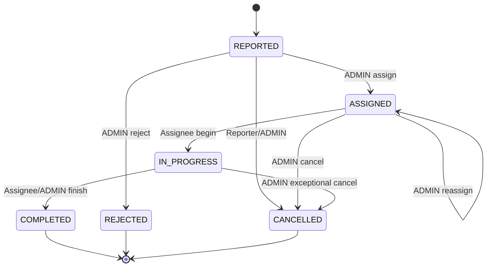

# FixOps v1.0 — WorkOrder·예약·재고 상태 전이 및 정합성

> **상태:** v1.0 설계 승인 후보 — 사용자 승인 정책 24개 및 권장 추가 쟁점 6개 반영. 실행·통합 테스트 전이며 코드 반영을 의미하지 않음.  
> **기준:** 2026-11-18 / 최종 발표 2026-12-21 / 5명·20영업일 / `OZA-bot-droid/fixops` main/docs v0.5~v0.5.4  
> **우선순위:** P0=시연 핵심 구현, P1=여력 시, P2=후속 확장.

## 1. 기본 상태 기계



- 완료·거절·취소는 종결 상태. 재개 필요 시 새 WorkOrder와 `related_work_order_id`로 연결.
- 상태 전이 시 `expectedVersion` 또는 `If-Match`를 요구해 갱신 충돌 방지, 모든 상태 변경 `work_order_history`에 기록.
- 미배정 TECHNICIAN의 진행/완료 요청 거부. 작업자의 역할·단지 접근·배정 관계 모두 재검증.
- WORK_ORDER에 설비 필수 아님(`asset_id=null`); 위치/단지 소속은 필수.
- 신청자 취소는 `REPORTED`에서만 가능하고 접수 후에는 관리자 정책을 따름.

## 2. 예약 수명주기

- WorkOrder 1개에 방문 이력 여러 건 허용. 단 **활성 CONFIRMED 방문은 최대 1건**.
- `CONFIRMED → CANCELLED` 혹은 `COMPLETED`. 변경은 취소 + 새 예약.
- `start_at < end_at` CHECK, 중복 예약은 DB Exclusion Constraint(작업자 ID/시간 범위)와 작업당 활성 예약 Partial Unique로 방지.
- 가용 시간 조회는 **쓰기 보장이 아니므로**, 조회 결과 직후 다른 예약이 확정되면 409를 정상 반환.

```sql
CREATE EXTENSION IF NOT EXISTS btree_gist;

ALTER TABLE maintenance_schedule
  ADD CONSTRAINT chk_booking_time CHECK (start_at < end_at);

ALTER TABLE maintenance_schedule
  ADD CONSTRAINT no_technician_overlap
  EXCLUDE USING gist (
    technician_id WITH =,
    tstzrange(start_at, end_at, '[)') WITH &&
  ) WHERE (status = 'CONFIRMED');

CREATE UNIQUE INDEX uq_active_schedule_per_workorder
  ON maintenance_schedule(work_order_id)
  WHERE status = 'CONFIRMED';
```

**사전조건:** 실제 DDL의 필드명·상태명과 일치해야 함. `technician_id` NOT NULL, 기존 충돌 데이터 정리 필요. 다중 DB에서는 예약 같은 WorkOrder DB 안에서만 트랜잭션 수행.

### 예약 생성 API

- `POST /api/schedules` with `Idempotency-Key`.
- 트랜잭션: 본인/조직/단지/작업 상태 확인 → 요청키 중복 판정 → 예약 INSERT → 결과 저장.
- 같은 키+같은 본문은 이전 결과 재전달, 같은 키+다른 본문은 409.
- 작업자를 추천·배정하는 내부 식별자는 USER에 불필요하게 노출하지 않음.

## 3. 재고 트랜잭션

- `part`와 `stock_balance`, `stock_movement`, `part_usage`는 Inventory DB 소유.
- 차감은 `UPDATE ... SET quantity = quantity - :qty WHERE ... AND quantity >= :qty` 조건부 갱신 또는 낙관적 잠금.
- **잔액 차감 + 사용 기록 + 원장 삽입 + idempotency 결과**가 같은 Inventory DB 트랜잭션.
- 입고 역시 원장에 양수 기록; 취소는 새 음/양수 보상 원장 기록, 기존 내역 직접 수정 금지.

```sql
UPDATE stock_balance
SET quantity = quantity - :quantity,
    version = version + 1
WHERE part_id = :part_id
  AND quantity >= :quantity;
-- 영향 0행: 재고 부족 또는 동시 충돌 => 같은 TX에서 rollback
```

### 재고 차감 기준

- TECHNICIAN은 자신에게 배정된 유효 WorkOrder에서만 사용 확정 가능, ADMIN은 관리범위 내 허용.
- Inventory는 WorkOrder 서비스의 인증된 상태/소속 조회 API로 작업의 현재 상태 확인. 작업 응답 장애 시 차감하지 않음.
- 재고 부족은 409, 작업 완료는 별도 정책으로 관리하며 자동 무효화하지 않음.

## 4. Cross-service 실패 및 보상

**분산 트랜잭션·RabbitMQ·Saga P0 비도입.** 서비스마다 원자성 범위를 제한하고 업무 순서를 명확히 한다.

| 사고 | 기본 처리 | 복구 |
|---|---|---|
| 예약 조회 후 다른 이용자가 선점 | 확정 409 | 최신 후보 다시 조회 |
| Inventory 차감 성공, WorkOrder 상태 갱신 실패 | 재고 차감은 유효한 독립 사실로 유지 | 동일 operation key 상태 확인; 필요시 보상 원장 |
| WorkOrder 상태 조회 서비스 다운 | Inventory 쓰기 실패(503) | 재시도, 무조건 차감 금지 |
| 사용 기록 중복 제출 | operation key 중복 검출 | 결과 재전달, 추가 차감 없음 |
| 작업 취소 후 사용 부품 반환 | 기존 차감 기록 유지 | 보상성 `STOCK_RETURN` 기록(실제 반환 확인) |
| Asset/Location 정지 중 | 신규 예약·신고 제한 | 과거 이력·조회 유지 |

도메인 간 생성 성공 후 응답 유실 사례에 대비해 `GET /.../operations/{key}` 형태의 상태 조회를 검토한다. 최소한 결과를 멱등 저장하여 동일 키 재시도가 안전하게 처리돼야 한다.

## 5. 조직·단지 변경 정책

- 작업과 재고 원장은 **발생 당시 조직**을 기록하고, 이력 보존.
- 관리권 이전은 과거 데이터의 작성 조직을 일괄 재작성하지 않는다.
- 새로운 관리 조직에 과거 작업 이력을 보일지 여부는 PLATFORM_ADMIN 승인 이력/가시성 정책으로 결정.
- 물리 단지·설비/위치 ID 변경 금지, 이미 참조된 자원의 물리 삭제 대신 비활성화.

## 6. 필수 테스트

| 상황 | 기대값 |
|---|---|
| 동시 동일 작업자 예약 2개 | 1개만 성공, 다른 409 |
| 동일 작업의 다른 작업자 활성 방문 2개 | 1건 성공, 다른 409 |
| 취소 후 재예약 | 이력 보존, 신규 일정 정상 |
| 같은 Idempotency-Key 중복 요청 | 결과 1회, 예약 1건 |
| 재고 5개에서 4개 사용 2건 동시 | 한 건만 차감, 잔액 >=0 |
| 재고 차감 성공 응답 유실 후 재시도 | 1회 차감 |
| 관리 조직 외 다른 단지 작업 조작 | 403/404 |
| 상태 전이 완료→진행 시도 | 409 |
| 타 작업자 완료 요청 | 403 |
| 작업/재고 생성 후 정정 | 원본 이력·보상 이력 모두 보존 |
