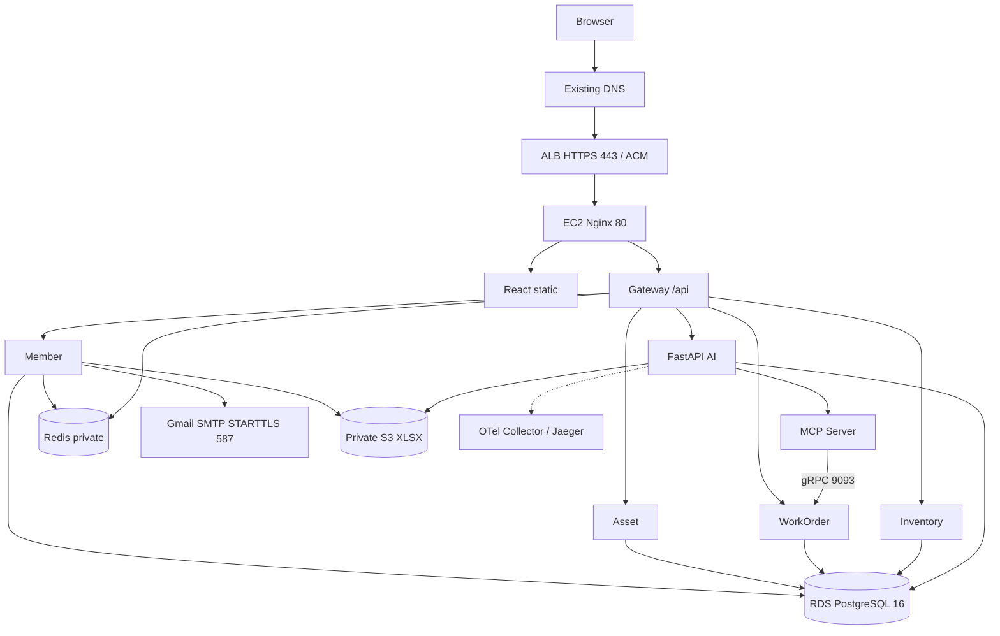

# FixOps v1.0 — AWS 시연 배포·테스트·철수 실행 계약

> **상태:** v1.0 설계 승인 후보 — 사용자 승인 정책 24개 및 권장 추가 쟁점 6개 반영. 실행·통합 테스트 전이며 코드 반영을 의미하지 않음.  
> **기준:** 2026-11-18 / 최종 발표 2026-12-21 / 5명·20영업일 / `OZA-bot-droid/fixops` main/docs v0.5~v0.5.4  
> **우선순위:** P0=시연 핵심 구현, P1=여력 시, P2=후속 확장.

## 1. 배포 목표

- 발표: **2026-12-21 월요일**; AWS 구축: 12/15~16, 통합 리허설 12/18, 발표 후 12/22~23 철수.
- AWS **총 지급 예산 USD 400**. 예산을 소진할 필요 없음; 안정성과 검증 우선.
- 서울 `ap-northeast-2`, 기존 보유 도메인, EC2 `m7i.2xlarge` 후보 8 vCPU/32 GiB + Docker Compose, RDS PostgreSQL 16 Single-AZ, ALB+ACM HTTPS, private S3, IAM role, CloudWatch/OTel+Jaeger.
- RDS 인스턴스 후보 `db.t4g.medium`, 실측 리소스 및 0.8.2 지원 확인 후 조정.
- **ECS Fargate는 장기 목표**, 시연에선 구현하지 않음. 단일 EC2는 HA 아님.

## 2. 배포 구성·진입점



### 네트워크

- ALB는 서로 다른 AZ의 public subnet 2개 이상; HTTPS 443 외부 공개.
- EC2는 발표용 public subnet 가능하나 **인바운드 Nginx 80을 ALB SG로만 제한**, SSH 대신 SSM Session Manager. 다른 컨테이너 포트 외부 Publish 금지.
- RDS는 private subnet group, public access 금지, 5432는 EC2 SG만 허용.
- Jaeger 16686 외부 비공개, SSM 포트 포워딩 또는 인증된 내부 접속.
- ALB 대상 그룹 Healthcheck 이외에 실제 API/로그인/AI E2E 별도 실행.

## 3. RDS pgvector 0.8.2 선행 확인

AWS 공식 확장 호환 매트릭스: https://docs.aws.amazon.com/AmazonRDS/latest/PostgreSQLReleaseNotes/postgresql-extensions.html

```sql
SELECT name, version
FROM pg_available_extension_versions
WHERE name='vector'
ORDER BY version;

CREATE EXTENSION IF NOT EXISTS vector VERSION '0.8.2';

SELECT extname, extversion
FROM pg_extension WHERE extname='vector';
```

- **특정 RDS PostgreSQL 16 마이너에서 vector 0.8.2를 지원하는지 실제 DB 생성 후 확인**. 불가하면 호환 엔진 마이너를 선택하거나 배포전 설계 변경 승인(무작정 0.8.7/0.8.2 혼합 금지).
- 로컬 PostgreSQL 16에서도 기능적으로 `vector` 0.8.2와 동일하게 검증. Registry 이미지 태그는 실제 존재 확인 후 pin, 미검증 이미지 추측 금지.
- `vector(embedding_dimension)`과 모델 임베딩 출력 차원 일치 확인.
- 기존 0.8.7 extension **다운그레이드 금지**; 신규 DB+재색인.

## 4. 파일·비밀정보

- S3 Private 버킷: `organizations/{id}/rosters/{jobId}/` 및 `manuals/{documentId}/` Prefix, Block Public Access, 암호화·수명주기 정리.
- AWS SDK는 **EC2 Instance Profile IAM Role** 자격증명 사용. S3/Secrets 권한 최소화.
- JWT 개인키는 Member만 접근. SSM SecureString/Secrets Manager에서 안전하게 주입; 소스·Docker 이미지·CloudWatch 로그 내 저장 금지.
- 사업자등록 진위확인 API는 **사용하지 않음**. K-apt API Key는 Member 서버에만 두고, 실패 시 데모용 지정 fixture 사용.
- 가상 명부만 사용, 실제 거주자의 연락처/개인정보 사용 금지.

### 4.1 이메일 발송 및 주민 인증 설정

Member Service에만 아래 환경변수를 주입한다. 예시는 비밀값을 포함하지 않는다.

```dotenv
VERIFICATION_EMAIL_PROVIDER=smtp
VERIFICATION_SMS_PROVIDER=disabled
MAIL_HOST=smtp.gmail.com
MAIL_PORT=587
MAIL_USERNAME=
MAIL_PASSWORD=
MAIL_FROM=
VERIFICATION_HASH_KEY=
```

- Gmail 계정의 2단계 인증과 앱 비밀번호 발급 가능 여부를 사전 확인한다. 계정과 앱 비밀번호는 서버 비밀 저장소에서 주입한다. MAIL_FROM은 인증 계정 또는 허용된 발신 주소로 설정한다.
- SMTP 활성화 시 필수 값 누락은 시작 실패로 처리한다. 실제 인증 성공은 테스트 계정 발송으로 검증한다. STARTTLS 필수 및 연결/읽기/쓰기 제한을 유지한다. EC2의 TCP 587 외부 연결 가능 여부를 검증한다.
- VERIFICATION_HASH_KEY는 Base64 인코딩된 32바이트 비밀키로 안정적으로 유지한다. 임의 교체 시 기존 인증 증명에 영향이 있으므로 교체 계획 필요.
- Redis는 외부 공개 금지, Gateway/Member의 활성 SID 접근을 허용하고 장애 시 보호 요청을 차단한다. 09/10 운영 검증 계약 참조.
- 코드 원문·OTP·SMTP 비밀번호·해시 키를 Git, 이미지, 로그, Trace, 스크린샷에 기록하지 않는다. 가상 명부 및 통제된 테스트 이메일만 사용한다.
- V9 적용 전 백업 및 이전 이미지와의 호환성을 검증한다. 신규 인증 방식 데이터 생성 후 이전 버전으로 단순 롤백 가능한지 별도 확인한다.

## 5. 배포·롤백

1. `main` 릴리스 태그/커밋 SHA 고정, GitHub Actions CI(Java·Python·FE·Proto·Contract) 통과.
2. Docker 이미지를 immutable 태그로 빌드, ECR 또는 검증된 private registry에 Push.
3. EC2에서 Compose 이미지 Pull 및 Up. 환경별 `.env` 값은 서버만 관리.
4. Flyway/Alembic 마이그레이션 변경사항은 롤백용 이미지와의 역호환 여부 검증.
5. ALB/ACM/DNS·Health 확인, End-to-End 테스트.
6. 장애 시 이전 이미지 태그로 복귀; DB 스키마가 이미 변경되었다면 DB 마이그레이션 역호환 또는 백업 복구 절차를 따름.
7. 발표 전날 코드·환경 설정 동결. AWS Budget 경고 $100/$200/$300/$350, **Budget은 하드 사용제한 아님**.

## 6. 필수 E2E 테스트 매트릭스

| ID | 테스트 | 통과 조건 |
|---|---|---|
| T01 | 공개 가입 시 ADMIN 지정 | 거부 또는 무시 후 무권한 계정 |
| T02 | PLATFORM_ADMIN 조직 승인 | 조직 ACTIVE+최초 ADMIN 1명 원자적 생성 |
| T03 | K-apt 동일 코드 중복 등록 | 409 또는 수동 심사 대기 |
| T04 | 타 단지 주민의 신고 접근 | 차단 |
| T05 | XLSX 2000행 업로드/재업로드 | 중복 회원·중복 명부 없음, 검증 보고 |
| T06 | 이름+동/호수만 매칭 | 자동 승인 불가 |
| T07 | 유효 등록 코드 또는 활성 SMS OTP + 활성 명부 및 UNIT 일치 | 세대 소속 승인 |
| T08 | 퇴거/권한 회수 후 JWT | 민감 조회·변경 차단 |
| T09 | TECHNICIAN 미배정 작업 완료 | 403 |
| T10 | 동시 동일 작업자 예약 | 단 한 건 확정, 나머지 409 |
| T11 | 같은 예약 생성 재시도 | Idempotency로 1건 |
| T12 | 재고 부족/동시 차감 | 음수 불가, 원장 1회 |
| T13 | WorkOrder 응답 장애 시 Inventory | 쓰기 자동 성공 금지 |
| T14 | MCP 다른 org/complex 명시 | 원본 Java 서비스 거부 |
| T15 | RAG 타 조직 문서 검색 | 내용/출처 유출 없음 |
| T16 | gRPC 불능 | 인증된 REST 조회 fallback, 쓰기 영향 없음 |
| T17 | Jaeger Trace | Gateway→AI→MCP→WorkOrder 연결 |
| T18 | AWS HTTPS/ALB | 보유 도메인 정상, 유효 TLS, 80→443 |
| T19 | S3 비공개 | 익명 다운로드 거부, IAM Role로 정상 접근 |
| T20 | DB vector | `vector` 확장 `0.8.2` 확인, RAG 검색 성공 |

### 주민 인증 추가 회귀 검증 (미실행 체크리스트)

| ID | 테스트 | 통과 조건 |
|---|---|---|
| T21 | SMTP 필수 설정 누락 및 실제 이메일 발송 | 설정 누락 시작 실패, 정상 설정에서 테스트 이메일 수신 |
| T22 | SMS disabled 및 조회 실패 | 등록 코드만 표시, SMS 발송 차단 |
| T23 | 코드 재발급·만료·회수·재사용 | 기존 코드 인증 불가, 원문 비노출 |
| T24 | 동일 코드 동시 사용·인증 방식 간 중복 | 중복 연결/심사 생성 금지 |
| T25 | 등록 코드 실패 5회/15분 | 추가 시도 429, 윈도우 종료 후 재시도 가능 |
| T26 | 타 단지 ADMIN 발급/회수 | 권한 차단 |
| T27 | 심사 대기 후 퇴거·재입주 | 이전 신청 반려 유지, 미사용 코드 무효화 |
| T28 | 주민 승인·퇴거 후 Redis SID | 기존 세션으로 권한 접근 불가, 재로그인 후 최신 권한 |
| T29 | 기존 DB V1~V8에서 V9 적용 | 기존 SMS 이력 보존, 신규 제약 정상 |

**외부 API 장애와 실제 보안 결함을 구분**한다. 외부 API 대체는 데모 계정만, JWT·권한·DB 쓰기 기능은 Mock으로 통과 처리하지 않는다.

## 7. 일정

| 날짜 | 실무 목표 | 담당 |
|---|---|---|
| 12/11~14 | CI, 이미지, DB SQL, Mock 데이터/SSL 준비 | 전원·오좌언 |
| 12/15 | EC2/RDS/ALB/S3/IAM 생성, pgvector 검증 | 오좌언·하진철 |
| 12/16 | HTTPS/도메인·Compose·DB 마이그레이션 | 오좌언 |
| 12/17 | Member/K-apt/XLSX/Asset E2E | 오좌언·이도형 |
| 12/18 | WorkOrder/Inventory/AI/MCP/gRPC/RAG/Jaeger 전체 리허설 | 박천보·이도관·하진철 |
| 12/19~20 | 발표 버전 동결, 로컬 백업 영상·DB 준비 | 전원 |
| 12/21 | 최종 시연 | 전원 |
| 12/22~23 | 백업/기록·DNS 회수·리소스 삭제 | 오좌언 |

## 8. 철수

- 발표 후 필요한 자료/로그/DB 스냅샷·RAG 매뉴얼 산출물 백업(비밀정보 제외).
- ALB/TargetGroup/Listener, EC2/EBS/공용IP, RDS/스냅샷, S3 버전 및 객체, Secrets, ECR, CloudWatch, DNS 레코드·인증서, 관련 비용 재확인.
- AWS 리소스 **중지와 삭제는 다름**. Cost Explorer로 정리 후 비용 발생 여부 확인.
- 복구를 위한 코드·Docker 이미지 Digest·DB 스키마 버전을 기록.

## 9. 문서로 확정되지 않은 실측 항목

- 실제 도메인 hostname·ACM CNAME, RDS 16 마이너 및 확장 0.8.2 결과, EC2/DB 실제 RAM/CPU, IAM ARN, AWS 최종 청구 금액, LLM 제공자 정책.
- 이 항목들은 환경 생성 전에는 **미검증**으로 표시하며 설계 문서에 비밀번호·개인키 기록 금지.
