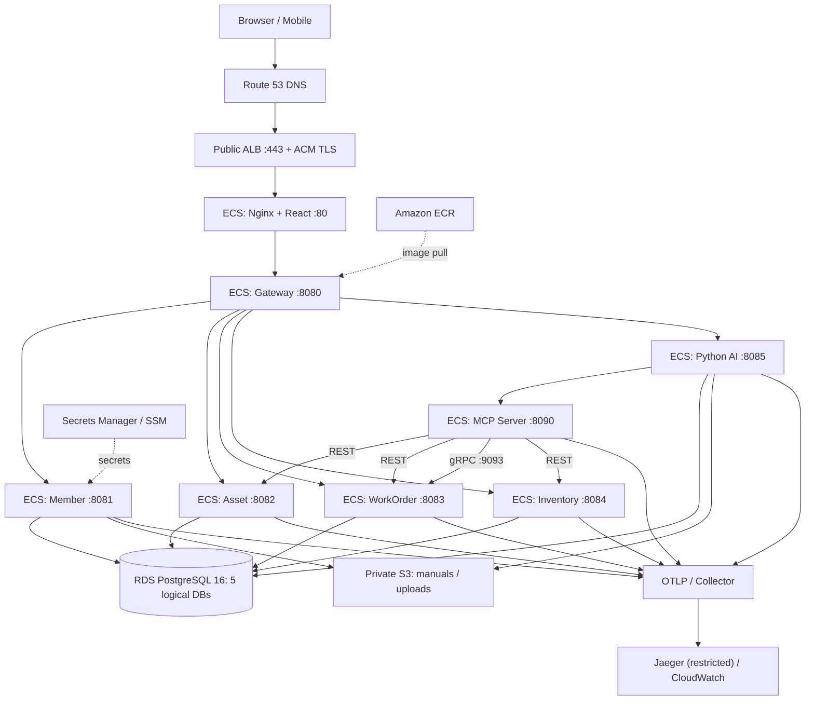
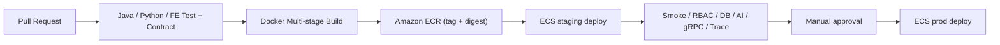

# FixOps — AWS 배포 준비 아키텍처 및 개발 설계 보완 v0.5.3

> **상태:** 배포 전 설계 기준안 (실제 AWS 프로비저닝·배포 미수행)  
> **작성일:** 2026-11-18  
> **참조:** `docs/FixOps_시스템_설계_초안_v0.5.md`, `docs/FixOps_기술스택_호환성_검토_v0.5.1.md`, 공동주택 단지 식별·명부 가입 v0.5.2 설계  
> **목표:** 로컬 Docker Compose 개발을 유지하면서, 개발 완료 후 AWS로 안전하게 이동할 수 있는 코드·구성·운영 계약을 사전에 확정한다.

## 0. 설계 결정 및 적용 범위

### 유지할 사항

- **5인 개발:** 팀장 오좌언(Member·Organization·Gateway·공통 인프라), A 이도형(Asset·Location), B 박천보(WorkOrder·예약·gRPC), C 이도관(Inventory), D 하진철(Python AI·MCP·RAG).
- **업무:** BUILDING/FACTORY, 조직별 RBAC, 회원가입·초대·승인, 아파트 K-apt 단지 식별, XLSX 명부 Import와 입주민 인증, 설비·작업·예약·재고.
- **서비스:** Gateway 8080 / Member 8081 / Asset 8082 / WorkOrder 8083 + 내부 gRPC 9093 / Inventory 8084 / AI 8085 / MCP 8090.
- **AI:** FastAPI, LangChain, MCP Streamable HTTP, pgvector RAG. gRPC는 `GetAvailableSlots` 읽기 RPC 한 개.
- **관측성:** OpenTelemetry/OTLP/Jaeger. RabbitMQ는 P2로 유지.
- **인증:** JWT RS256, 조직·세대·작업 단위 권한. 사업자등록 API 검증은 **채택하지 않는다**.

### 신규 배포 결정

1. **개발:** 각 서비스 Docker 이미지 + Docker Compose. 주소·비밀정보·파일경로는 환경변수로 분리.
2. **저비용 시연 배포(옵션 A):** EC2 1대 + Docker Compose + HTTPS reverse proxy. 단일 장애점이 있는 비운영형 배포.
3. **정식 AWS 목표 배포(옵션 B, 권장 아키텍처):** ECS Fargate + ALB + RDS PostgreSQL + S3 + ECR + Secrets Manager + CloudWatch + Route 53/ACM.
4. **RDS PostgreSQL 16 + pgvector:** RDS에서 해당 엔진 마이너 버전에 지원하는 extension 버전을 확인해 DDL을 설계. 로컬 이미지의 `pgvector 0.8.7`이 RDS에도 동일하게 제공된다고 가정하지 않는다.
5. 조직·개인정보를 다루는 실제 운영 배포 전에 보안·개인정보·가용성 점검을 별도로 통과한다.

---

## 1. AWS 배포 옵션 비교

| 기준 | A. EC2 + Docker Compose | B. ECS Fargate + RDS + S3 |
|---|---|---|
| 목표 | 최종 발표·기능 시연·단기 검증 | 실제 운영을 고려한 목표 구조 |
| 서비스 분리 | 컨테이너 단위 | ECS Service/Task 단위 |
| DB | 같은 EC2의 DB(시연 전용) 또는 RDS | **RDS PostgreSQL** |
| HTTPS | Nginx + Certbot 등 직접 관리 | ALB + ACM |
| 확장/복구 | 수동·단일 호스트 의존 | 서비스별 확장, 배포/롤백 지원 |
| 운영 책임 | OS/보안패치/백업 포함 직접 관리 | 관리형 서비스 중심 |
| 비용 | 상대적으로 저렴할 수 있음 | ALB·NAT·RDS·Fargate 상시 비용 주의 |
| 판단 | **선택적 시연 경로** | **코드와 인프라를 준비할 기본 설계** |

> 옵션 A도 실제 사용자 개인정보를 저장하면 시연 전용이라는 이유로 보안 요건을 생략할 수 없다. 가능하면 발표용에는 가상 입주민 명부만 사용한다.

## 2. 목표 AWS 논리 아키텍처



### 2.1 AWS 리소스 구성

| AWS 리소스 | 역할 | 적용 정책 |
|---|---|---|
| VPC | 네트워크 경계 | 최소 2개 AZ, Public/Private Subnet 분리 |
| ALB | 공개 HTTPS 진입점 | 80→443 redirect, `/` → Nginx만 공개 |
| ACM | TLS 인증서 | `app.example.com` 인증서·갱신 관리 |
| Route 53 또는 기존 DNS | 도메인 해석 | ALB Alias/적절한 DNS 레코드, 기존 등록기관 이용 가능 |
| ECS/Fargate | Java/Python/Nginx 실행 | 서비스별 이미지·Task Definition·Healthcheck |
| ECS Service Connect/Cloud Map | 내부 서비스 탐색 | 내부 DNS 이름 고정, 서비스 포트 기반 접근 |
| ECR | Docker 이미지 저장 | 태그 + immutable digest, 취약점 검사 |
| RDS PostgreSQL 16 | 서비스별 논리 DB | Private Subnet, 백업 활성화, DB별 계정 |
| S3 | 매뉴얼/PDF, 임시 XLSX | Private Bucket, SSE, 업로드 수명·삭제 정책 |
| Secrets Manager / SSM | 비밀값 보관 | IAM 최소 권한, Git·이미지에 비밀값 금지 |
| CloudWatch Logs / Alarms | 장애·서비스 로그 | 기간·보존·알림 설정, 민감정보 마스킹 |
| OpenTelemetry Collector/Jaeger | 분산 Trace | 외부 공개 금지, 예산 고려하여 보존 제한 |
| IAM / IAM Task Role | 서비스 권한 | S3·Secret 사용 주체별 분리 |
| AWS Budgets | 비용 통제 | 일/월 경고, 비용 태그, 미사용 리소스 정리 |

## 3. 네트워크 및 포트 원칙

- **Public Subnet:** Internet-facing ALB. NAT Gateway는 사전 예산 검토 후 선택.
- **Private Application Subnet:** Nginx, Gateway, Member, Asset, WorkOrder, Inventory, AI, MCP, OTel.
- **Private DB Subnet:** RDS; Public Access 비활성화.
- **Security Group:** 인터넷→ALB 443만; ALB→Nginx 80; Nginx→Gateway 8080; Gateway→업무 서비스 8081~8085; AI→MCP 8090; MCP→WorkOrder gRPC 9093; 서비스→RDS 5432; 불필요한 횡단 접근 차단.
- **gRPC:** `9093`은 내부용이며 외부 ALB 라우팅이 불필요하다. ECS Service Connect/Cloud Map으로 `workorder:9093` 접근.
- **OTLP:** Collector 내부 4317(gRPC)/4318(HTTP); Jaeger UI 16686은 외부 비공개.
- **외부 LLM·K-apt API 통신:** Private Task의 Outbound 경로(NAT 또는 검증된 네트워크 방식) 필요. VPC Endpoint는 AWS 지원 서비스용이며 일반 공공 API/LLM 인터넷 접속을 자동으로 대체하지 않는다.
- **ECR/CloudWatch/Secrets/S3 접근:** NAT 비용을 줄이기 위한 VPC Endpoint 조합을 검토하되, Endpoint 자체의 시간·데이터 요금도 계산한다.

> ALB가 Nginx에만 연결되는 구조이므로 Spring Cloud Gateway의 `/api/**` 인증 라우팅과 Browser의 Same-Origin 사용 전략을 유지한다. ECS Service Connect의 별도 프록시·사이드카 포트와 Security Group 요구사항은 배포 시 검증한다.

## 4. 개발 단계에서 반드시 분리할 설정

### 4.1 환경 변수 계약

| 변수 | 역할 | 예시(가상) |
|---|---|---|
| `SPRING_PROFILES_ACTIVE` | Java 환경 | `local`, `staging`, `prod` |
| `APP_ENV` | Python 환경 | `local`, `staging`, `prod` |
| `MEMBER_BASE_URL` 등 | 서비스 내부 호출 | `http://member:8081` |
| `MCP_SERVER_URL` | AI→MCP 내부 주소 | `http://mcp:8090/mcp` |
| `WORKORDER_GRPC_TARGET` | MCP→WorkOrder | `workorder:9093` |
| `DB_URL` / `DB_USER` / `DB_PASSWORD` | 서비스별 DB 접속 | 서비스별 자격증명 |
| `JWT_PRIVATE_KEY_PATH` | Member 발급 키 | 로컬 PEM 경로 또는 보안 주입 경로 |
| `JWT_PUBLIC_KEY_PATH` | 검증 키 | 공개키 또는 JWKS URI |
| `AI_PROVIDER_API_KEY` | LLM 키 | Secrets Manager 참조 |
| `AWS_REGION` | 리전 | `ap-northeast-2` 후보 |
| `UPLOAD_STORAGE` | 파일 저장 | `local` 또는 `s3` |
| `UPLOAD_BUCKET` | Private S3 Bucket | 예시 이름 |
| `OTEL_EXPORTER_OTLP_ENDPOINT` | 추적 전송 | 내부 Collector 주소 |
| `BUSINESS_VERIFICATION_PROVIDER` | 사업자 검증 | **사용 금지: 사업자 검증 기능 제외** |

- `.env.example`에는 키 **이름만**, `.env`는 Git 제외.
- 로컬에 `local-secrets/jwt/private_key.pem` 등을 둘 수 있지만, 운영 키를 이미지에 COPY하지 않는다.
- 운영에서 RSA 개인키는 **Member Task만 접근**하도록 Secrets Manager/SSM에서 주입하거나 비밀파일로 안전하게 마운트한다. 공개키 배포도 검증된 경로로 통일한다.
- JWT `issuer`, `audience`, `kid`, TTL, refresh rotation은 환경과 서비스에 일관되게 적용하고 시크릿 회전 절차를 마련한다.
- Compose 서비스 호스트명(`postgres`, `member`, `mcp`)을 코드에 하드코딩하지 않는다.

### 4.2 로컬·AWS 설정 계층

```text
infra/
  compose/
    compose.local.yml
    compose.staging.yml       # 선택: 시연 환경
  aws/
    README.md
    terraform/               # 권장 IaC 위치, 직접 구현 후 사용
      environments/staging/
      environments/prod/
      modules/network/
      modules/ecs-service/
      modules/rds/
      modules/s3/
      modules/observability/
  nginx/
    nginx.conf
contracts/
  proto/fixops/schedule/v1/schedule.proto
frontend/
  .env.example
member-service/
  src/main/resources/application-local.yml
  src/main/resources/application-staging.yml
  src/main/resources/application-prod.yml
ai-service/
  pyproject.toml
  uv.lock
mcp-server/
  pyproject.toml
  uv.lock
```

> 위 트리는 **추가 권장 폴더**, 실제 저장소에 이미 생성되었다는 뜻은 아니다. 로컬 Compose 파일 위치는 기존 저장소 구조에 맞춰 결정한다.

### 4.3 환경 차이 없애기

- 모든 서비스는 OCI/Docker 이미지로 빌드 가능하게 구현(멀티스테이지, non-root, health endpoint).
- **동일한 이미지 digest**를 staging→production으로 승격하고 환경변수만 변경한다.
- 서비스별 DB 마이그레이션(Flyway/Alembic)은 독립 실행; 프로덕션에서는 실행 순서와 실패 롤백 절차를 명문화한다.
- 요청 사이즈·업로드 제한, CORS, Cookie Secure/SameSite, 프록시 헤더(Forwarded/X-Forwarded-Proto) 및 OAuth Redirect URI를 도메인/HTTPS 기준으로 설정한다.
- 프론트 API 경로는 가능하면 **상대 경로 `/api`** 사용. 빌드에 포함된 로컬 호스트명 금지.

## 5. 데이터베이스: Compose PostgreSQL → RDS PostgreSQL

### 5.1 데이터 소유

| DB | 소유 서비스 | 마이그레이션 |
|---|---|---|
| `member_db` | Member | Flyway |
| `asset_db` | Asset | Flyway |
| `workorder_db` | WorkOrder | Flyway |
| `inventory_db` | Inventory | Flyway |
| `ai_db` | AI | Alembic + pgvector |

- **초기 AWS MVP**는 하나의 RDS PostgreSQL 인스턴스에 논리적으로 5개 DB를 분리하는 구성이 가능하다. 단, 인스턴스 장애·리소스 경쟁은 공통 장애가 된다.
- 서비스별 **로그인 계정·DB 권한을 분리**하고, 타 DB 읽기 권한을 허용하지 않는다.
- `PGHOST` 등 연결정보를 환경별로 분리하고 DB 커넥션 풀 최대값을 여러 서비스 합산하여 RDS 연결 제한을 넘지 않게 설계한다.
- 운영 실데이터는 SSL/TLS 연결 요구·RDS 보안그룹 제한.
- 시간 규약은 PostgreSQL `TIMESTAMPTZ` ↔ Java `Instant` ↔ Python aware datetime ↔ ISO 8601 UTC `Z` 유지.

### 5.2 pgvector 이식성 주의

- 로컬 컨테이너 후보 `pgvector/pgvector:0.8.7-pg16`과 **AWS RDS 제공 pgvector 확장 버전이 다를 수 있음**.
- AWS RDS는 AWS가 제공하는 지원 확장만 설치할 수 있다. 실제 리전/엔진 마이너 버전별 `pg_available_extensions` 및 `pg_available_extension_versions`를 확인한다.
- **지원 공통분모의 SQL 문법/인덱스**만 사용하도록 테스트하고, 로컬 개발 버전을 RDS 지원 버전에 맞추는 것이 가장 안전하다.
- `ai_db`에서 `CREATE EXTENSION IF NOT EXISTS vector`를 권한이 있는 역할로 실행한다.
- 임베딩 모델/차원 고정. pgvector 인덱스 생성, 필터+검색 결과·성능 테스트 후 전환한다.

### 5.3 백업·복구

- 운영 RDS Automated Backup, 삭제 보호, 스냅샷, 보존기간 설정.
- **시연/테스트는 Single-AZ**, 실제 운영 요구가 있으면 Multi-AZ를 검토.
- 배포 전 수동 Snapshot, 마이그레이션 후 샘플 조회·권한 검사, 장애 시 복구 목표(RPO/RTO)를 기록한다.
- DB 백업 성공뿐 아니라 **복원 시험**을 수행한다.

## 6. 파일 저장: XLSX 입주민 명부 및 RAG PDF

### 6.1 Storage 추상화

```java
public interface ObjectStorage {
    StoredObject save(UploadObject object);
    InputStream open(String objectKey);
    void delete(String objectKey);
}
```

- `LocalObjectStorage` — 로컬 개발 파일시스템.
- `S3ObjectStorage` — AWS Private S3 Bucket.
- 문서 DB에는 파일 바이너리 대신 **S3 Object Key, owner organization ID, 상태, 파일 검증정보** 저장.
- 앱 업로드 파일을 컨테이너 파일시스템에 영구 보관하지 않는다(ECS Task 교체 시 유실 가능).

### 6.2 Excel 입주자 명부

1. ADMIN만 명부 업로드 요청 가능, 조직 컨텍스트 서버 검증.
2. 서버가 파일 크기·확장자·매직바이트·행·열·수식·압축 제한 검사.
3. 소규모 MVP는 API에서 파일을 수신해 S3 임시 Key로 저장 가능; 운영 규모가 커지면 **짧은 만료의 Presigned Upload URL**로 브라우저가 직접 S3 업로드하는 구조 검토.
4. 임시 파일 파싱→오류 리포트→관리자 Preview→Commit.
5. 개인 식별·연락처는 접근 제어, 암호화, 로그 마스킹 및 최소 보유 정책 적용.
6. 완료/실패 후 임시 원본 파일은 수명 정책에 따라 자동 삭제. 조직별 Prefix만으로 권한이 확보되지는 않으므로 서버에서 객체 접근 권한을 검증.
7. 시연 Mock 가입·OTP는 staging에서만 허용하고 **prod에서는 Mock 자동 승인 불가**.

### 6.3 RAG PDF

- Private Bucket(`documents/{organizationId}/{uuid}`)에 파일 저장, 허용 형식/스캔·파싱 처리.
- AI Indexer는 승인된 객체만 읽고 청크·임베딩을 `ai_db`에 저장.
- RAG 검색에 조직/문서 권한 필터링을 DB 질의단계에서 적용.
- S3 자체의 파일 공개 URL 금지, 필요 시 인증된 Presigned Download URL 사용.

## 7. 조직·공공 API·인증의 AWS 운영 원칙

- **사업자등록번호·대표자 정보 검증은 도입하지 않는다.**
- K-apt 공공 API는 **단지 식별·주소 확인** 수단이지 신청자의 **관리 권한 증명** 수단이 아니다.
- `kaptCode`가 있는 단지는 유니크 제약; 없는 경우 주소·단지명 정규화 후 수동 심사.
- 외부 K-apt API Key는 Member Task 비밀값으로 주입하고 브라우저에 노출하지 않는다.
- K-apt API 실패는 `NO_RESULT`와 구분. 요청 timeout·호출 한도·캐시·Circuit Breaker 고려.
- 최초 조직 ADMIN 지정은 별도 운영자 승인, USER는 Excel 명부+별도 신원 검증·가입 정책, TECHNICIAN은 조직 관리자 승인.
- 플랫폼 운영자 계정은 공개 가입으로 생성 금지; 생성·회수 감사 기록.
- 운영 관리자와 API 개발용 Mock/시드 사용자 데이터 분리.

## 8. ECS·gRPC·MCP·관측성

### 8.1 ECS 배포 단위

- ECS Service: `frontend-nginx`, `gateway`, `member`, `asset`, `workorder`, `inventory`, `ai`, `mcp`.
- ECS Service Connect/Cloud Map으로 내부 DNS. `workorder`는 8083 REST/9093 gRPC 각각 명명된 포트.
- Gateway→업무 서비스와 AI→MCP→Java 호출 시 내부 DNS 이름 사용. Service Connect 설정이 없다면 Cloud Map 등 다른 서비스 디스커버리 방식으로 일관되게 구현.
- ECS Task CPU/Memory/healthcheck, graceful shutdown, readiness, JVM 메모리 상한, Python worker 수, DB pool을 컨테이너 자원에 맞춘다.
- AI 외부 LLM 호출을 고려해 outbound 연결/timeout/재시도와 비용 상한을 설계한다.

### 8.2 gRPC 내부 호출

- `MCP → WorkOrder GetAvailableSlots` **Unary RPC 1개만**; 업무 변경은 WorkOrder REST.
- 외부 9093 포트 공개 금지. Security Group으로 MCP(필요하면 AI) 호출자만 허용.
- 내부 네트워크만을 인증으로 간주하지 않는다. 사용자 위임 인증 + 서비스 신원 검증, deadline과 Trace Metadata 적용.
- gRPC 경로 장애 시 동일 인가 규칙을 갖는 REST 조회 경로로 후퇴.

### 8.3 OpenTelemetry·Jaeger

- Spring Boot/Python 계측→OTLP Collector→Jaeger 구조 유지.
- **배포 시나리오 1:** 시연 시 ECS/EC2 내부 Collector+Jaeger, UI는 운영자 VPN/SSM 터널에서만 접근.
- **배포 시나리오 2:** 실제 운영은 CloudWatch/다른 관리형 관측성 플랫폼 연계를 추가로 검토하되 Jaeger 필수 요건을 유지하려면 보존·운영 책임을 정한다.
- Trace ID를 API 오류 응답에 포함; DB 질의·MCP·gRPC 호출 Span 연결.
- 세대별 개인정보, JWT·API Key·프롬프트 원문을 로그/Trace에 기록하지 않는다.

## 9. 인증·도메인·HTTPS·OAuth2 (선택)

- Route 53 또는 기존 DNS에서 `app.<domain>` → ALB 연결. ALB에 ACM 인증서로 HTTPS 443.
- HTTP 80은 HTTPS 리다이렉트. Security Header, HSTS는 HTTPS 정상 확인 후 적용.
- 프론트는 `https://app.<domain>` 기반 `/api` Same-Origin으로 호출.
- CORS는 필요한 Origin만 허용하며 무분별한 `*` 사용 금지.
- Cookie 사용 시 `Secure`, `HttpOnly`, `SameSite` 정책 및 CSRF 검토.
- 구글/네이버 OAuth 로그인 도입 시 Provider 콘솔의 **정확한 배포 도메인·Redirect URI·허용 Origin** 등록 필요. 로컬 주소·IP·HTTP Redirect를 운영에 남기지 않는다.
- Gateway Forwarded Headers, Spring Security redirect URL 계산, Nginx의 Host/Proto 전달 검증.

## 10. GitHub Actions → ECR → ECS CI/CD



1. PR: Gradle/JUnit/Flyway, pytest/MCP, npm lint/build, `.proto` Stub 생성 검증.
2. Merge: 서비스별 이미지 빌드, 이미지 취약점 검사, ECR Push.
3. AWS 로그인: **GitHub OIDC + IAM Role Assume**, 장기 AWS Access Key를 GitHub Secret에 저장하지 않는 방향.
4. Staging 배포: ECS Task Definition의 이미지 digest 갱신 및 Service 배포.
5. Healthcheck + API smoke + 조직 격리 + PDF/Excel + gRPC + Jaeger 검증.
6. 운영 배포: 수동 승인 후 동일 digest 배포. 불량 시 기존 Task Definition으로 롤백.
7. **DB 마이그레이션은 애플리케이션 이미지 롤백으로 자동 복구되지 않는다.** 호환성 있는 expand/contract 스키마 변경 및 백업을 우선.

### 최소 배포 계약

- `GET /actuator/health/readiness` 등 서비스별 Readiness 확인.
- `/api` 통합 요청, JWT, 파일 업로드, K-apt 응답·장애 처리, Python MCP Tool, gRPC 내부 호출, OTel Trace 확인.
- `main`은 코드·배포 파이프라인 보호, `develop`은 개발·검증. 운영 AWS 리소스 생성은 별도 권한으로 제한.

## 11. IAM·보안·개인정보 처리

- IAM 최소 권한: ECS Execution Role(ECR pull/log/Secret injection), Task Role(업무별 S3·KMS·AWS API 접근) **분리**.
- Member에만 JWT signing private key와 입주민 명부 접근권한. Asset/WorkOrder/Inventory에는 필요 시 Read 권한만.
- S3 Block Public Access, SSE, 버전관리·수명 정책, 다운로드 서명 URL, 바이러스/유해파일 검사 도입 단계 검토.
- RDS Public Access=false, 서비스별 자격증명, TLS, 파라미터 보안.
- ECS Task에 root 금지, 이미지 스캔, 불필요한 포트 노출 금지.
- 고객 실데이터 수집 전 개인정보 처리 근거, 역할(관리사무소와 FixOps 운영 주체 간), 위탁계약 필요성, 보존·파기 기준 검토.
- 이메일/휴대전화 OTP Mock, Demo ADMIN·고정 암호는 **prod 프로파일에서는 배포 실패하도록 통제**.
- 인증 오류·조직 승인·권한 변경·명부 Import·파일 다운로드를 감사 로그에 기록하되 개인정보 원문은 기록하지 않는다.

## 12. 비용·용량·운영 의사결정

| 비용 항목 | 검토 포인트 |
|---|---|
| ECS Fargate | Java 4 + Gateway + Python 2 + Nginx 등 상시 Task CPU·Memory 비용 |
| ALB | 시간당 요금·LCU |
| NAT Gateway | 시간당 비용 + 처리 데이터 비용. LLM·K-apt 호출량 및 VPC Endpoint 비용 비교 |
| RDS | 인스턴스·스토리지·백업·Multi-AZ 선택 |
| S3 | 용량·요청·전송·Lifecycle |
| CloudWatch/Jaeger | 로그 수집·보존량, trace 저장소 비용 |
| LLM API | 토큰 사용량·월별 한도 |
| Route 53/도메인 | Hosted Zone·DNS·도메인 등록 비용 |

- AWS Pricing Calculator에서 `ap-northeast-2` 리전, 24×7 상시 운영과 필요 시 시작하는 Demo 환경을 **별도로** 산정한다.
- 예산이 작으면 발표용은 **EC2 Compose**, 운영 확장 설계는 **ECS Fargate**로 문서화한다.
- 개발 계정 AWS Budgets 알림 및 태그 `Project=FixOps`, `Env=staging`, `Owner=SYNC5` 사용.
- 비용 절약을 위해 RDS를 중지하거나 ECS DesiredCount를 0으로 설정하면 앱이 동작하지 않으므로 시연 일정과 연계한다.

## 13. 배포 전 점검 및 20일 WBS 반영

| 시기 | 완료 항목 | 담당 |
|---|---|---|
| **D1~D5** | Dockerfile, `local/staging/prod` 설정, 환경변수 계약, S3 Storage Interface, 내부 서비스 URL/포트 분리 | 오좌언 주도, 전원 |
| **D6~D10** | DB Flyway/Alembic, healthcheck, JWT Secret 주입 구조, K-apt Adapter, Excel/RAG 업로드 저장소 추상화 | 오좌언·이도형·하진철 |
| **D11~D15** | Compose 클린 빌드, 내부 MCP/gRPC, API/데이터 조직 격리, Jaeger Trace, 이미지 빌드 검증 | 전원 |
| **D16~D18** | AWS Staging IaC 검토, 비용 산정, HTTPS/Secrets/DB 백업·S3 연동 시범 배포(시간·예산 허용) | 오좌언 + 각 서비스 담당 |
| **D19~D20** | 배포 매뉴얼, 복구/롤백 절차, 클린 환경 배포 Smoke, 최종 발표 | 전원 |

> **기능 우선 원칙:** 20일 안에 실제 AWS ECS 배포까지 완료해야 한다는 필수 약속이 아니다. 핵심 업무·AI 통합을 우선하면서 **배포 가능한 코드 계약과 인프라 설계**를 D15까지 갖추는 것이 목표다.

### 13.1 서비스별 담당

| 담당 | AWS 준비 책임 |
|---|---|
| **팀장 오좌언** | VPC/ALB/ECS 전체 설계, Gateway·Member, JWT·Secrets, K-apt, 명부 Import, CI/CD, 비용·도메인 |
| **A 이도형** | Asset 이미지/헬스체크, DB·마이그레이션, 조직·단지 Location 이식성 |
| **B 박천보** | WorkOrder 이미지, 예약 DB 제약, 내부 gRPC 9093, deadline/trace/roll back |
| **C 이도관** | Inventory 이미지, 재고 DB 이식성, 트랜잭션·중복차감 복구 테스트 |
| **D 하진철** | Python AI/MCP 이미지, pgvector/RDS 호환, S3 RAG, LLM 키, OTel/Jaeger |

## 14. 최종 AWS 배포 완료 판정

- [ ] 모든 서비스가 주소 하드코딩 없이 환경변수로 실행된다.
- [ ] Docker 이미지 빌드/실행 및 공통 헬스체크가 성공한다.
- [ ] ALB+ACM HTTPS와 `/api` Same-Origin 라우팅이 정상이다.
- [ ] ECS 내부 서비스는 공개 접속되지 않으며 Service Connect/Cloud Map으로 연결된다.
- [ ] Member signing private key, DB 암호, LLM/K-apt API Key는 Secrets Manager/SSM에서 주입한다.
- [ ] PostgreSQL 16 RDS에 5개 DB가 분리되고 Flyway/Alembic이 성공한다.
- [ ] RDS 지원 pgvector 버전으로 RAG 검색과 인덱싱이 성공한다.
- [ ] S3에서 PDF/XLSX 저장·삭제·권한 분리가 검증된다.
- [ ] Mock OTP/Mock 신원 승인·데모 계정은 prod에서 비활성화된다.
- [ ] AI→MCP→WorkOrder gRPC 9093 조회와 REST 예약 확정이 성공한다.
- [ ] Java·Python Jaeger Trace가 하나의 요청으로 연결된다.
- [ ] 타 조직·타 세대 정보 조회 차단, 입주자 명부 접근통제가 통과한다.
- [ ] RDS 백업·복원 및 ECS 롤백 시나리오가 기록·시험되었다.
- [ ] 배포 전후 비용 모니터링, 로그 보존, 공개 포트 검증이 끝났다.

## 15. 참고 공식 문서 및 이전 설계

### FixOps 기존 설계 (GitHub main)

- [FixOps 시스템 설계 v0.5](https://github.com/OZA-bot-droid/fixops/blob/main/docs/FixOps_시스템_설계_초안_v0.5.md)
- [FixOps 기술 스택 호환성 v0.5.1](https://github.com/OZA-bot-droid/fixops/blob/main/docs/FixOps_기술스택_호환성_검토_v0.5.1.md)

### AWS 공식 자료

- [ECS + ALB](https://docs.aws.amazon.com/AmazonECS/latest/developerguide/alb.html)
- [ECS Service Connect](https://docs.aws.amazon.com/AmazonECS/latest/developerguide/service-connect.html)
- [ECS Secrets Manager 주입](https://docs.aws.amazon.com/AmazonECS/latest/developerguide/secrets-envvar-secrets-manager.html)
- [RDS PostgreSQL 확장 버전](https://docs.aws.amazon.com/AmazonRDS/latest/PostgreSQLReleaseNotes/postgresql-extensions.html)
- [S3 Presigned URL](https://docs.aws.amazon.com/AmazonS3/latest/userguide/using-presigned-url.html)
- [ACM / ALB HTTPS](https://docs.aws.amazon.com/elasticloadbalancing/latest/application/https-listener-certificates.html)
- [RDS Automated Backup](https://docs.aws.amazon.com/AmazonRDS/latest/UserGuide/USER_WorkingWithAutomatedBackups.html)
- [NAT Gateway 과금](https://docs.aws.amazon.com/vpc/latest/userguide/nat-gateway-pricing.html)
- [AWS Fargate Pricing](https://aws.amazon.com/fargate/pricing/)

---

**판정:** 기존 v0.5/v0.5.1/v0.5.2 설계를 바꾸지 않고 AWS 배포를 위한 별도 보완 규격을 추가한다. 실제 AWS 리소스 및 비용은 아직 생성·검증되지 않았으며, Terraform/Task Definition/CI 워크플로는 구현 단계에서 이 규격에 맞춰 제작한다.
