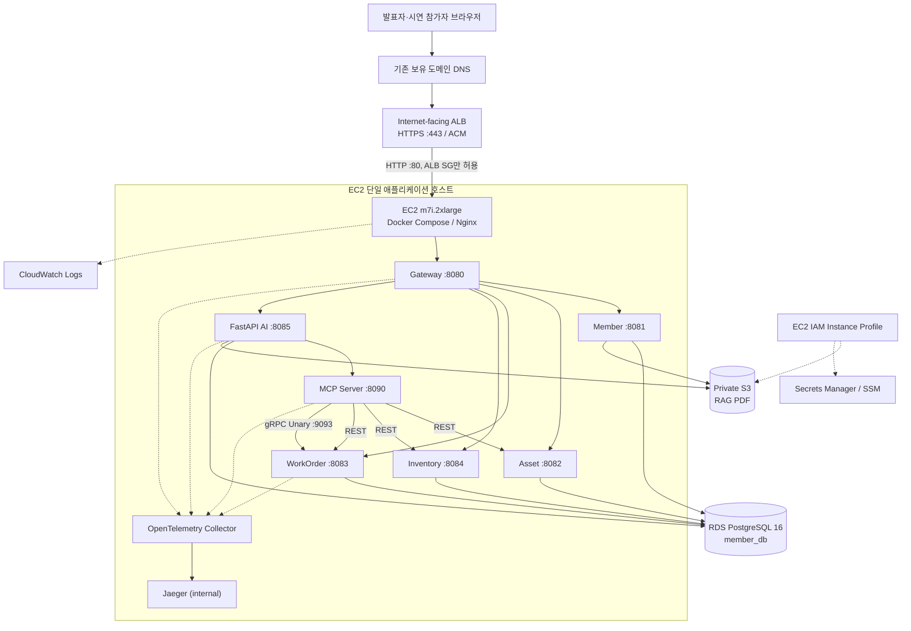
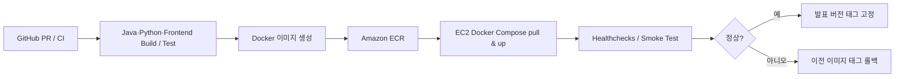

# FixOps — AWS 최종 시연 배포 설계 v0.5.4

> **작성 기준:** 2026-11-18 · **발표:** 2026-12-21(월) · **운영:** 발표 전 약 7~9일, 발표 후 1~2일 내 정리  
> **총 배포 예산:** USD 400 (사용 가능 상한; 전액 소진 의무 없음) · **도메인:** 기존 보유 도메인 활용  
> **배포 상태:** **목표 설계 / 실제 배포 미실시 / 정확한 리전별 가격과 인스턴스 가용성은 생성 전 확인**  
> **문서 권장 경로:** `docs/FixOps_AWS_최종_시연배포_설계_v0.5.4.md`
>
> **기준 문서:** `FixOps_시스템_설계_초안_v0.5.md`, `FixOps_기술스택_호환성_검토_v0.5.1.md`, `FixOps_공동주택_단지식별_명부가입_설계_v0.5.2.md`, `FixOps_AWS_배포_준비_설계_v0.5.3.md`.
>
> 이 문서는 **기존 v0.5.3의 ECS Fargate 장기 운영 목표 구조를 삭제하지 않고**, **2026-12-21 일회성 시연을 위한 실제 우선 배포 경로**를 EC2 + RDS + ALB + S3로 구체화한다.

## 0. 최종 확정 및 변경 요약

| 항목 | 이번 결정 |
|---|---|
| 배포 목적 | 12/21(월) 발표 당일 안정적인 외부 URL 시연, 약 1주 미만 유지 |
| 리전 | `ap-northeast-2` (서울), 서비스 및 인스턴스 가용 여부 확인 |
| 애플리케이션 서버 | **EC2 `m7i.2xlarge` 후보** — 8 vCPU, 32 GiB, x86_64, Linux |
| 컨테이너 오케스트레이션 | Docker Compose v2 (서비스별 Dockerfile 유지) |
| 관리형 DB | **RDS PostgreSQL 16, Single-AZ**, `db.t4g.medium` 시작 후보 |
| Vector DB | **pgvector 0.8.2로 통일** — 로컬/테스트/배포 SQL 및 기능 하위 호환 기준 |
| 외부 진입 | ALB :443 + ACM 인증서 + 기존 DNS |
| 프론트 | Nginx 정적 React 빌드, `/api` Gateway Reverse Proxy |
| 첨부·문서 | S3 비공개 버킷 (XLSX·PDF, 서버 측 암호화) |
| 비밀정보 | Secrets Manager 또는 SSM Parameter Store, EC2 IAM Role |
| 모니터링 | CloudWatch Logs·Metrics + OpenTelemetry Collector·Jaeger(시연용 비공개 접근) |
| gRPC / MCP | 내부 전용, WorkOrder `GetAvailableSlots` 1개 RPC 유지 |
| 메시징 | RabbitMQ 미도입(P2) |
| 비용 | 8일 가동 **약 $140~$220 계획 범위**, 최대 $400 예산 모니터링 |
| 삭제 | 12/22~23 로그·백업·산출물 확보 후 리소스 삭제 |

**중요:** 조직의 사업자등록번호/사업자정보 공공 API 진위확인 기능은 도입하지 않는다. 아파트 단지의 **K-apt 식별 API**는 별개 기능이며 유지한다.

---

## 1. 최종 배포 아키텍처



### 1.1 네트워크 및 보안 그룹

- VPC: 필요 시 기본 VPC 사용 가능. 발표 환경에서는 **새 VPC 또는 기존 VPC의 경계·보안 그룹을 명시적으로 검증**.
- ALB: **서로 다른 AZ의 공용 서브넷 2개 이상**에 연결.
- EC2: **공용 서브넷에 배치하되 애플리케이션 인바운드는 ALB 보안 그룹에서 오는 80/tcp만 허용**. EC2 공용 IP를 직접 시연 URL로 사용하지 않음. SSM Session Manager 우선, SSH 22/tcp는 기본 미개방.
- RDS: **비공개 DB 서브넷 그룹(2 AZ 이상 서브넷)**, `Publicly accessible = No`, 인바운드 `5432/tcp`는 EC2 보안 그룹에서만 허용.
- 외부 공개 포트: **ALB 443**(HTTP 80은 443 리디렉션 선택).
- 외부 비공개 포트: 8080~8085, 8090, 9093, 5432, 4317/4318, Jaeger UI 16686.
- EC2의 퍼블릭 아웃바운드는 패키지, ECR/공개 레지스트리, K-apt API, LLM API 접근 용도로 사용. AWS 서비스 권한은 **IAM Instance Profile**로 부여.
- **주의:** EC2 공용 서브넷 배치는 1주짜리 시연의 NAT 비용·운영 복잡도를 줄이기 위한 단기 방안. 장기 상용 배포 시 ECS/Private Subnet + VPC Endpoint 또는 NAT 등으로 재설계.
- ALB→EC2 구간은 VPC 내부 HTTP로 설정하되, 진정한 종단 간 TLS가 필요한 실서비스는 ALB→타깃 HTTPS를 별도로 구현해야 한다.

### 1.2 서비스별 포트·데이터

| 서비스 | 컨테이너 내부 포트 | 데이터 소유 | 외부 공개 |
|---|---:|---|---|
| Nginx / React | 80 | 없음 | ALB를 통해서만 |
| Gateway | 8080 | 없음 | 아니오 |
| Member | 8081 | `member_db` | 아니오 |
| Asset | 8082 | `asset_db` | 아니오 |
| WorkOrder | 8083(REST), 9093(gRPC) | `workorder_db` | 아니오 |
| Inventory | 8084 | `inventory_db` | 아니오 |
| FastAPI AI | 8085 | `ai_db` + S3 | 아니오 |
| MCP | 8090 | 서비스 원본 데이터 없음 | 아니오 |
| OTel Collector | 4317/4318 | 추적 전달 | 아니오 |
| Jaeger | 16686 | 시연 Trace | 아니오 |

서비스별 데이터베이스는 **한 RDS 인스턴스 내 5개 논리 DB**로 분리하고 **각 서비스 DB 계정에 해당 DB 최소 권한**만 부여한다. 다른 서비스 DB에 직접 SQL 접근하지 않는다.

---

## 2. pgvector 0.8.2 조정 — 반드시 반영

### 2.1 버전 결정 및 조건

- **기존 로컬 계획:** PostgreSQL 16 + `pgvector/pgvector:0.8.7-pg16` 후보.
- **이번 최종 목표:** PostgreSQL 16 + **`vector` 확장 버전 0.8.2**.
- AWS 공식 *RDS PostgreSQL extension versions* 표에 PostgreSQL 16의 일부 최신 엔진 마이너 버전에서 **pgvector 0.8.2** 지원이 안내되어 있다.
- **RDS PostgreSQL 16 전체 마이너 버전에서 0.8.2가 제공되는 것은 아님.** 리전·DB 엔진 버전 선택 및 생성 후 실제 가용 버전을 SQL로 확인한다.
- `pgvector`는 패키지/프로젝트 이름이고, **PostgreSQL 확장 이름은 `vector`**.

**공식 참조:** https://docs.aws.amazon.com/AmazonRDS/latest/PostgreSQLReleaseNotes/postgresql-extensions.html

### 2.2 로컬 Docker 이미지 정렬

개발 DB도 0.8.2에 맞춰 운영·로컬 간 Vector 기능 차이를 최소화한다.

```yaml
# compose.local.yml (개념 예시)
services:
  postgres:
    # 실제 Registry에 해당 태그가 있는지 검증하고 사용.
    # 없다면 PostgreSQL 16 기반 커스텀 이미지를 빌드하여 pgvector v0.8.2를 설치한다.
    image: ${POSTGRES_IMAGE:?Set a verified PostgreSQL16+pgvector0.8.2 image}
    environment:
      POSTGRES_USER: postgres
      POSTGRES_PASSWORD: ${POSTGRES_PASSWORD:?required}
    volumes:
      - dbdata:/var/lib/postgresql/data

volumes:
  dbdata:
```

> **임의의 `pgvector/pgvector:0.8.2-pg16` 태그가 항상 존재한다고 가정하지 않는다.** 실제 태그가 확인되기 전에는 이미지를 확정하지 않는다. PostgreSQL 16 + pgvector v0.8.2 Dockerfile을 직접 생성할 수도 있다. 기존 0.8.7 DB 볼륨을 0.8.2 이미지에 그대로 연결하는 **확장 다운그레이드는 지원된다고 가정하지 않는다.** 필요시 별도 새 DB에 덤프/복원 및 재색인한다.

### 2.3 RDS 생성 직후 검증 SQL

`ai_db`에 연결하여 다음 SQL 실행:

```sql
-- 해당 인스턴스/DB가 제공하는 확장 버전
SELECT name, version
FROM pg_available_extension_versions
WHERE name = 'vector'
ORDER BY version;

-- 설치 전 버전 지정 (필요 권한·엔진 버전 충족 확인)
CREATE EXTENSION IF NOT EXISTS vector VERSION '0.8.2';

-- 설치 결과 검증
SELECT extname, extversion
FROM pg_extension
WHERE extname = 'vector';

SELECT version();
```

`CREATE EXTENSION IF NOT EXISTS`는 **이미 설치된 확장의 버전 변경을 수행하지 않는다.** 이미 0.8.7 등으로 설치되어 있다면 아래 확인이 필요하다:

```sql
SELECT extversion
FROM pg_extension
WHERE extname = 'vector';
```

- 확장 버전을 내려야 하는 경우 `ALTER EXTENSION ... UPDATE`로 다운그레이드된다고 가정하지 않는다.
- 이미 다른 버전인 데이터베이스에서 운영 데이터가 존재하면 **새 DB에 v0.8.2 생성 후 데이터 이관·벡터 인덱스 재생성·검색 테스트**를 수행한다.
- Flyway(Java)와 Alembic(Python)이 `ai_db`의 `vector` 설치에 동시에 관여하지 않도록 분리한다. AI DB 확장 활성화는 **초기 RDS 프로비저닝 작업 또는 AI 측 관리 마이그레이션 하나**에서만 수행한다.
- RDS는 완전한 PostgreSQL superuser 권한을 제공하지 않는다. 확장 생성은 AWS가 허용한 역할·버전 조건에서만 수행한다.

### 2.4 RAG SQL·라이브러리 호환 정책

`0.8.2`와 양립되는 기본 기능만 요구한다.

```sql
CREATE TABLE IF NOT EXISTS document_chunk (
  id UUID PRIMARY KEY,
  organization_id BIGINT NOT NULL,
  document_id UUID NOT NULL,
  page_number INTEGER,
  content TEXT NOT NULL,
  embedding vector(1536) NOT NULL
);

-- 해당 임베딩 모델의 차원(예: 1536)과 실제 vector(n)을 일치시킨다.
-- 연산자는 선택한 거리 메트릭에 맞춰 통일: <=> 코사인 거리.
CREATE INDEX IF NOT EXISTS idx_document_chunk_embedding
ON document_chunk USING hnsw (embedding vector_cosine_ops);

CREATE INDEX IF NOT EXISTS idx_document_chunk_org
ON document_chunk (organization_id);
```

**주의:** 위 SQL은 데이터 구조 예시다. 실제 프로젝트에서는 `document_id`의 참조·문서 접근범위·Embedding 차원·RAG 인덱스 생성 기준을 먼저 확정한다. `organization_id` 필터를 벡터 검색 **SQL 조회 단계**에 적용하고, 다른 조직/세대의 비공개 매뉴얼이 LLM에 전달되지 않도록 한다.

`pgvector` 확장 버전과 Python 패키지 `pgvector` 버전은 **별개**다. Python 패키지는 `SQLAlchemy`/드라이버와 호환성을 확인한 뒤 `uv.lock`으로 잠근다.

---

## 3. RDS PostgreSQL 상세 구성

| 항목 | 권장값 |
|---|---|
| 엔진 | PostgreSQL **16.x**, pgvector 0.8.2 지원 **마이너 버전 선택** |
| 인스턴스 | `db.t4g.medium` 시작 후보 (2 vCPU / 4 GiB) |
| 가용성 | Single-AZ (단기 시연), DB subnet group은 다중 AZ 서브넷 포함 |
| 스토리지 | gp3 약 30~50 GiB 시작 후보 |
| 공개 액세스 | **No** |
| 백업 | 자동 백업 + 발표 직전 수동 스냅샷 검토 |
| 삭제 방지 | 기간 중 활성화 가능, 종료 시 계획에 따라 해제 |
| 데이터 | `member_db`, `asset_db`, `workorder_db`, `inventory_db`, `ai_db` |
| 암호화 | RDS 저장 암호화, TLS 연결(`sslmode=require` 또는 인증서 검증 정책) |
| 사용자 | 서비스별 별도 DB 계정, 최소 권한 |
| Vector | **`ai_db`에만 `CREATE EXTENSION vector VERSION '0.8.2'`** |

**RDS DB 생성·확장 설치 시 관리자 권한을 애플리케이션 실행 계정으로 영구 부여하지 않는다.** Bootstrap 사용자와 앱 계정을 분리한다.

### 3.1 Java 환경설정 예시

```yaml
spring:
  datasource:
    url: ${DB_URL}
    username: ${DB_USER}
    password: ${DB_PASSWORD}
  jpa:
    hibernate:
      ddl-auto: validate
  flyway:
    enabled: true
```

컨테이너의 DB 주소는 `postgres`라는 Docker 서비스 이름이 아니라 **RDS 엔드포인트**를 사용한다. 각 DB 연결 URL은 `jdbc:postgresql://<rds-endpoint>:5432/member_db?sslmode=require` 형태로 관리하고, 실제 인증서 검증 설정은 환경에 맞게 강화한다.

### 3.2 Python AI 환경설정

```dotenv
AI_DATABASE_URL=postgresql+psycopg://ai_app:***@<rds-endpoint>:5432/ai_db?sslmode=require
EMBEDDING_DIMENSION=1536
# 파일 저장
FILE_STORAGE_PROVIDER=s3
S3_BUCKET=<private-bucket-name>
AWS_REGION=ap-northeast-2
```

위 플레이스홀더는 예시이며 실 비밀번호는 `.env`를 Git에 커밋하지 않고 Secrets Manager/SSM에서 주입한다. DB URL 문자열에 포함된 암호가 로그에 나타나지 않도록 로깅을 제한한다.

---

## 4. EC2 Docker Compose 및 애플리케이션 운영

### 4.1 EC2 인스턴스 정책

- `m7i.2xlarge` **후보**를 사용하되 서울 리전 가용성·실측 비용 확인.
- AMI: AWS 공식 Amazon Linux 2023 또는 검증한 Ubuntu LTS x86_64.
- 디스크: EBS gp3 80~100 GiB 후보.
- Docker Engine + Compose v2 설치.
- 시스템 재부팅 후 `docker compose` 서비스 재기동 가능하도록 설정.
- Java 각 서비스에 메모리 제한 설정: 32 GiB 전체 중 OS/파일 캐시·AI·Jaeger·Collector 여유 확보.
- 실 서버에는 `npm run dev`, Vite Dev Server, Java IDE 프로세스를 실행하지 않는다.
- Java·Python 모두 Multi-stage Dockerfile 빌드 및 런타임 의존성 최소화.

### 4.2 외부 노출 정책과 Compose 주의

```yaml
# compose.aws.yml — 배포 환경 개념 예시(전체 실행 구성 아님)
services:
  nginx:
    image: fixops/nginx-frontend:${APP_VERSION}
    ports:
      - "80:80"
    depends_on:
      - gateway
    networks: [fixops_internal]

  gateway:
    image: fixops/gateway:${APP_VERSION}
    expose: ["8080"]
    networks: [fixops_internal]

  workorder:
    image: fixops/workorder:${APP_VERSION}
    expose: ["8083", "9093"]
    networks: [fixops_internal]

  ai:
    image: fixops/ai:${APP_VERSION}
    expose: ["8085"]
    networks: [fixops_internal]

  mcp:
    image: fixops/mcp:${APP_VERSION}
    expose: ["8090"]
    networks: [fixops_internal]

networks:
  fixops_internal:
    driver: bridge
```

- 이 YAML은 **핵심 포트 정책을 나타내는 스니펫**이다. 실제 배포 파일에는 Member/Asset/Inventory/Collector/Jaeger/Secrets/Healthcheck 및 이미지 주소를 추가해야 한다.
- 내부 통신은 Docker Compose 서비스 이름(`gateway`, `member`, `workorder`, `mcp`)으로 해결한다.
- `ports`는 Nginx 외 서비스에 사용하지 않는다.
- 실제 EC2에는 ECR 로그인 또는 GitHub Actions 이미지 배포 및 버전 롤백 경로를 확보한다.
- Docker `expose` 자체는 보안경계가 아니므로 **호스트 보안 그룹, 애플리케이션 인증, 내부 JWT/Service Credential**을 함께 적용한다.

---

## 5. 기존 도메인·ALB·ACM·HTTPS

### 5.1 주소 구조

```text
https://fixops.<기존보유도메인> → ALB :443 → EC2 Nginx :80
                                              ├── /       → React
                                              └── /api    → Gateway :8080
```

- ACM 인증서를 ALB와 **동일 리전**에서 요청한다.
- 기존 DNS 관리 사업자가 가비아 등 외부여도 사용 가능하며 Route 53 이전은 필수가 아니다.
- ACM 제공 **DNS 검증 CNAME**을 기존 DNS에 추가한다.
- 서브도메인(`fixops.example.com`)은 ALB DNS 이름으로 CNAME 설정 가능.
- **루트 도메인(apex)** 은 표준 CNAME 등록이 제한되므로 Route 53 Alias 또는 DNS 제공업체의 ALIAS/ANAME 지원 여부를 검토한다.
- ALB HTTPS 리스너 443, HTTP 80 → HTTPS 리다이렉트, 대상 그룹 EC2 포트 80.
- 대상 그룹 Healthcheck는 `/healthz`에서 **Nginx와 필요한 업스트림 상태를 점검**. 단순 200 정적 응답만으로 전체 애플리케이션 정상 상태를 보장하지 않으므로 별도 E2E 확인 필요.
- ALB에서 `X-Forwarded-Proto` 및 Host 정보를 전달하고, Gateway/백엔드가 이를 정확히 해석하도록 설정한다.
- OAuth2를 추가하는 경우 Provider 콘솔에 실제 `https://` Redirect URI 등록(로컬 IP·HTTP 주소 잔존 금지).

**공식:** ACM DNS 검증 https://docs.aws.amazon.com/acm/latest/userguide/dns-validation.html

---

## 6. S3·Excel 명부·PDF RAG 파일

### 6.1 버킷 및 경로

```text
s3://<private-fixops-bucket>/
  organizations/<org-id>/rosters/<job-id>/source.xlsx
  organizations/<org-id>/manuals/<document-id>/original.pdf
  organizations/<org-id>/manuals/<document-id>/processed/
```

- 버킷 **Block Public Access 활성**, ACL 기반 공유 지양, 최소 권한 IAM.
- S3 업로드는 서버 매개 또는 조건이 제한된 Presigned URL 방식 선택; 대량 개인정보 원본 업로드는 확정 전 미리보기 및 임시 보관 처리.
- 전송 중 HTTPS, 저장 시 SSE-S3 또는 SSE-KMS.
- 기존 `LOCAL` 파일 저장 구현이 있다면 `StorageProvider` 인터페이스로 `LOCAL`/`S3` 교체형 구성.
- 명부 원본은 최소 기간만 보관하고 작업 확정·검증 완료 후 정책에 따라 삭제. 실제 사용자 개인정보 업로드 시 처리 근거·보유기간·파기 책임 확인 필요.
- **12/21 발표는 모두 가상 입주민·가상 단지 데이터 사용**.

### 6.2 외부 공공 API

- K-apt 조회용 공공 API 키는 Member Service 서버에서 사용.
- K-apt는 **단지 식별 및 중복 후보 조회** 목적일 뿐 조직 관리자 신원 검증 수단 아님.
- 공공 API 장애 시 Mock 단지 검색/등록을 통한 데모 후퇴 경로 제공.
- 사업자등록 진위확인 API는 **도입하지 않음**.

---

## 7. JWT·내부 통신·AI·Observability

### 7.1 JWT 및 서비스 인증

- Member Service만 RSA **개인키**로 Access/Refresh 발급 관련 서명을 수행.
- Gateway 등 검증 측은 **공개키**만 사용.
- 개인키·LLM API Key·DB 비밀정보는 Secrets Manager/SSM SecureString에서 인스턴스 Role을 통해 읽고 컨테이너에 안전하게 주입한다.
- EC2 파일 경로 방식 사용 시 개인키를 엄격한 권한의 호스트 파일로 임시 작성·읽기전용 bind mount. 파일 권한(예: 0400), 백업·로그에 비밀 포함 금지.
- Gateway 전달 사용자 헤더는 외부 입력을 제거하고 재생성하되, MCP/gRPC/업무 서비스는 **사용자 위임 JWT와 내부 서비스 신원 검증**을 별도로 수행한다.
- 실제 사용자 조직·세대·작업 권한을 Java 서비스에서 최종 검증한다.

### 7.2 MCP 및 gRPC

- MCP Server는 EC2 Docker 내부 네트워크에서만 동작.
- MCP 표준 Streamable HTTP는 그대로 유지.
- MCP → WorkOrder **`GetAvailableSlots` Unary gRPC :9093**만 적용.
- 예약 생성은 WorkOrder REST가 담당. 확정 전에 충돌/조직 소속/멱등성을 다시 확인.
- AI 도구는 조회 위주, 프롬프트로 권한을 상승시키지 않음.
- gRPC Deadline·예외 매핑·Trace Metadata 전파 검증.

### 7.3 OpenTelemetry + Jaeger

- OTel Collector: EC2 내부 Compose 서비스.
- Jaeger UI 16686 포트는 **대외 공개 금지**. SSM 포트포워딩 또는 개발자 인증·내부 터널로 확인.
- W3C `traceparent`·gRPC Metadata를 통해 AI → MCP → WorkOrder 추적 연결.
- CloudWatch Logs에 애플리케이션 표준 로그 제공.
- Trace·로그에는 JWT, 원본 명부, 민감한 AI 프롬프트, 주민 연락처 등 기록 금지.
- Jaeger 데이터는 단기 시연용. 시연 중 Trace를 저장·확인할 용량과 유지 정책을 사전 점검.

---

## 8. CI/CD 및 배포 롤백



- GitHub Actions → AWS는 장기 Access Key보다 **OIDC AssumeRole** 권장.
- `APP_VERSION`을 Git Commit SHA 또는 릴리스 태그로 관리해 정확한 발표 버전을 고정.
- 배포 전 DB 마이그레이션 호환성 확인. 스키마 변경은 **롤백 이미지와의 역호환성** 고려.
- 공개 발표 하루 전 애플리케이션·DB 버전 동결.
- 복구는 사전 빌드된 이전 이미지와 DB 백업으로 계획하고, 실제 복구 시점·소요 시간을 사전 확인.
- GitHub 저장소에 AWS Credential·JWT 개인키·LLM API Key·실제 입주자 명부 파일 커밋 금지.

---

## 9. 배포 비용 추산 — 8일 / USD 400

### 9.1 기준

- 2026-12-15 ~ 12-22: **약 192시간** 계산 편의상 가동.
- 서울 리전, 온디맨드, Single-AZ RDS, ALB 1개, EC2 1대, S3 소량.
- **부가세·환율·LLM API·도메인 기존 비용·NAT/초과 LCU/데이터 전송**은 실제 사용량에 따라 달라질 수 있음.
- 리전별 가격은 AWS Pricing Calculator/EC2 생성 화면을 통해 배포 직전 재검증.

| 항목 | 8일 계획 범위(USD) | 비고 |
|---|---:|---|
| EC2 `m7i.2xlarge` | 약 **95** | 시간당 약 $0.496 참고 추정 |
| RDS `db.t4g.medium` | 약 **20~30** | 인스턴스 + 일부 저장비 포함 추정 |
| ALB + LCU | **6~15** | 사용량 영향 |
| EBS gp3 80~100 GiB | **3~8** | 사용시간 비례 |
| S3 | **1~5** | 용량·요청량 영향 |
| CloudWatch / Secrets Manager / Snapshot | **5~20** | 사용량·보관 정책 영향 |
| IPv4 / 데이터 전송 / 기타 | **10~30** | 네트워크 구성 영향 |
| **기본 계획 합계** | **약 $140~$205** | LLM/세금/예외 제외 |
| **권장 통합 예산 프레임** | **$400 이내** | 비용 알림과 예비비 필수 |

**비용 프레임:** AWS 인프라 $220, LLM·외부 API $60, 사전 검증/백업 $50, 예비비 $70 = **$400**. 예상과 달리 더 쓸 수 있지만 **예산을 소진하기 위해 불필요한 인스턴스를 가동하지 않는다.**

AWS Budgets 예: $100/$200/$300/$350 경고. Budgets 알림은 자동 하드 캡이 아님.

### 9.2 자원 규모 조정 기준

- 32 GiB EC2에서도 JVM/AI/Jaeger 메모리 부족 시 **Jaeger·OTel 부하 및 JVM 힙 실제 사용량 측정**, 부하 생성 축소.
- RDS 4 GiB에 RAG HNSW 인덱스 구축·검색이 과중할 경우 단기간 `db.t4g.large` 등으로 조정; 비용 계산 재수행.
- 확장하지 않는 단일 EC2 구조는 **프로덕션 HA 아키텍처가 아니며**, 단기 발표용임을 명시.

---

## 10. 발표 일정 및 검증 체크리스트

| 날짜 | 책임 | 주요 작업 / 출구 조건 |
|---|---|---|
| **12/11~14** | 전체 / 오좌언 | Docker 이미지·환경변수·마이그레이션·Mock 데이터·도메인 접근권한 준비 |
| **12/15(화)** | 오좌언 | VPC/SG, EC2, RDS, S3, IAM 생성 / RDS PostgreSQL 16 버전·vector 0.8.2 확인 |
| **12/16(수)** | 오좌언 | ALB, ACM DNS 검증, 도메인 연결, HTTPS, Docker Compose 서비스 기동 |
| **12/17(목)** | 오좌언+이도형 | 조직·K-apt·XLSX 명부·입주민 가입·Asset 시나리오 |
| **12/18(금)** | 박천보+이도관+하진철 | WorkOrder 예약·Inventory 멱등성·AI MCP/gRPC/RAG·Jaeger Trace 통합 |
| **12/19~20** | 전원 | 발표 데이터 동결, 전체 E2E 최종 재현, 로컬 대체 환경/시연 녹화 준비 |
| **12/21(월)** | 전원 | **최종 발표** / 운영 중 변경 최소화 |
| **12/22~23** | 오좌언 | 산출물·로그·필요 DB 백업 후 비용 발생 리소스 정리 |

**배포 실무 소요**: 최종 Docker Compose와 API 계약이 준비되어 있으면 **2~4영업일**; IAM·네트워크·HTTPS·RDS를 처음부터 구성하고 장애를 해결해야 하면 **4~6영업일**까지 고려한다.

### 10.1 기능 검증

- [ ] `https://fixops.<도메인>` 접속 및 유효 HTTPS.
- [ ] ALB Target Group Healthy, Nginx `/healthz` 및 Gateway API.
- [ ] Member 가입/로그인·JWT 갱신·RBAC·조직 승인.
- [ ] K-apt 단지 검색·중복 등록 차단(Mock fallback).
- [ ] XLSX 2,000행 가상 명부 Import·오류 보고·조건부 자동 승인.
- [ ] Asset Location 동/호수 및 설비 데이터 관리.
- [ ] WorkOrder 접수→배정→예약→완료, 중복 예약 409.
- [ ] Inventory 동시 차감·멱등성.
- [ ] AI RAG 문서 업로드→색인→검색, `vector` 버전 0.8.2.
- [ ] MCP Tool 실제 조회 + WorkOrder gRPC Unary 1개 호출.
- [ ] Jaeger 단일 Trace 상의 Gateway→AI→MCP→WorkOrder.
- [ ] 다른 조직·세대 데이터 접근 차단, 개인 정보 로그 노출 없음.
- [ ] RDS 스냅샷·복구 절차 확인.
- [ ] 발표용 녹화 파일 및 로컬 Compose 백업.

---

## 11. 철수·비용 정리

1. 발표 후 필요한 DB Export 또는 스냅샷, Jaeger/CloudWatch 요약, 발표 화면·로그, CI 결과를 저장.
2. GitHub 릴리스 태그/이미지 Digest/구성 템플릿 기록. **보안키는 별도 안전 저장**.
3. 도메인의 데모 DNS 레코드를 제거/변경하여 삭제된 ALB로 향하지 않게 한다.
4. ALB·Target Group·Listener 및 EC2·EBS·Elastic IP(생성 시)를 삭제.
5. RDS 최종 백업 정책 확인 후 RDS·스냅샷·백업 보관 여부 결정.
6. S3 버킷·객체·버전·수명주기, ECR 이미지, CloudWatch Log Group, Secrets Manager/SSM, 추가 IPv4·DNS 자원 정리.
7. AWS Cost Explorer에서 다음날 및 청구 갱신 이후 남은 과금 확인. **리소스를 중지하는 것과 삭제하는 것은 다르다.**
8. 개인 정보가 포함된 자료는 목적 달성 후 삭제·접근 회수. 시연에는 실제 주민 명부 사용 금지.

---

## 12. 5인 역할

| 담당 | AWS 배포 관련 책임 |
|---|---|
| **오좌언 (팀장)** | 계정/조직·Gateway, IAM·EC2·ALB·ACM·RDS 구축 총괄, DNS, Compose, 배포/철수, 비용 |
| **이도형 (A)** | Asset·Location 데이터/마이그레이션 및 XLSX의 동·호수 참조·조직 격리 검증 |
| **박천보 (B)** | WorkOrder 서비스 배포, gRPC :9093 내부 연결, 예약 충돌·REST fallback |
| **이도관 (C)** | Inventory DB/Flyway·멱등성·정합성·배포 후 기능 테스트 |
| **하진철 (D)** | FastAPI AI·MCP·S3 PDF·RAG/pgvector 0.8.2·OpenTelemetry/Jaeger 통합 |

모든 팀원은 본인 서비스 컨테이너 Healthcheck, DB 연결, 배포 환경변수, 핵심 Smoke Test를 작성·검증한다.

---

## 13. 이전 문서에서 수정할 항목 (Patch Checklist)

| 파일 | 변경 대상 | 변경 지침 |
|---|---|---|
| `FixOps_시스템_설계_초안_v0.5.md` | 배포 섹션 | 발표 실 배포 경로 EC2+RDS+ALB+S3를 참조로 명시 |
| `FixOps_기술스택_호환성_검토_v0.5.1.md` | pgvector 후보 `0.8.7` | **RDS 배포 기준 `0.8.2`로 전환**, RDS 마이너 버전 지원 확인 |
| `FixOps_공동주택_단지식별_명부가입_설계_v0.5.2.md` | XLSX 파일 저장 | AWS S3 StorageProvider 추가, 가상 데이터 사용 |
| `FixOps_AWS_배포_준비_설계_v0.5.3.md` | ECS Fargate 중심 운영 예시 | ECS는 장기 목표로 유지, **12/21 시연은 EC2 Compose + RDS/ALB/S3** |
| Compose / Infra | PostgreSQL 컨테이너 | AWS 배포 Compose에서 Postgres 서비스 제거, RDS DB_URL 사용 |
| Local PostgreSQL | vector 설치 | **0.8.2 호환 환경으로 재구축**, 기존 0.8.7 데이터 직접 다운그레이드 금지 |
| Python AI DB | Alembic 및 RAG 인덱스 | `vector(차원)`, 거리 연산·인덱스가 0.8.2에서 작동하는지 테스트 |

이 표는 **기존 문서를 자동 수정했다는 뜻이 아니다.** 본 파일을 보완 문서로 추가하고, 실제 코드 및 기존 docs는 별도 PR에서 변경한다.

---

## 14. 참고 자료

1. AWS RDS PostgreSQL 16의 확장별 버전: https://docs.aws.amazon.com/AmazonRDS/latest/PostgreSQLReleaseNotes/postgresql-extensions.html
2. AWS RDS PostgreSQL 확장 설치·관리: https://docs.aws.amazon.com/AmazonRDS/latest/UserGuide/PostgreSQL.Concepts.General.FeatureSupport.Extensions.html
3. AWS RDS 확장 업그레이드 주의: https://docs.aws.amazon.com/AmazonRDS/latest/UserGuide/USER_UpgradeDBInstance.PostgreSQL.ExtensionUpgrades.html
4. ACM DNS 검증: https://docs.aws.amazon.com/acm/latest/userguide/dns-validation.html
5. ALB 구성: https://docs.aws.amazon.com/elasticloadbalancing/latest/application/create-application-load-balancer.html
6. ALB HTTPS 인증서: https://docs.aws.amazon.com/elasticloadbalancing/latest/application/https-listener-certificates.html
7. AWS Pricing Calculator: https://calculator.aws/
8. pgvector 프로젝트: https://github.com/pgvector/pgvector

**문서의 핵심 결론:** FixOps의 시연용 최종 AWS 배포는 **EC2 32 GiB + RDS PostgreSQL 16(pgvector 0.8.2) + ALB/ACM + 기존 도메인 + S3**, 서비스는 **Docker Compose**로 운영한다. ECS Fargate는 이후 실제 서비스 확장 경로로 남겨 둔다.
