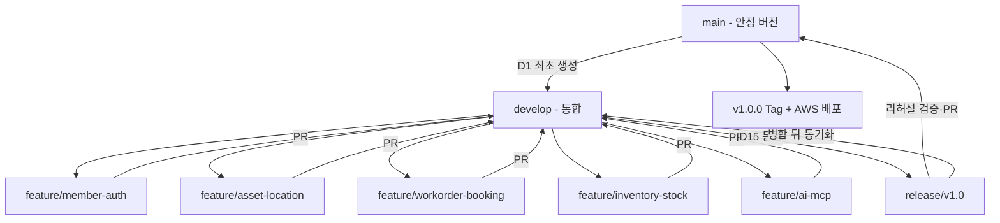

# FixOps — Git 브랜치·Pull Request·릴리스 운영 계약 v1.0

> 상태: 팀 승인용 운영 계약 / 제안. 기준 저장소: `OZA-bot-droid/fixops` (`main`, `docs` 확인). 기준일: 2026-11-18. 발표일: 2026-12-21. 개발인원: 5명.
>
> 이 문서는 실제 브랜치 생성이나 GitHub 설정 변경을 수행했다는 뜻이 아니다.

## 1. 목적 및 기본 원칙

- 5명의 병렬 개발에서 변경 내역과 코드 책임을 구분하고, `develop` 통합·`main` 배포를 안전하게 관리한다.
- **Lightweight GitFlow** 사용: `main`, `develop`, 단기 `feature/*`, `fix/*`, `release/v1.0`, 필요 시 `hotfix/*`, 기존 `docs`.
- 모든 PR은 최소 한 명 이상의 다른 팀원 리뷰, CI 통과, 충돌 해결 후 병합한다. 작성자의 단독 승인·자기 PR 병합은 피한다.
- **실제 확인된 현황:** `main`, `docs`만 존재하며 두 브랜치 모두 보호되지 않음. 아직 `develop`·CI 워크플로 생성 전인 초기 저장소 상태를 전제로 한다.
- 설계 기준 문서는 `/docs`에 두고, 브랜치마다 계약이 분산되지 않도록 동결된 v1.0은 통합 브랜치와 `main`으로 반영한다.

## 2. 팀원 및 소유 영역

| 담당 | 이름 | 기본 소유 영역 | 대표 브랜치 예시 |
|---|---|---|---|
| 팀장 | 오좌언 | Member, Organization, Gateway, 공통 CI/Infra, AWS, AI 보안 | `feature/member-auth`, `feature/gateway`, `feature/aws-deploy` |
| A | 이도형 | Asset, Location, 단지·동·호수, Excel 업로드 UI, Asset MCP | `feature/asset-location`, `feature/roster-ui` |
| B | 박천보 | WorkOrder, Booking, gRPC, Booking MCP | `feature/workorder-booking`, `feature/grpc-schedule` |
| C | 이도관 | Inventory, 재고 원장·동시성, Inventory MCP | `feature/inventory-stock` |
| D | 하진철 | FastAPI, LangChain, RAG, MCP Server, OTel/Jaeger | `feature/ai-mcp`, `feature/rag-search` |

소유 영역은 일차 리뷰 책임을 뜻하며, 다른 영역 수정 자체를 금지하지 않는다. 공통 DTO·보안·인프라·계약 변경은 관련 서비스 소유자의 리뷰를 반드시 요청한다.

## 3. 브랜치 역할 및 생성 기준

| 브랜치 | 역할 | 생성 기준 | 허용 변경 | 병합 대상 |
|---|---|---|---|---|
| `main` | 배포·발표용 안정 버전 | 기본 브랜치 | 승인된 릴리스/핫픽스만 | 배포 기준 |
| `develop` | 통합 기준 | `main`에서 최초 1회 생성 | 검증된 feature/fix PR | `release/v1.0` |
| `feature/<scope>-<topic>` | 기능 개발 | 최신 `develop` | 해당 기능·테스트·문서 | `develop` |
| `fix/<scope>-<topic>` | 통합 중 오류 수정 | 최신 `develop` | 버그 수정 및 회귀테스트 | `develop` |
| `docs` | 현재 존재하는 문서 협업 브랜치 | 기존 브랜치 유지 | 문서만, 실행 코드 혼합 금지 | PR로 `develop` 및 릴리스에 반영 |
| `release/v1.0` | 발표 버전 안정화 | D15 후 승인된 `develop` | 버그·보안·설정·문서만 | `main`, 이후 `develop` 동기화 |
| `hotfix/<topic>` | 배포 후 긴급 수정 | 최신 `main` | 긴급 버그·검증 테스트 | `main`, 이후 `develop` |

**금지 사항:** `main`/`develop` 직접 push, `--force`/force-push, 보호 브랜치 히스토리 재작성, 공용 브랜치에서 실험 커밋, 비밀키·실제 입주민 명부·실제 `.env` 커밋.

### 3.1 초기 설정 명령

```bash
git fetch origin
git switch main
git pull --ff-only origin main
git switch -c develop
git push -u origin develop
```

`docs`에만 존재하는 최신 계약 파일은 `docs`에서 `develop`로 **문서 PR**을 만들어 반영한다. 무조건 `docs` 전체를 `main`에 즉시 병합하지 않으며, docs가 이미 main과 같은 SHA라면 별도 내용 변경이 없을 수 있다.

### 3.2 기능 브랜치 생성

```bash
git fetch origin
git switch develop
git pull --ff-only origin develop
git switch -c feature/workorder-booking
git push -u origin feature/workorder-booking
```

브랜치 이름은 소문자 케밥 표기, 영문·숫자·`/`·`-` 사용. 이름에 담당자 이름 대신 **기능 영역**을 반영한다. Jira 이슈가 있다면 `feature/EMS-123-...`가 아닌 FixOps 이슈 키로 통일한다(실제 키 부여 전 가정 금지).

## 4. PR 계약과 리뷰 게이트

### 4.1 필수 PR 요약 항목

- 작업 목적/연관 이슈
- 변경 파일 및 영향 서비스
- API·DB·권한·MCP·gRPC 계약 변경 여부
- 마이그레이션 방법과 롤백 시 고려사항
- 로컬 테스트 명령과 결과
- UI 변경 화면 캡처(해당 시)
- 보안/조직 격리 영향
- 배포 환경변수·Compose 변경 여부

### 4.2 병합 전 필수 검사

| 영역 | 기본 CI 검증 |
|---|---|
| Java | Gradle compile/test, Flyway 검증, 단위테스트 |
| Python | Ruff, pytest, MCP 계약 테스트 |
| Frontend | `npm ci`, lint, build |
| 통합 계약 | OpenAPI·Protobuf 유효성/Stub 생성, 공통 오류 규칙 |
| 인프라 | `docker compose config`, 배포 환경변수 목록 점검 |
| 보안 | 민감정보·개인정보 커밋 여부, 조직·세대 접근 영향 확인 |

초기 CI가 전부 구성되지 않은 시점에는 보호 규칙의 필수 Check를 **실제로 존재하는 Job에 한정**하고, D5까지 체크를 단계적으로 확정한다. 존재하지 않는 Check를 Required로 지정해 병합을 영구 차단하지 않는다.

### 4.3 승인 규칙

1. `feature/*` → `develop`: **다른 팀원 1명 승인 + 필수 CI 성공**.
2. 인증·인가·API 공통 계약·DB 스키마·Compose·gRPC Protobuf·MCP 공통 기반 변경: **해당 도메인 소유자 승인**을 포함한다. 팀장이 PR 작성자일 경우 다른 팀원이 승인한다.
3. `release/v1.0` → `main`: **팀장 포함 2명 검토(팀장 PR 작성 시 타 팀원 2명)** + 전체 E2E·스모크 검증. GitHub 설정에서 2 approvals를 요구하도록 설정.
4. 릴리스 검증 기간에는 기능 추가 PR 금지. 버그 수정은 `release/v1.0`에서 PR로 진행하고 `develop`에 역반영한다.
5. PR 병합 후 사용이 끝난 feature/fix 브랜치는 삭제. `main`, `develop`, `docs` 및 활성 release 브랜치는 보존.

**병합 방식:** 기능 PR은 **Squash merge** 권장(하나의 기능 단위 히스토리); 릴리스 PR은 **Merge commit** 권장(릴리스 분기 이력 유지). 팀원이 같은 feature 브랜치를 협업 중이면 rebase/force-push 금지. 커밋 메시지는 `feat(member): ...`, `fix(booking): ...`, `docs: ...`, `test(inventory): ...`, `chore(ci): ...` 형태 권장.

## 5. 브랜치 보호 설정 (GitHub Ruleset/Branch Protection)

| 규칙 | `main` | `develop` |
|---|---|---|
| PR 없이 직접 push | 금지 | 금지 |
| 승인된 리뷰 | 2건(릴리스 PR) | 1건 |
| CI 통과 | 필수 | 필수 |
| Conversation resolution | 필수 | 필수 |
| Force push | 금지 | 금지 |
| Branch deletion | 금지 | 금지 |
| 관리자 우회 | 원칙적 금지 | 원칙적 금지 |
| CODEOWNERS | 권장 | 권장 |

GitHub 저장소 플랜 및 Ruleset 기능 가용성에 따라 실제 메뉴가 다를 수 있다. 설정이 미지원되면 최소한 팀 합의·PR 리뷰를 유지하고 가용해질 때 강화한다.

## 6. 계약 파일(문서·DB·API·Protobuf) 변경 절차

- `contracts/openapi/`, `contracts/proto/`, `docs/`의 **공통 계약 파일은 단일 진실 원천**이다.
- ERD·Flyway·Alembic·OpenAPI·MCP Tool Schema·`.proto` 변경은 **같은 PR**에서 호환되는 서비스/테스트 변경 또는 별도 선행 계약 PR과 함께 처리한다.
- 계약이 깨지는 변경은 D5 이전 팀 합의를 받는다. D5 이후에는 영향 범위·마이그레이션·리뷰를 기록하고 최소한의 후방 호환을 유지한다.
- 서비스 간 DB 외래키 금지. `organizationId`, `complexId`, `locationId` 등이 어떻게 검증되는지 명세에 기록한다.
- `docs` 브랜치는 실제 실행 코드의 우회 병합 경로가 아니다. 문서 변경은 PR로 정규화한다.

## 7. 동시 개발·충돌·병합 원칙

- 독립된 `feature/*`에서 개발하고 공통 파일(라우터, Axios, Tailwind 토큰, Compose, Gateway) 수정 전 담당자와 짧게 합의한다.
- 장수 기능 브랜치 금지: 최소 **1~2영업일마다** 최신 `develop`을 병합해 차이를 줄인다.
- 브랜치가 여러 명이 공유하는 경우 `git rebase`보다 `git merge origin/develop`을 권장한다. 혼자 사용하는 미공유 브랜치는 rebase 가능하나 강제 push하지 않는다.
- PR 충돌 발생 시 **기능 브랜치에서** 최신 develop을 가져와 해결하고 CI 재실행. develop에서 개별 작업의 충돌을 수동으로 모아 고치지 않는다.
- 통합 PR 실패 시 원인 수정 또는 PR Revert. 공유 브랜치에서 `reset --hard` + force push 금지.
- 여러 변경 중 특정 파일만 가져올 때 `git restore --source <branch> -- <path>`를 사용할 수 있으나 해당 파일 전체가 바뀌므로 diff 및 테스트를 반드시 확인한다. 기능 커밋 단위라면 `cherry-pick`을 검토한다. 임의 파일 복사로 계약 변경이 누락되지 않게 한다.

## 8. 릴리스·AWS 시연 흐름



| 단계 | 브랜치 | 완료 조건 |
|---|---|---|
| D1 | `main → develop` | 최초 브랜치 생성·PR 규칙 합의 |
| D5 | `develop` | ERD·API·MCP·gRPC·JWT 계약 동결 |
| D10 | `feature → develop` | 각 서비스 독립 빌드·테스트 |
| D15 | `develop → release/v1.0` | P0 기능 동결, 버그 수정만 허용 |
| 12/15~18 | `release/v1.0` / `main` | AWS·RDS·pgvector 0.8.2·HTTPS·AI·gRPC·RAG E2E 검증 |
| 12/18 | `release → main` | 리허설 승인 후 최종 발표 버전 `v1.0.0` 태그 |
| 12/19~21 | `main` | 비긴급 변경 금지, 승인된 릴리스 태그 이미지 배포 |
| 12/22~23 | `main` | 발표 후 산출물 백업, AWS 리소스 정리 |

**원칙:** AWS 배포는 `develop`의 임의 HEAD가 아니라 **승인된 main 커밋 SHA / Git Tag / ECR 이미지 digest**를 기준으로 한다. 동일 빌드 이미지로 배포/재배포해야 재현성이 보장된다.

### 8.1 핫픽스 절차

1. `git switch main && git pull --ff-only origin main`.
2. `git switch -c hotfix/<topic>`.
3. 오류만 수정하고 회귀테스트 추가, PR로 main 병합.
4. 긴급 배포 후 동일 변경을 `develop`에 별도 PR/merge 반영.
5. 태그 `v1.0.1` 등 새 버전으로 관리. 기존 `v1.0.0` 태그는 이동하지 않는다.

## 9. GitHub 저장소 초기 체크리스트

- [ ] `develop` 생성.
- [ ] `main`, `develop` Ruleset/Protection 적용.
- [ ] PR Template + CODEOWNERS(선택) + 이슈 템플릿 구성.
- [ ] CI Java/Python/FE/Compose 검증을 단계적으로 추가.
- [ ] 최신 v1.0 `docs` 패키지를 PR로 반영.
- [ ] AWS OIDC·ECR·EC2 배포 환경 Secret을 코드와 분리.
- [ ] 팀원 5명 PR 권한 및 Reviewer 설정 확인.
- [ ] 12/18 시연용 릴리스 태그·이미지 고정.

## 10. 최종 합의 문구

> FixOps 팀은 `main`을 배포용 안정 브랜치, `develop`을 통합 브랜치, `feature/*`를 기능 개발 브랜치로 사용한다. 모든 변경은 PR·리뷰·CI를 통해 병합하며, `release/v1.0`에서 기능을 동결하고 2026-12-21 발표에 사용할 승인된 `main` 태그를 AWS에 배포한다. 문서 계약과 DB/API/MCP/gRPC 스키마 변경은 소유자 리뷰 없이 단독 변경하지 않는다. 비밀정보·실제 입주민 데이터는 Git 저장소에 기록하지 않는다.

---

**적용 범위:** 정책 제안 문서. 실제 브랜치 생성, PR 보호 설정, CI 워크플로 적용, GitHub 커밋은 별도 수행해야 한다.
