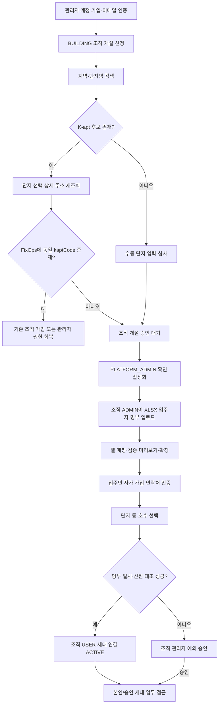
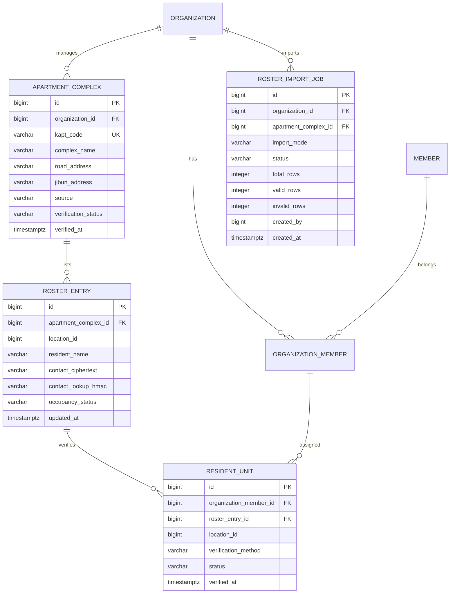
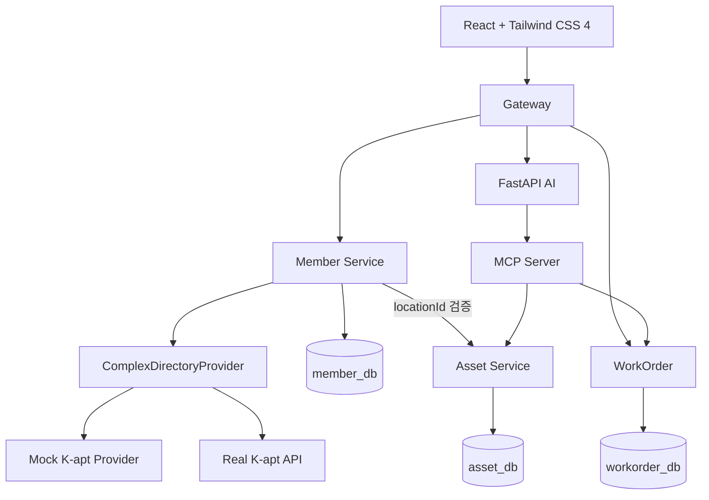

# FixOps v0.5.2 — 공동주택 단지 식별·중복 방지 및 입주자 명부 기반 가입 설계

> 기준일: 2026-11-17  
> 참조 저장소: [`OZA-bot-droid/fixops`](https://github.com/OZA-bot-droid/fixops), `main` 브랜치 `docs/`  
> 문서 성격: **v0.5 시스템 설계 / v0.5.1 기술 호환성 검토에 대한 보완 설계** (기존 문서 대체 아님)  
> 개발 조건: 5명 · 20영업일 · Java Member Service 중심 · 시연용 Mock 지원

## 0. 확정 사항 및 기존 문서와의 관계

| 항목 | 기존 설계 | 본 문서 반영 |
|---|---|---|
| 산업 분기 | `BUILDING`, `FACTORY` | 유지. K-apt 연계는 **BUILDING의 공동주택에만 적용** |
| 조직 계정 | Member/Organization/OrganizationMember | 유지. 조직 개설 승인과 구성원 가입 승인 분리 |
| 회원 역할 | `ADMIN`, `TECHNICIAN`, `USER` | 유지. 가입자가 스스로 역할 선택·승격 불가 |
| 아파트 세대 | Asset의 `location`과 Member의 `resident_unit` 논리 참조 | 유지, Excel 명부를 통해 검증된 연결 추가 |
| 외부 검증 | 사업자등록정보 검증 논의 | **사업자등록번호·대표자 정보 검증 도입하지 않음** |
| 단지 중복 확인 | 내부 조직명 위주 | **K-apt `kaptCode` + 주소·명칭 보조 대조** |
| 대규모 입주민 가입 | 초대/관리자 개별 승인 중심 | **XLSX 명부 일괄 Import + 본인 인증 후 자동 연결** |
| 프론트 | React/Vite/Tailwind CSS 4 | 유지. 추가 화면도 Tailwind로 구현 |
| MSA·AI | Java 서비스 + FastAPI/MCP/gRPC/OTel | 변경 없음. API 소유권은 Member 중심 |

**범위 구분:** 외부 공공 API는 `실재하는 단지 식별`을 돕는다. `FixOps에서 해당 단지를 관리할 권한`, `입주민의 거주 사실`, `계정 사용자 신원`을 증명하지 않는다. 이 세 영역은 독립적으로 확인한다.

## 1. 목적과 요구사항

1. 아파트 조직 개설 시 이미 등록된 동일 단지가 중복으로 생성되지 않도록 한다.
2. 사용자가 단지명·도로명주소로 후보를 검색하고, 공공 단지코드를 확정하도록 한다.
3. K-apt 등록 대상이 아니거나 조회되지 않는 단지에는 **수동 등록·심사**를 허용한다.
4. 대규모 단지의 관리자가 기존 입주자 명부 `.xlsx`를 업로드해 가입 대상 정보를 일괄 준비하도록 한다.
5. 회원 계정은 입주민이 직접 생성하고, 검증된 연락처 등과 명부 정보를 대조한 뒤 조직 USER·세대 연결을 승인한다.
6. 명부 누락·중복·퇴거·연락처 변경·제3자 세대 사칭 등의 예외를 처리한다.
7. P0 범위를 제한하고 실제 개인정보를 사용하지 않는 Mock 시연을 제공한다.

## 2. 외부 데이터: K-apt 단지 식별

### 2.1 우선 검토 API

| 서비스 | 활용 | 출처 |
|---|---|---|
| 국토교통부 공동주택 단지 목록제공 서비스 | 지역별 단지 목록, 단지명·단지코드·도로명주소 후보 검색 | https://www.data.go.kr/data/15057332/openapi.do |
| 국토교통부 공동주택 기본 정보제공 서비스 | 선택한 단지의 기본정보 추가 대조(실제 세부 필드는 활용 명세 확인) | https://www.data.go.kr/data/15058453/openapi.do |

단지 목록 API는 공공데이터포털 명세에 `AptListService4`와 지역별 목록 연산이 안내된다. **API 키, 실제 요청 파라미터와 응답 필드, 기본정보 API의 현재 제공 상태는 개발 시작 시 활용신청 후 실제 응답으로 검증한다.** 단지명 문자열만으로 별도의 검색 API가 보장된다고 가정하지 않는다. 지역 코드 기반 목록을 가져온 다음 서버에서 검색/정규화할 수 있다.

K-apt는 서비스에 포함된 공동주택만 다룰 수 있으므로 **검색 결과 없음 ≠ 존재하지 않는 아파트**이다.

### 2.2 중복 판정 우선순위

1. **확정된 K-apt 단지코드(`kapt_code`)가 동일:** 내부에 기존 활성·승인대기 단지가 있으면 중복 조직 개설을 정지하고 기존 조직 가입/관리권한 회복 절차를 안내.
2. **단지코드는 다르나 주소·이름이 유사:** 검토 대상으로 분류. 공공데이터의 단지 분리·합병·명칭 변경 가능성을 고려하여 자동 병합하지 않음.
3. **K-apt 코드가 없고 주소가 유사:** 수동 중복 후보 목록 제시 및 PLATFORM_ADMIN 심사.
4. **같은 주소에 여러 동/단지가 존재:** 도로명주소만 같다는 이유로 자동 중복 판정하지 않음.

문자열 정규화는 공백·괄호·`동`, `아파트` 등의 표현차를 보조적으로 처리하되 원본 이름과 주소는 별도 보존한다. 주소 지오코딩/표준화가 필요한 경우 별도 주소 API 도입을 P1로 검토한다.

### 2.3 조직과 단지의 관계

`organization`은 권한과 운영 주체, `apartment_complex`는 물리적 단지 식별 정보를 나타낸다. **한 조직이 여러 단지를 관리할 수 있으므로 일대다 관계**를 사용한다. 단지 중복 방지는 `apartment_complex.kapt_code`의 글로벌 유니크 정책(활성 단지의 코드)에 두고, 하나의 단지를 여러 관리 조직이 공동 관리하는 기능은 이번 MVP에서 지원하지 않는다.

FACTORY 조직에서는 K-apt 검증을 수행하지 않으며 조직명·소속 승인 중심으로 진행한다.

## 3. 권장 전체 흐름



**관리권한 부여 규칙:** 새로운 조직을 먼저 만든 사용자라고 즉시 활성 ADMIN이 되는 것은 아니다. `PENDING_APPROVAL` 조직을 운영자 심사 후 활성화하고 최초 ADMIN을 부여한다. 시연에서는 사전 생성된 플랫폼 운영자 계정으로 승인한다.

## 4. Excel 명부 설계

### 4.1 업로드 방식

- **P0:** FixOps 표준 `.xlsx` 양식, 1개 시트, 행·열 상한 지정, 업로드 미리보기·확정, 오류 다운로드.
- **P1:** 기존 `.xls` 지원, 기존 관리사무소 양식의 열 이름 매핑, 저장된 매핑 템플릿, 다중 시트 처리.
- **지양:** 명부 업로드만으로 `member` 계정을 대량 생성하거나 초대 이메일을 강제로 발송하지 않는다.

### 4.2 표준 컬럼

| 컬럼 | 필수 | 의미/규칙 |
|---|---|---|
| `building_code` | Y | 동 식별자(문자열 보존, `105동` → `105` 규격화) |
| `unit_code` | Y | 호 식별자(문자열 보존, 선행 0 유지) |
| `resident_name` | Y | 명부 대조 이름; 동일 이름만으로 자동 승인 불가 |
| `contact_phone` | 조건부 | 본인 인증 가능한 연락처, 정규화·보호 저장 |
| `contact_email` | 선택 | 인증 가능한 보조 수단 |
| `occupancy_status` | Y | `ACTIVE`, `INACTIVE` 등 정해진 값 |
| `move_in_date` | 선택 | 입주 개시일 |
| `move_out_date` | 선택 | 퇴거일 |
| `roster_reference` | 선택 | 기존 명부의 비민감 내부 행 식별값 |

**수집 제한:** 주민등록번호, 대표자 생년월일, 가족관계·민감정보는 기본 명부에서 수집하지 않는다. 이름·동·호수만 아는 사용자는 자동 승인하지 않는다.

### 4.3 검증 규칙

1. 파일 확장자뿐 아니라 실제 XLSX 형식, 크기, 행 수, 시트 수 제한.
2. 수식·매크로·외부 링크 처리 금지 또는 거부. 압축 폭탄 대응.
3. `building_code + unit_code`가 Asset의 같은 조직·단지 내 `location`에 존재하는지 확인. 동·호수 미생성 시 **등록 대상 위치를 먼저 생성할지** 미리보기에서 관리자가 결정(자동 생성은 P1).
4. 행 내부 필수값·연락처 형식·상태·날짜 범위 검사.
5. 중복 이름/연락처가 있다고 자동 삭제하지 않음. 한 세대에 여러 입주자가 있을 수 있다.
6. 전량 교체와 증분 갱신을 명시적으로 구분. 업로드에 없는 기존 행을 자동 퇴거 처리하지 않음.
7. 원본과 DB 변경 예상 수(추가/수정/충돌/비활성)를 보여준 후 `commit`.
8. 반영 실패 시 재시도 가능한 작업 ID를 제공하고 중복 반영 방지.

### 4.4 대량 처리

- P0 검증 목표: **가상 명부 2,000행** 정상·오류 혼합 업로드.
- 다량 입력에서는 모든 행을 JPA 엔티티로 장시간 유지하지 말고 배치 크기를 나눈 JDBC Batch/Streaming 파싱 방식 검토.
- 파일 업로드·검증과 DB 반영 작업을 분리한다. `PREVIEW` → `COMMITTED` 상태 전이.
- 파일 및 오류 리포트에 포함되는 개인정보는 접근권한을 제한하고 보관기한 설정 후 삭제.

## 5. 입주민 가입과 자동 승인 정책

### 5.1 가입 모델

- `member`: 전역 사용자 계정. **명부 Import 단계에서 생성하지 않음**.
- `organization_member`: 특정 조직의 승인된 역할. 자동 승인 성공 시 `USER` 부여.
- `resident_unit`: 승인된 `location_id`와 계정 소속 연결.
- `roster_entry`: 사전 Import한 거주 후보 정보. 계정 자체가 아님.

### 5.2 자동 승인 조건 (보수적)

1. 사용자는 자신의 계정을 생성하고 이메일 등 기본 인증을 완료.
2. 소속하려는 조직/단지·동·호수 선택.
3. 명부 내 현재 활성 항목과 1건 또는 관리자 정책상 명확한 후보가 매칭.
4. **실제로 인증된 연락처**가 명부 연락처와 일치(또는 동등한 별도 신원 확인 정책 통과).
5. 명부가 최신이고 이미 다른 계정과 충돌하지 않음.
6. 해당 세대에 대한 승인 기록이 남고 제한된 USER 권한이 부여됨.

이름 + 동 + 호수 **단독 일치로 자동 승인하지 않는다**. 전화번호 인증은 그 번호의 소지를 확인할 뿐, 법적 거주 사실까지 확정하지는 않으므로 명부 최신성·권한 회수 정책이 필요하다.

### 5.3 예외·상태

| 경우 | 처리 |
|---|---|
| 연락처 누락/불일치 | 자동 승인 거부 → `PENDING_REVIEW` |
| 이름·동·호수만 일치 | 자동 승인 거부 |
| 해당 연락처로 다른 세대 가입 시도 | 추가 검토·감사 |
| 이미 다른 계정에 명부 항목 연결 | 자동 가입 차단, 관리자 확인 |
| 같은 세대 여러 구성원 | 별도 `roster_entry` 또는 관리자 정책으로 다중 연결 |
| 이사·퇴거 | 연결 `REVOKED`, 해당 세대에 대한 권한 즉시 회수 |
| 업로드 오류/외부 인증 장애 | 자동 승인하지 않고 재시도 또는 수동 심사 |
| 명부가 오래됨 | 대조 성공해도 관리자 검토 전환 가능 |

### 5.4 시연용 Mock

- 개발·시연에서는 **실제 입주민이 아닌 가상 명부/가상 연락처**만 사용.
- `PhoneVerificationProvider` 인터페이스 → `MockOtpProvider`(시연) / `RealOtpProvider`(운영 시 별도 계약).
- Mock OTP가 성공해도 주민등록상 본인확인을 완료했다고 표현하지 않는다.
- Mock 계정이나 고정 OTP가 운영 프로파일에서 활성화되면 서비스 시작 실패하도록 Fail Closed.

## 6. DB 상세안 (Member 소유)



### 6.1 물리 제약 초안

```sql
CREATE TABLE apartment_complex (
    id BIGINT GENERATED BY DEFAULT AS IDENTITY PRIMARY KEY,
    organization_id BIGINT NOT NULL REFERENCES organization(id),
    kapt_code VARCHAR(30),
    complex_name VARCHAR(200) NOT NULL,
    road_address VARCHAR(300),
    jibun_address VARCHAR(300),
    source VARCHAR(30) NOT NULL,
    verification_status VARCHAR(30) NOT NULL,
    verified_at TIMESTAMPTZ,
    created_at TIMESTAMPTZ NOT NULL DEFAULT now()
);

CREATE UNIQUE INDEX ux_apartment_complex_kapt_code
    ON apartment_complex (kapt_code)
    WHERE kapt_code IS NOT NULL;

CREATE INDEX ix_apartment_complex_address
    ON apartment_complex (road_address);
```

`organization_id`와 `location_id`를 혼동하지 않는다. Member 소유의 `roster_entry.location_id`는 **Asset Service의 논리 참조**이며 Member DB 내부 FK가 아니다. 위 SQL은 부분 DDL 예시이며 `roster_import_job`, `roster_entry` 등 전체 Flyway 마이그레이션은 구현 단계에 확정한다.

### 6.2 정보 보호

- 전화번호는 암호화 저장. 동일성 검색용 인덱스는 비밀 키를 사용하는 HMAC 기반 등으로 분리하고 키 회전 정책 마련.
- 상세 명부 접근은 조직 ADMIN과 허가된 운영자만 가능하며 ADMIN도 **자신의 조직** 자료만 조회.
- 프론트/API/Trace에 명부 전체·연락처·인증값 노출 금지.
- 가입 시 존재 여부를 구체적으로 노출하지 않아 세대·명부 정보의 대량 열거 방지.
- 조직·세대 권한 변경 및 개인정보 접근 기록 감사.
- 업로드 원본·검증 오류 다운로드 파일의 보관기간·삭제 정책 운영.
- 실제 서비스 도입 전 기존 입주자 명부를 회원가입 검증 목적으로 처리하는 적법한 근거·안내·위탁 관계를 검토.

## 7. API 계약 제안

### 7.1 단지 검색·중복 확인

| Method | API | 호출 권한 | 설명 |
|---|---|---|---|
| GET | `/api/complexes/search?regionCode=&keyword=` | 인증 사용자 | 내부 단지 + K-apt 후보 검색, 개인정보 없음 |
| GET | `/api/complexes/external/{kaptCode}` | 인증 사용자 | 서버 측 상세정보 재조회 |
| POST | `/api/organizations/complex-check` | 인증 사용자 | 새 조직 신청 전 중복 검사 |
| POST | `/api/organizations` | 인증 사용자 | 조직 개설 신청, `PENDING_APPROVAL` |
| POST | `/api/organizations/{id}/complexes/manual` | 운영자 심사 대상 | K-apt 미등재 단지 수동 신청 |

모든 외부 API 요청은 Member Service 서버에서 수행한다. 공공 API Key는 브라우저로 전달하지 않는다.

**중복 응답 예시(가상):**

```json
{
  "success": true,
  "data": {
    "duplicate": true,
    "matchType": "KAPT_CODE",
    "registrationStatus": "ACTIVE",
    "action": "JOIN_EXISTING_OR_REQUEST_ACCESS"
  }
}
```

기존 조직의 관리자 이름·연락처 및 입주자 정보는 반환하지 않는다. 단지 중복 검사 응답은 사전 안내이며 **조직 개설 트랜잭션에서도 유니크 제약으로 최종 방어**한다.

### 7.2 명부 Import

| Method | API | 호출 권한 | 설명 |
|---|---|---|---|
| POST | `/api/organizations/{id}/roster-imports` | 조직 ADMIN | XLSX 업로드 후 검증 및 작업 생성 |
| GET | `/api/organizations/{id}/roster-imports/{jobId}` | 조직 ADMIN | 행·오류·예상 변경 미리보기 |
| POST | `/api/organizations/{id}/roster-imports/{jobId}/commit` | 조직 ADMIN | 검증 통과 행 확정, 멱등 처리 |
| GET | `/api/organizations/{id}/roster` | 조직 ADMIN | 접근통제된 명부 조회 |
| GET | `/api/organizations/{id}/roster-imports/{jobId}/errors` | 조직 ADMIN | 안전한 오류 보고서 |

**업로드 보안:** 파일 MIME/매직 바이트 검사, 크기 제한, 인증/인가, 압축 폭탄 방어, 멀웨어·수식 처리 정책, 개인정보 보존 기간.

### 7.3 자가 가입·세대 연결

| Method | API | 호출 권한 | 설명 |
|---|---|---|---|
| POST | `/api/members/resident-enrollments` | 인증 사용자 | 단지·동·호수 연결 신청 |
| POST | `/api/members/resident-enrollments/verify` | 신청자 | 연락처 인증 및 명부 대조 |
| GET | `/api/organizations/{id}/resident-enrollments/pending` | 조직 ADMIN | 예외 승인 목록 |
| PATCH | `/api/organizations/{id}/resident-enrollments/{requestId}` | 조직 ADMIN | 승인·거절·회수 |

### 7.4 조직별 권한 계약

- 등록 단지 외부 검증/명부 Import는 **Member Service**에서 관리.
- 동·호수의 정확성은 **Asset Service 내부 조회 API**로 확인.
- WorkOrder·AI/MCP는 `organization_member` 및 `resident_unit`의 승인된 범위를 따른다.
- 업무 변경 후 JWT가 오래된 세대 소속을 담고 있더라도 실제 리소스 접근 판단은 최신 서버 상태 기준.

## 8. 서비스 경계 및 기술 구조



### 8.1 확장 가능한 Provider

```java
public interface ComplexDirectoryProvider {
    List<ComplexCandidate> search(String regionCode, String keyword);
    ComplexDetails getByKaptCode(String kaptCode);
}
```

- `MockComplexDirectoryProvider`: 공공 단지코드·주소와 유사한 **가상 데이터**를 반환. 시연용.
- `KaptComplexDirectoryProvider`: 실제 공공 API 호출, 응답 검증, 짧은 캐싱, 타임아웃과 오류 매핑.
- 설정 방식: `fixops.complex.provider=mock|kapt`.
- 운영 환경에서 Mock Provider가 실수로 활성화되지 않도록 환경 검증(비운영 전용).
- 외부 API 장애는 '단지 없음'으로 간주하지 않고 `UPSTREAM_UNAVAILABLE`로 반환.

### 8.2 간단한 경로 예시

```text
member-service/
  src/main/java/com/fixops/member/
    organization/
      complex/
        ComplexController.java
        ComplexDirectoryProvider.java
        MockComplexDirectoryProvider.java
        KaptComplexDirectoryProvider.java
        ComplexDuplicateService.java
      roster/
        RosterImportController.java
        RosterImportService.java
        RosterValidator.java
        RosterEntryRepository.java
      enrollment/
        ResidentEnrollmentController.java
        ResidentEnrollmentService.java
        PhoneVerificationProvider.java
        MockOtpProvider.java
```

기존 v0.5.1 호환성 검토에 따라 Java 21 / Spring Boot 4.0.9 / Spring Cloud 2025.1.3은 **선행 검증 후보**이며, 실제 Gradle 빌드 성공 후 최종 고정한다. PostgreSQL 16과 Flyway를 유지한다.

## 9. UI 화면 추가 (Tailwind 통일)

| 화면 | 접근 역할 | 제공 기능 |
|---|---|---|
| 단지 검색·선택 | 조직 개설 신청자, 가입자 | 지역 검색·단지 선택·주소 확인 |
| 신규 단지 중복 경고 | 조직 개설 신청자 | 기존 단지 안내·관리 권한 회복 안내 |
| 신규 조직 개설 심사 | PLATFORM_ADMIN | 신청 목록·승인·거절 |
| 입주자 명부 업로드 | 조직 ADMIN | XLSX 선택·검증·미리보기·확정 |
| 명부 오류 관리 | 조직 ADMIN | 중복·불일치·누락 행 확인 |
| 입주민 세대 연결 가입 | USER | 단지·동·호수·연락처 인증 |
| 예외 가입 승인 | 조직 ADMIN | 연락처 불일치·명부 누락 심사 |

모든 컴포넌트는 기존 `Button`, `Input`, `Modal`, `Table`, `StatusBadge`, `AppLayout`을 재사용하고 SCSS/CSS Modules를 사용하지 않는다.

## 10. 5인 업무분장 (실명)

| 담당 | 소유 업무 | 추가 범위 |
|---|---|---|
| **팀장 오좌언** | Member, Organization, JWT, Gateway, 산업 선택, AI 조직 컨텍스트 | **K-apt Adapter·단지 중복·Roster Import·입주민 가입 검증** |
| **A 이도형** | Asset·Location, Asset MCP Tool | 단지에 속한 동·호수 조회/검증 내부 API; 명부 위치 대조 지원 |
| **B 박천보** | WorkOrder·예약·gRPC·Booking MCP Tool | 승인된 세대 범위 내 신고/예약 접근권한 검증 |
| **C 이도관** | Inventory·Inventory MCP Tool | 업무 변화 없음, 조직·권한 공통 계약 준수 |
| **D 하진철** | FastAPI·LangChain·RAG·MCP 플랫폼 | 조직·세대 범위에 맞는 AI/MCP 도구 결과 검증 |

> **일정 위험:** 입주자 명부 기능은 팀장에게 큰 추가 부담이므로 4주 MVP에서는 `XLSX 고정 템플릿 + Mock K-apt + Mock OTP + 자동·수동 승인`을 우선한다. Real K-apt Adapter는 연결 가능 구조와 간단한 Spike까지 구현하고, 실호출은 API 이용승인 및 일정에 따라 선택한다. A의 Location API 계약을 D5까지 확정한다.

## 11. 20영업일 추가 WBS (기존 v0.5 일정 안에 편입)

| 기간 | 작업 | 책임 | 통과 기준 |
|---|---|---|---|
| D1~D3 | 단지/명부/가입 계약·ERD·Mock Provider 골격 | 오좌언 | 공공 단지코드 입력·조직 중복 정책 확정 |
| D4~D5 | K-apt API 연결 Spike·Location API 계약·XLSX 표준 양식 | 오좌언+이도형 | Mock 검색·DB 단지 식별·XLSX 유효성 검사 |
| D6~D8 | 명부 업로드·미리보기·배치 반영 | 오좌언 | 2,000행 가상 명부 검증 및 오류 표시 |
| D9~D10 | 입주민 가입/Mock OTP·명부 대조 | 오좌언 | 검증 성공/실패/중복 케이스 통과 |
| D11~D13 | 세대 접근권한 연동·AI/MCP 정책 확인 | 전원(각 영역) | 타 세대/타 조직 접근 차단 |
| D14~D15 | 조직 승인·입주민 자동·예외 가입 E2E | 오좌언·이도형 | 핵심 가입 시나리오 통과, 기능 동결 |
| D16~D18 | 보안·명부 갱신·퇴거·중복 테스트 | 오좌언 중심 | 권한 회수 및 오류 처리 검증 |
| D19~D20 | 문서·시연 | 전원 | Mock 데이터 기반 재현 가능 데모 |

**범위 조정 우선순위:** ① 단지코드 중복 등록 방지 ② 명부 안전한 업로드·확정 ③ 검증된 가입 자동 승인 ④ 수동 예외 승인 ⑤ 기존 양식 매핑·`.xls` 확장(후순위). 기존 WorkOrder/Inventory/RAG/gRPC/OTel P0 일정이 지연되면 ④ 이후 기능을 P1로 이동한다.

## 12. 테스트 시나리오

| 번호 | 테스트 | 기대 결과 |
|---|---|---|
| TC-01 | 동일 `kaptCode`로 조직 개설 2회 | 1건만 등록, 나머지 중복 처리 |
| TC-02 | 단지명 유사·주소 다름 | 자동 중복 거부하지 않음 |
| TC-03 | 주소 동일·단지코드 다름 | 수동 검토로 분류 |
| TC-04 | K-apt 조회 실패/미등재 | 수동 단지 등록 경로 제공 |
| TC-05 | 가상 2,000행 XLSX | 검증·미리보기·배치 확정 성공 |
| TC-06 | Excel 중복/잘못된 동·호수 | 행별 오류 표시, 잘못된 데이터 반영 방지 |
| TC-07 | 연락처 본인 인증 + 명부 일치 | USER/세대 연결 ACTIVE |
| TC-08 | 이름·동·호수만 일치 | 자동 승인 불가 |
| TC-09 | 명부와 연락처 불일치 | 관리자 예외 심사 |
| TC-10 | 명부 재업로드에서 일부 행 누락 | 기존 입주민 자동 퇴거 금지 |
| TC-11 | 퇴거 및 권한 회수 | 기존 세대 WorkOrder·AI 조회 차단 |
| TC-12 | 타 조직의 명부 조회 | 403/404 정책에 맞게 차단 |
| TC-13 | 운영 프로파일에서 Mock 인증 | 기동 실패 또는 Mock 사용 거부 |
| TC-14 | 동시 중복 단지 신청 | DB 유니크 제약으로 1건만 성공 |

## 13. 보안·운영 위험과 대응

| 위험 | 대응 |
|---|---|
| 동일 단지 중복 조직 생성 | K-apt 코드 유니크 + 트랜잭션 내 재검사 + 수동 후보 검토 |
| K-apt 미등록·불완전 데이터 | 수동 등록·PLATFORM_ADMIN 심사; '검색 안 됨'을 부재 증명으로 간주하지 않음 |
| 단지 식별과 관리자 신원 혼동 | 두 검증을 분리; 최초 ADMIN은 플랫폼 승인 후 활성화 |
| Excel의 민감 데이터 유출 | 필드 최소화·접근 제어·암호화·원본 만료 삭제·감사 |
| 오래된 명부를 이용한 부정 가입 | 입주 상태·명부 갱신일·연락처 인증·수동 심사 |
| 이름·호수 사칭 | 단순 일치만으로 자동 승인 불가 |
| 인증 코드 무차별 대입·명부 열거 | 시도 횟수/Rate Limit·범용 응답·이상징후 로깅 |
| 대량 업로드로 서버 과부하 | 파일/행 수 제한, 배치·시간 제한, 비동기 확장은 후순위 |
| 서비스 간 데이터 불일치 | Member가 조직/명부 소유, Asset이 Location 소유, 논리 참조 검증 |
| 일정 과다 | 고정 XLSX·Mock으로 P0 제한, 실 API·복잡한 매핑 P1 |

## 14. 참고 문서 및 링크

### FixOps 저장소 기준 문서

- [시스템 설계 v0.5](https://github.com/OZA-bot-droid/fixops/blob/main/docs/FixOps_시스템_설계_초안_v0.5.md) — 역할·MSA 경계·업무/AI 통신·20일 WBS.
- [기술 스택 호환성 v0.5.1](https://github.com/OZA-bot-droid/fixops/blob/main/docs/FixOps_기술스택_호환성_검토_v0.5.1.md) — Java 21, Spring Boot/Cloud 검증 후보, PostgreSQL/Flyway, Frontend/Tailwind 규격.
- [시스템 설계 v0.4](https://github.com/OZA-bot-droid/fixops/blob/main/docs/FixOps_시스템_설계_초안_v0.4.md) — 팀장 Member, A Asset, B WorkOrder, C Inventory, D Python AI/MCP 공동 개발 기조.

### 외부 데이터 출처

- [공공데이터포털 — 공동주택 단지 목록제공 서비스](https://www.data.go.kr/data/15057332/openapi.do)
- [공공데이터포털 — 공동주택 기본 정보제공 서비스](https://www.data.go.kr/data/15058453/openapi.do)

> 주의: API 키로 실제 호출, 공공 데이터 품질/갱신 확인, 개인정보 처리의 운영 법적 검토, 부하 성능 테스트는 **아직 수행하지 않았으며** 별도 검증 필요. 본 문서는 구현 계약 및 개발 계획안이다.

---

**최종 권고:** BUILDING 단지 식별은 `kaptCode` 중심, K-apt 미등재 시 수동 심사. 대규모 입주민 가입은 `XLSX 명부 적재 → 본인 인증 → 명부 대조 → USER·세대 승인`으로 구성한다. `FACTORY`에는 이 가입 흐름을 강제하지 않으며 사업자등록정보 검증은 도입하지 않는다.
