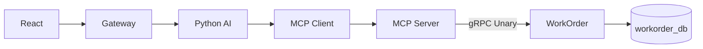
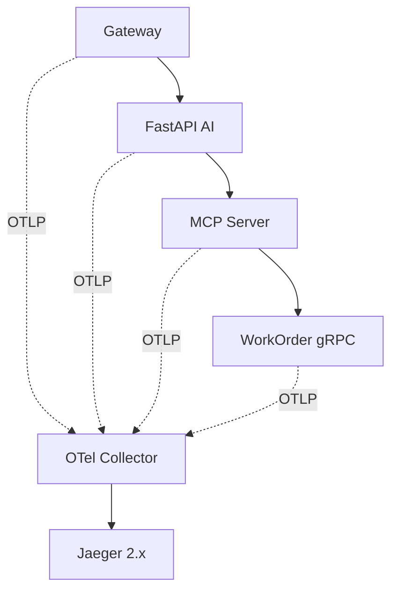

# FixOps v0.5.1 — 기술 스택 버전 호환성 전면 검토

> **기준일:** 2026-11-17  
> **기준 설계:** FixOps v0.5 (Java MSA + Python AI + MCP + gRPC 시범 적용 + OpenTelemetry/Jaeger)  
> **개발 조건:** 5명, 20영업일, Java 서비스 4개 + AI/MCP 내부 서비스  
> **검증 상태:** 공식 호환성·의존성 방향에 관한 **설계 검토**. FixOps 저장소에서 실제 빌드·통합 테스트를 수행했다는 의미가 아님.

---

## 1. 검토 목적 및 결론

FixOps v0.5에서 채택한 Java/Spring, Python AI/MCP, 프론트엔드, DB 및 분산 추적 스택을 일관된 버전 정책으로 정리한다.

핵심 결정은 다음과 같다.

1. 신규 프로젝트의 Java 기준을 **Java 21 + Spring Boot 4.0.9 + Spring Cloud 2025.1.3** 조합으로 **우선 검증**한다. 기존 EMS의 Boot 3.4.5 코드는 호환성 검토 없이 복사하지 않는다.
2. Python은 **3.12.x**를 유지한다. **LangChain 1.x + MCP Python SDK 2.x** 연동은 실제 설치 및 도구 호출 검증을 거쳐 잠근다.
3. DB는 **PostgreSQL 16**을 유지하되 pgvector를 포함한 **`pgvector/pgvector:0.8.7-pg16`** 이미지를 우선 검증한다.
4. 프론트엔드는 **Node 22.x(최소 22.12) + React 19.x + Vite 7.x + Tailwind CSS 4.x**를 우선한다. SCSS, CSS Modules는 사용하지 않는다.
5. 서비스 통신은 **REST 기본**, **WorkOrder 예약 가능 시간 조회 1개 RPC만 gRPC 시범 적용**, **AI Tool 통신은 MCP**로 구분한다.
6. **OpenTelemetry + Collector + Jaeger 2.x**를 도입하되 필수 Trace 한 경로부터 검증한다.
7. **RabbitMQ, Redis, Kubernetes**는 4주 MVP 필수 범위에서 제외한다.

> **중요:** 아래의 정확한 릴리스 버전은 선행 검토에서 제안한 검증 후보이다. 실제 프로젝트 시작 시 Maven/Gradle, PyPI, npm, Docker 이미지 태그와 공식 호환성 문서를 확인하고 `gradle.lockfile`, `uv.lock`, `package-lock.json`, 이미지 digest 등으로 최종 잠금한다. 지원 여부와 애플리케이션 실행 성공은 별개다.

---

## 2. 권장 버전 매트릭스

| 영역 | 구성 요소 | v0.5.1 검증 후보/정책 | 판단 |
|---|---|---|---|
| JVM | Java | **21 LTS** | 유지 |
| Java Backend | Spring Boot | **4.0.9** | v0.5 3.4.x에서 변경, 우선 검증 |
| Java MSA | Spring Cloud | **2025.1.3** | Boot 4.0 계열 대응 후보 |
| API Gateway | Spring Cloud Gateway | **5.0.x** | Spring Cloud BOM 관리 |
| Build | Gradle | **8.14.x** 후보 | Boot 플러그인과 실제 빌드 확인 후 고정 |
| Java ORM | Spring Data JPA / Hibernate | Spring Boot BOM | 개별 버전 직접 지정 금지 |
| Java Security | Spring Security | Spring Boot BOM | JWT/OAuth2 Starter 이름 재검토 |
| DB migration (Java) | Flyway | Spring Boot BOM | PostgreSQL 전용 모듈 포함 |
| Database | PostgreSQL | **16.x** | 유지 |
| Vector extension | pgvector | **0.8.7** 후보 | DB 이미지·확장 적용 테스트 |
| JS Runtime | Node.js | **22.x, 최소 22.12** | 유지, 패치 버전 고정 |
| Package Manager | npm | **10.x** | `packageManager`, lockfile 통일 |
| Frontend | React | **19.x** | 유지 |
| Build/Dev | Vite | **7.x** | 안정적인 범위 우선 |
| Styling | Tailwind CSS | **4.x** | CSS `@theme`, Vite Plugin |
| Router | React Router | **7.x** 후보 | 라우터 API 확인 |
| HTTP | Axios | **1.x** | 공통 인스턴스 사용 |
| Python | Python | **3.12.x** | 유지 |
| AI API | FastAPI | 호환되는 안정 패치 고정 | Pydantic 2 사용 |
| DTO | Pydantic | **2.12+** 후보 | MCP SDK 요구사항 확인 |
| LLM | LangChain | **1.4+의 1.x** 후보 | MCP 통합 API 사전 검증 |
| MCP | MCP Python SDK | **2.x** 후보 | Server/Client 조합 함께 검증 |
| HTTP Client | httpx | 의존성 호환 버전 잠금 | Java REST 호출 |
| gRPC (Python) | grpcio / grpcio-tools | **서로 동일한 버전** | 생성 코드·런타임 검증 |
| ORM (Python) | SQLAlchemy | **2.x** | AI DB 한정 |
| Migration (Python) | Alembic | SQLAlchemy 2 호환 버전 | AI DB 소유 |
| Trace | OpenTelemetry | 플랫폼별 BOM/Lockfile | API/SDK/Exporter 불일치 방지 |
| Trace Backend | Jaeger | **2.x** | Collector OTLP 수신 검증 |
| Container | Docker Compose | v2 | 유지 |

### 버전 잠금 원칙

- **Gradle:** Spring Boot Gradle Plugin 버전, Spring Cloud BOM 버전 고정. 런타임 의존성은 가능한 한 해당 BOM 사용.
- **Python:** AI Service와 MCP Server 각각 `pyproject.toml` + `uv.lock` 관리. 두 서비스의 MCP 관련 버전 호환성을 CI로 검증.
- **Frontend:** `package.json`의 `engines`, `packageManager`를 명시하고 `package-lock.json` 커밋. CI에서 `npm ci` 사용.
- **Docker:** 이미지 태그 검증 후 가능한 경우 digest 고정. 환경별 이미지 업데이트 정책을 별도 관리.

---

## 3. Java / Spring Boot / Spring Cloud 호환성

### 3.1 핵심 호환성 판단

- 기존 EMS의 **Spring Boot 3.4.5**는 동일 버전의 코드 재사용에 유리하지만 신규 FixOps에서는 지원 상태와 최신 gRPC/관측성 연계를 함께 고려해야 한다.
- 신규 프로젝트의 **Spring Boot 4.0.9 + Spring Cloud 2025.1.3** 조합을 우선 검증한다.
- Boot와 Cloud는 각자 임의 최신 버전으로 조합하지 않는다. 공식 호환성 표와 Release Train BOM을 기준으로 맞춘다.
- 기존 코드 이전 시 Security, Gateway, Starter 구성, 테스트 및 자동 설정 차이를 확인한다.

### 3.2 Spring Boot 4 Starter 주의 사항

이전 3.x 예제를 그대로 사용하지 말고 Boot 4에 대응하는 Starter 이름과 의존성을 확인한다.

| 목적 | Boot 4 우선 검증 방향 |
|---|---|
| MVC 업무 API | `spring-boot-starter-webmvc` |
| JPA | `spring-boot-starter-data-jpa` |
| Validation | `spring-boot-starter-validation` |
| Spring Security | `spring-boot-starter-security` |
| OAuth2 Resource Server | `spring-boot-starter-security-oauth2-resource-server` |
| OAuth2 Client (필요할 경우) | `spring-boot-starter-security-oauth2-client` |
| Flyway | `spring-boot-starter-flyway` + `flyway-database-postgresql` |
| Actuator | `spring-boot-starter-actuator` |
| OpenTelemetry | `spring-boot-starter-opentelemetry` |
| gRPC WorkOrder Server | `spring-boot-starter-grpc-server` 후보 |
| Gateway WebFlux | `spring-cloud-starter-gateway-server-webflux` 후보 |

**업무 서비스용 Gradle 의존성 예시(설계 초안):**

```gradle
dependencies {
    implementation 'org.springframework.boot:spring-boot-starter-webmvc'
    implementation 'org.springframework.boot:spring-boot-starter-data-jpa'
    implementation 'org.springframework.boot:spring-boot-starter-validation'
    implementation 'org.springframework.boot:spring-boot-starter-security'
    implementation 'org.springframework.boot:spring-boot-starter-flyway'
    implementation 'org.springframework.boot:spring-boot-starter-actuator'

    runtimeOnly 'org.postgresql:postgresql'
    runtimeOnly 'org.flywaydb:flyway-database-postgresql'

    testImplementation 'org.springframework.boot:spring-boot-starter-test'
}
```

위 예시는 공통 출발점이다. **실제 배포 프로젝트는 Spring Initializr와 공식 BOM 기준으로 컴파일 검증**하여 변경한다.

### 3.3 Gateway 예외

Gateway는 **WebFlux 전용 프로젝트**로 구성한다. 불필요한 MVC/JPA Starter를 Gateway에 포함하지 않는다.

```gradle
implementation 'org.springframework.cloud:spring-cloud-starter-gateway-server-webflux'
```

Gateway는 외부 요청에서 전달된 `X-Member-Id`, `X-User-Role` 등 사용자 식별 헤더를 제거하고, 검증된 JWT에 대응하는 내부 컨텍스트만 생성한다. 단, 헤더 재생성만으로 내부 서비스 신뢰가 보장되지는 않으므로 내부 호출 인증과 업무 리소스 인가가 필요하다.

### 3.4 gRPC Starter

Spring Boot 4 공식 gRPC 통합을 우선 검토하되, **Spring Boot 버전·생성 Stub·gRPC Java 런타임·Netty 전송 계층**의 호환성을 실제 실행으로 확인한다.

```gradle
implementation 'org.springframework.boot:spring-boot-starter-grpc-server'
```

WorkOrder 서비스는 일반 REST API와 별도의 내부 gRPC 포트를 관리한다.

---

## 4. Python AI / LangChain / MCP 호환성

### 4.1 권장 Python 구성

```text
Python 3.12.x
├── FastAPI / Pydantic 2.x
├── LangChain 1.x
├── MCP Python SDK (동일 프로토콜 호환 버전)
├── httpx
├── grpcio + grpcio-tools (동일 버전)
├── SQLAlchemy 2.x + Alembic
├── pgvector / PostgreSQL driver
├── OpenTelemetry Python SDK + Instrumentation
└── pytest + Ruff
```

### 4.2 주요 충돌 위험

- **MCP SDK 메이저 버전 차이:** 서버 클래스·클라이언트 연결 방식·프로토콜 버전·Pydantic 요구사항 확인.
- **LangChain MCP 통합 API 변화:** 기존 `langchain-mcp-adapters` 사용 예제와 새로운 LangChain 내장 MCP 통합 예제를 섞지 않는다.
- **Python AI와 MCP 분리 배포:** 두 프로세스가 같은 프로토콜 버전을 협상하는지 확인.
- **Pydantic 호환:** FastAPI와 MCP SDK가 함께 요구하는 최소 버전을 충족해야 한다.
- **Async I/O:** FastAPI·MCP·httpx·gRPC 비동기/동기 경계를 통일하고 타임아웃을 명시한다.
- **RAG 패키지:** Embedding Provider, pgvector 드라이버, SQLAlchemy 호환성을 함께 잠근다.

### 4.3 권장 선행 검증

D3까지 아래 기능을 실제 코드로 검증한다.

1. FastAPI `/health` 호출.
2. LLM에 테스트 메시지 전달.
3. MCP Server가 테스트 Tool 하나를 노출.
4. LangChain에서 MCP Tool 발견·실행.
5. MCP Tool이 인증된 Java REST API를 호출.
6. 권한 없는 사용자 컨텍스트로 호출 시 거부.

**대응안:** 선택한 MCP SDK 2.x와 LangChain 연결에 문제가 발생할 경우, 검증된 SDK/어댑터 버전 조합으로 전환한다. SDK 메이저 버전을 한 프로세스에서 혼합하지 않는다.

### 4.4 별도 lock 파일

```text
ai-service/
  pyproject.toml
  uv.lock

mcp-server/
  pyproject.toml
  uv.lock
```

AI와 MCP 사이의 계약 테스트는 별도 CI Job으로 수행한다.

---

## 5. Frontend 호환성

### 5.1 권장 범위

| 항목 | 방향 |
|---|---|
| Node.js | 22.x(최소 22.12), 팀 공통 버전 고정 |
| npm | 10.x |
| React | 19.x |
| Vite | 7.x 우선 |
| Tailwind | 4.x |
| React Router | 7.x 후보 |
| Axios | 1.x |
| ESLint / Prettier | 각각 호환되는 안정 버전으로 잠금 |

Vite 8 도입도 가능하지만, 4주 프로젝트에서는 빌드 시스템 변경을 추가하지 않는 **Vite 7.x**가 우선이다.

### 5.2 Tailwind CSS 4 예시

```js
// vite.config.js
import { defineConfig } from 'vite';
import react from '@vitejs/plugin-react';
import tailwindcss from '@tailwindcss/vite';

export default defineConfig({
  plugins: [react(), tailwindcss()],
});
```

```css
/* src/styles/index.css */
@import "tailwindcss";

@theme {
  --color-fixops-primary: #0d9488;
  --color-fixops-background: #f8fafc;
  --color-fixops-text: #0f172a;
}
```

**스타일 표준:** Tailwind 유틸리티 + `@theme` 토큰 + React 공통 UI 컴포넌트. SCSS와 CSS Modules는 도입하지 않는다.

---

## 6. PostgreSQL / pgvector / 마이그레이션

### 6.1 권장 DB 구성

- PostgreSQL **16.x** 유지.
- 개발 환경에서 한 인스턴스에 `member_db`, `asset_db`, `workorder_db`, `inventory_db`, `ai_db`를 **논리적으로 분리**할 수 있다.
- 업무 서비스의 DB 마이그레이션은 **Flyway**, AI DB는 **Alembic**으로 소유권 분리.
- AI DB에만 pgvector 확장을 활성화한다.

### 6.2 Docker 이미지 후보

```yaml
services:
  postgres:
    image: pgvector/pgvector:0.8.7-pg16
    environment:
      POSTGRES_USER: postgres
      POSTGRES_PASSWORD: ${POSTGRES_PASSWORD:?set POSTGRES_PASSWORD}
    volumes:
      - dbdata:/var/lib/postgresql/data
      - ./infra/postgres/init:/docker-entrypoint-initdb.d:ro
```

위 Compose는 예시 일부이다. 실제로는 `volumes:` 최상위 정의, DB 초기화 스크립트, 계정 권한, 헬스체크를 추가해야 한다.

```sql
-- ai_db에서 실행
CREATE EXTENSION IF NOT EXISTS vector;
```

`CREATE EXTENSION`은 **각 대상 DB 별도 실행**이며, PostgreSQL 전체 인스턴스에 자동 적용되는 것이 아니다.

### 6.3 마이그레이션 주의 사항

- 기존 Docker Volume이 있으면 `/docker-entrypoint-initdb.d/` 초기화 스크립트가 자동 재실행되지 않을 수 있다.
- Flyway/Alembic이 같은 테이블·스키마를 관리하지 않도록 분리한다.
- Java `Instant`, Python timezone-aware `datetime`, DB `TIMESTAMPTZ`, API ISO 8601 UTC 규약을 유지한다.
- pgvector의 Embedding 차원 수는 **선택한 모델의 출력 차원과 일치**시켜야 하며 모델 변경 시 재색인 계획이 필요하다.

---

## 7. gRPC + Protobuf 단일 RPC 검증

### 7.1 고정 범위

**WorkOrder 예약 가능 시간 조회 1개 경로**만 gRPC 적용.



MCP 자체는 gRPC 전송이 아니며, MCP Server 뒤의 Java 내부 호출에 gRPC를 사용한다.

### 7.2 계약 예시

```proto
syntax = "proto3";
package fixops.schedule.v1;

option java_package = "com.fixops.workorder.grpc.v1";
option java_multiple_files = true;

service ScheduleQueryService {
  rpc GetAvailableSlots(AvailabilityRequest)
      returns (AvailabilityResponse);
}

message AvailabilityRequest {
  int64 asset_id = 1;
  string date = 2;             // YYYY-MM-DD, 조직 시간대 기준
  int32 duration_minutes = 3;
}

message AvailabilityResponse {
  repeated AvailableSlot slots = 1;
  string checked_at = 2;       // ISO 8601 UTC
}

message AvailableSlot {
  string start_at = 1;         // ISO 8601 UTC
  string end_at = 2;           // ISO 8601 UTC
  int64 technician_id = 3;
}
```

### 7.3 호환성·보안 검증

- `.proto` 파일을 `contracts/proto` 아래에서 **단일 원본**으로 관리.
- Java/Python 생성 Stub는 동일 `.proto`에서 생성.
- `grpcio`와 `grpcio-tools` 버전 일치.
- 호출 Deadline 예시 **2초**(실측 후 조정).
- 호출자 인증, 사용자 위임 컨텍스트, 서버 측 조직·리소스 권한 검증 필수.
- Trace Context를 gRPC Metadata로 전파.
- 조회가 성공했지만 가용 슬롯이 없으면 **빈 목록** 반환.
- RPC 실패가 핵심 예약 기능을 막지 않도록 **REST 대체 조회 경로 유지**.

### 7.4 변경 API 금지

gRPC는 예약 생성·재고 차감에 도입하지 않는다. 변경 API는 해당 Java 서비스의 REST 엔드포인트가 최종 트랜잭션·충돌 검사·멱등성 검사를 수행한다.

---

## 8. OpenTelemetry + Jaeger 호환성

### 8.1 권장 구성



- Java는 Spring Boot 4에 맞는 관측성 Starter/BOM을 우선 사용.
- Python은 OpenTelemetry API·SDK·Exporter·Instrumentation의 버전을 **조합하여 잠금**.
- OTLP: 보통 gRPC `4317`, HTTP `4318` 사용(실제 Collector 설정 확인).
- HTTP `traceparent`/`tracestate`, gRPC Metadata를 통해 Trace Context 전파.
- D5 목표는 **Gateway → AI → MCP → WorkOrder** 한 요청의 Trace를 연결하는 것이다.

### 8.2 Java Starter 예시

```gradle
implementation 'org.springframework.boot:spring-boot-starter-actuator'
implementation 'org.springframework.boot:spring-boot-starter-opentelemetry'
```

### 8.3 보안·개인정보

로그/Trace에 JWT, 비밀번호, LLM API 키, 세대별 민감정보, 프롬프트 전문, 매뉴얼 원문을 남기지 않는다. Tool명, 처리시간, 서비스명, 제한된 오류 코드 중심으로 추적한다.

---

## 9. 서비스별 위험도 및 대응

| 위험도 | 항목 | 주요 위험 | 대응 |
|---|---|---|---|
| 높음 | Boot 3.4 → 4.0 | Starter/보안/자동 설정 변경 | Member+Gateway 최소 빌드부터 검증 |
| 높음 | LangChain ↔ MCP SDK | SDK 메이저 버전·API 변화 | Tool 검색·호출 기술 검증, lockfile |
| 중간 | gRPC Java ↔ Python | Stub/런타임/Netty 충돌 | 단일 Unary RPC + REST fallback |
| 중간 | OpenTelemetry Java+Python+MCP | Trace 전파 누락 | 1개 E2E Trace부터 통과 |
| 중간 | pgvector Docker | 확장 미설치·DB 미적용 | pgvector 이미지 및 ai_db extension 검증 |
| 중간 | 예약 동시성 | 이중 예약 | PostgreSQL Exclusion Constraint 및 테스트 |
| 중간 | 재고 멱등성 | 중복 차감 | 키·트랜잭션·DB 제약 |
| 낮음 | Java 21 / PostgreSQL 16 | 현 구조와 자연스러운 조합 | 유지 |
| 낮음 | React 19 / Tailwind 4 | 컴포넌트 설정 충돌 | 공통 토큰·빌드 검증 |

---

## 10. D1~D5 버전 호환성 검증 WBS

| 일자 | 책임 | 검증 대상 | 통과 기준 |
|---|---|---|---|
| **D1** | 팀장 | Java 21 + Boot 4.0.9 + Cloud 2025.1.3 | Member/Gateway 빌드·실행 |
| **D2** | A/B/C | JPA + Flyway + PostgreSQL 16 | 각 서비스 마이그레이션·기본 CRUD |
| **D2** | 팀장 | Node 22 + React 19 + Vite 7 + Tailwind 4 | `npm ci`, `npm run build` 성공 |
| **D3** | D | Python 3.12 + LangChain + MCP SDK | MCP Tool 발견·호출 |
| **D4** | B + D | gRPC Java Server + Python Client | 가용 슬롯 Unary RPC 성공 |
| **D5** | 팀장 + D | OpenTelemetry Collector + Jaeger | Java·Python·MCP 구간 단일 Trace 확인 |

### 실패 시 의사결정

- **Boot 4 이전 비용 과다:** 공식 지원 중인 Boot/Cloud 호환 조합을 다시 검증하고 기능 우선순위에 따라 결정.
- **MCP SDK 통합 실패:** 상호 호환성이 검증된 SDK/어댑터 버전 조합으로 조정.
- **gRPC 실패:** 예약 조회는 기존 REST 경로로 운영하고 gRPC는 P1 실험으로 유지.
- **Trace 연결 실패:** Gateway·AI·WorkOrder 핵심 Span부터 순차 검증.

D5까지 빌드·실행·테스트를 통과한 버전만 **최종 고정 버전**으로 승인한다.

---

## 11. 5인 기술 검증 책임 배분

| 담당 | 주요 서비스 | 호환성·검증 책임 |
|---|---|---|
| **팀장** | Member, Gateway, 조직·산업 선택, AI 보안 | Java·Cloud BOM, JWT, Gateway, React 기반, CI, Java Trace |
| **A** | Asset·Location + Asset MCP Tool | JPA/Flyway, API 계약, Asset Tool Python HTTP 연동 |
| **B** | WorkOrder·예약 + Booking MCP Tool | gRPC Java 서버, `.proto`, 예약 동시성 제약·테스트 |
| **C** | Inventory + Inventory MCP Tool | PostgreSQL 정합성, 멱등성, Testcontainers, API 계약 |
| **D** | Python AI·RAG·MCP | Python lockfile, MCP SDK/LangChain, gRPC Python Client, Python Trace |

모든 팀원은 담당 Python AI/MCP 코드와 테스트를 최소 1건 이상 제출한다.

---

## 12. 구현 우선순위

### P0 — 4주 MVP 핵심

- Java MSA, JWT·조직 RBAC, 설비·작업·예약·재고
- Python AI + MCP + RAG
- Tailwind 단일 스타일 체계
- REST API 계약 및 핵심 E2E
- 예약 충돌·재고 멱등성·조직 격리 검증

### P1 — v0.5 기술 검증 과제

- WorkOrder gRPC 조회 단일 RPC
- OpenTelemetry + Jaeger
- Testcontainers 확대
- AI SSE/대화 이력(시간 허용 시)

### P2 — 후속 버전

- RabbitMQ, Redis, Kubernetes
- 모든 내부 API gRPC 전환
- IoT·ML 예지보전, 다중 Agent

---

## 13. 최종 승인 기준 및 체크리스트

- [ ] Spring Boot 4.0.9 + Cloud 2025.1.3 최소 빌드/런타임 검증
- [ ] 각 Java 서비스 JPA·Flyway·PostgreSQL 연결
- [ ] Member JWT RS256 발급 및 Gateway 검증
- [ ] React 19 + Vite 7 + Tailwind CSS 4 빌드
- [ ] FastAPI + LangChain LLM 응답
- [ ] MCP SDK Server/Client 호환 및 Tool 호출
- [ ] ai_db pgvector 확장·Embedding 저장·검색
- [ ] `.proto`에서 Java/Python Stub 생성
- [ ] Python→WorkOrder gRPC 단일 RPC 성공
- [ ] gRPC 실패 시 REST 대체 경로 확인
- [ ] Gateway→AI→MCP→WorkOrder Jaeger Trace 확인
- [ ] 조직별 인가 및 예약·재고 정합성 테스트
- [ ] Gradle·uv·npm lockfile 및 Docker 이미지 버전 고정

**최종 결론:** v0.5.1의 우선 검증 스택은 **Java 21 / Spring Boot 4.0.9 / Spring Cloud 2025.1.3 / PostgreSQL 16 + pgvector / Python 3.12 + LangChain·MCP / React 19 + Vite 7 + Tailwind 4 / gRPC 단일 조회 / OpenTelemetry + Jaeger**이다. 실제 프로젝트의 최종 확정은 D1~D5 빌드·계약·E2E 검증 이후 수행한다.

---

## 14. 검토 시 참고할 공식 문서

> 링크는 추후 버전 업데이트 시 재확인한다.

- [Spring Boot Reference](https://docs.spring.io/spring-boot/reference/)
- [Spring Cloud Release Train](https://spring.io/projects/spring-cloud)
- [Spring Cloud Gateway](https://docs.spring.io/spring-cloud-gateway/reference/)
- [Spring Boot Migration Guides](https://github.com/spring-projects/spring-boot/wiki)
- [gRPC Guides](https://grpc.io/docs/)
- [Protocol Buffers](https://protobuf.dev/)
- [Model Context Protocol](https://modelcontextprotocol.io/)
- [MCP Python SDK](https://github.com/modelcontextprotocol/python-sdk)
- [LangChain Python](https://docs.langchain.com/oss/python/langchain/overview)
- [FastAPI](https://fastapi.tiangolo.com/)
- [Vite](https://vite.dev/guide/)
- [Tailwind CSS](https://tailwindcss.com/docs/installation/using-vite)
- [pgvector](https://github.com/pgvector/pgvector)
- [OpenTelemetry](https://opentelemetry.io/docs/)
- [Jaeger](https://www.jaegertracing.io/docs/)
