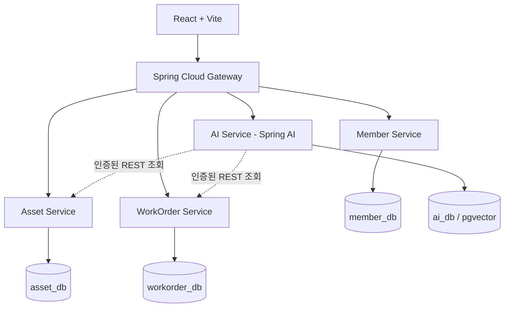
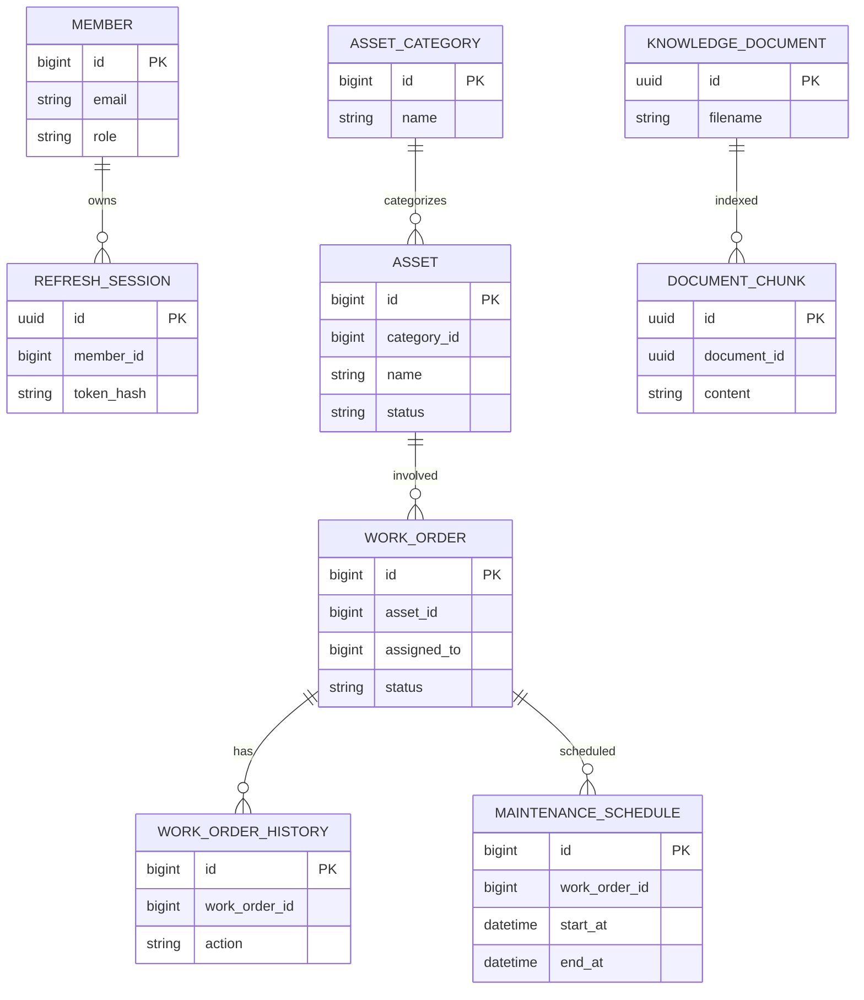

# FixOps — 시스템 설계 초안 v0.1

> **AI 기반 설비 유지보수 및 작업 관리 플랫폼**  
> 작성 목적: 5인 팀 신규 프로젝트 선정·범위 협의  
> 개발 기간: 4주(20영업일) · 개발 인원: 5명  
> **기본 설계:** 설비 관리 + 고장 접수 + 작업 지시 + 정기 점검 + Spring AI RAG  
> 상태: 초기 범위 정의(후속 버전과 구분)

## 1. 개요 및 목적

시설 설비의 등록, 고장 신고, 담당자 배정, 작업 처리, 수리 이력을 한곳에서 관리한다. 관리자는 작업 현황을 확인하고, 작업자는 설비 매뉴얼을 AI로 검색하여 점검을 지원받는다. 산업별 특화, 부품 재고, 예약 확대는 추후 협의할 확장 후보였다.

### 4주 MVP

| 영역 | 필수 범위 | 제외/후순위 |
|---|---|---|
| 인증 | 로그인·JWT·역할 | 조직 초대·SSO |
| 설비 | 설비 등록·수정·상태 조회 | 복잡한 위치 계층 |
| 고장 | 신고→배정→진행→완료·이력 | 다단계 SLA |
| 점검 | 기본 점검 일정 | 충돌 복합 최적화 |
| AI | 매뉴얼 업로드·RAG 질의응답 | Python ML·다중 Agent |
| 운영 | Docker·GitHub CI·통합 시연 | 클라우드 운영 자동화 |

## 2. 사용자·역할

| 역할 | 주요 권한 |
|---|---|
| ADMIN | 설비·회원·담당자·작업 관리 |
| TECHNICIAN | 배정 작업·점검·완료 보고 |
| USER | 고장 신고 및 본인 신고 조회 |

## 3. MSA 서비스

| 서비스 | 책임 | 기본 DB |
|---|---|---|
| Gateway | JWT 검증·라우팅 | 없음 |
| Member | 사용자·역할·Refresh Session | member_db |
| Asset | 설비 정보·상태·유형 | asset_db |
| WorkOrder | 고장·작업·이력·점검 일정 | workorder_db |
| AI | Spring AI ChatClient, RAG·문서 검색 | ai_db |

## 공통 기술 및 데이터 규약

- Java 21, Spring Boot, Spring Data JPA, Spring Security, PostgreSQL 16, Flyway
- React 19 + Vite, Axios, Docker Compose, Nginx, GitHub Actions
- Gateway에서 외부 요청 라우팅; 서비스별 DB 및 접근 계정 분리
- 서로 다른 서비스 DB에 물리적 외래 키 생성 금지. 서비스 내부 API로 소유 데이터 조회
- 시간: PostgreSQL `TIMESTAMPTZ` ↔ Java `Instant` ↔ REST ISO 8601 UTC (`Z`)
- JWT RS256: Member Service 개인키 발급, Gateway 공개키 검증; 서비스별 인가 재검증
- 외부 주입 `X-Member-Id`, `X-User-Role`, `X-Organization-Id` 같은 신원 헤더는 신뢰하지 않고 제거/재생성. 내부 서비스 호출도 별도 서비스 인증 필요
- API 실패 시 4xx/5xx 상태코드와 공통 오류 응답; 멱등성 키와 재시도 정책 명시

## 4. 논리적 ERD

> 다이어그램에서 다른 서비스 간 선은 논리적 관계다. `asset_id` 등은 서비스 간 FK를 생성하지 않는다.

## 5. 대표 API

| Method | Endpoint | 기능 |
|---|---|---|
| POST | `/api/members/login` | 로그인 |
| POST | `/api/members/refresh` | 토큰 갱신 |
| GET/POST | `/api/assets` | 설비 목록·등록 |
| PATCH | `/api/assets/{id}` | 설비 수정 |
| POST | `/api/work-orders` | 고장 접수 |
| POST | `/api/work-orders/{id}/assign` | 작업자 배정 |
| POST | `/api/work-orders/{id}/start` | 작업 시작 |
| POST | `/api/work-orders/{id}/complete` | 작업 완료 |
| GET/POST | `/api/schedules` | 점검 일정 조회·생성 |
| POST | `/api/ai/chat` | 매뉴얼 RAG 질문 |
| POST | `/api/ai/documents` | 설비 매뉴얼 등록 |

작업 상태는 `REPORTED → ASSIGNED → IN_PROGRESS → COMPLETED`, 취소 상태는 `CANCELLED`로 정의한다.

## 6. 프론트엔드

- 로그인, 관리자 대시보드, 설비 목록·상세, 고장 신고, 작업 목록·상세, AI 점검 지원, 간단한 사용자 관리
- `frontend/src/{app,api,components,features,styles}` 중심 구조
- `features/member`, `features/asset`, `features/workorder`, `features/ai`
- 공통 Axios·라우터·인증 가드 사용. 스타일은 후속 단계에서 규약 확정

## 7. 초기 5인 업무분장

| 담당 | 업무 담당 | AI 참여 |
|---|---|---|
| 팀장 | Gateway·인프라·공통 프론트·통합 | ChatClient·공통 AI API |
| A | Member·인증·권한 | AI 사용자 컨텍스트 |
| B | Asset Service | 문서 RAG·설비 Tool |
| C | WorkOrder·점검 일정 | 작업 이력 Tool |
| D | AI Service 지원·검색 UI | AI 검색·답변 통합 |

> 이 분장은 초기안이다. v0.2에서 부품 재고·예약·산업 선택을 본격 도입하고 AI 공동 개발 역할을 재편한다.

## 8. 4주 WBS

| 주차 | 개발 내용 | 종료 조건 |
|---|---|---|
| 1주차 | 요구사항·ERD·Gateway·Member·설비 CRUD | 로그인·설비 등록 |
| 2주차 | 작업 지시·점검 일정·AI 문서 색인 | 고장→배정·문서 검색 |
| 3주차 | Spring AI RAG·이력 조회·통합 | 작업 완료·RAG 응답 |
| 4주차 | 권한·회귀 테스트·문서·시연 | Compose 전체 실행 |

## 9. 핵심 시연

관리자 로그인 → 설비 등록 → 일반 사용자 고장 신고 → 작업자 배정 → AI 매뉴얼 검색 → 조치·작업 완료 → 대시보드 이력 확인.

## 10. 다음 버전 협의 사항

- 재고 사용 기능과 예약 관리 범위를 어떻게 추가할 것인가?
- `BUILDING` / `FACTORY` 산업 선택 여부와 시연 도메인
- 5명 모두 AI 개발에 직접 기여하는 책임 분할
- 4주 안에 업무 범위를 어디까지 제한할 것인가?
