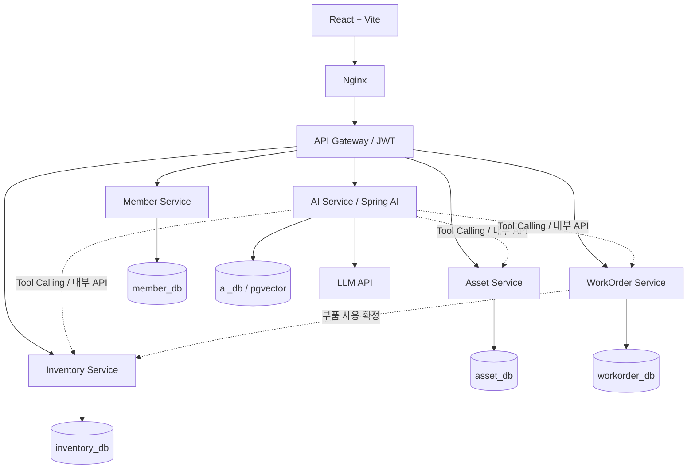
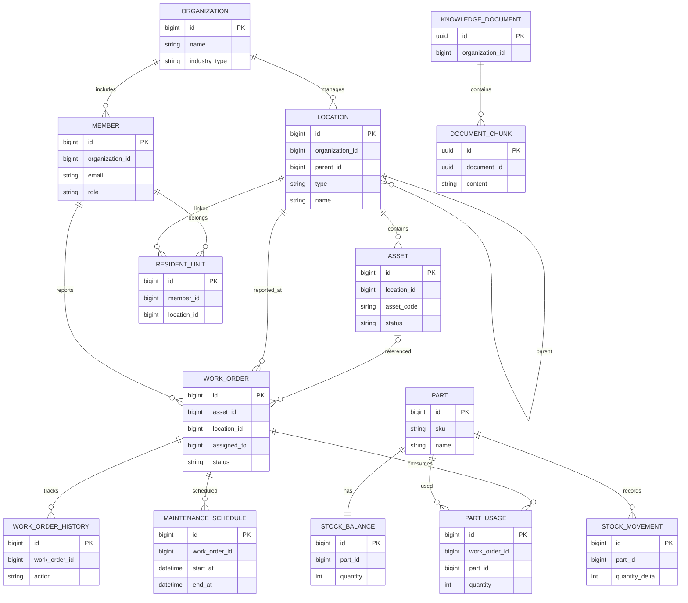

# FixOps — 통합 시스템 설계 초안 v0.2

> **AI 기반 시설·설비 유지보수 및 운영 관리 플랫폼**  
> 개발 기간: 4주(20영업일) · 개발 인원: 5명  
> 기본 시연 분야: 아파트 시설 유지보수 · 선택 산업: 건물 시설 관리 / 공장 설비 관리  
> 아키텍처: Spring Boot + JPA + React + Vite 기반 MSA  
> 문서 상태: 팀원 협의용 설계 초안

---

## 1. 프로젝트 개요

### 1.1 프로젝트 목적

FixOps는 아파트, 일반 건물, 공장 등에서 발생하는 시설 고장 신고와 유지보수 업무를 통합 관리하기 위한 플랫폼이다.

시설 이용자는 고장을 신고하고 처리 현황을 확인할 수 있으며, 관리자는 작업자를 배정하고 수리 일정을 관리한다. 작업자는 부품 재고를 확인하고 AI를 통해 점검 정보를 검색한 후 유지보수 작업 결과를 등록한다.

개선하려는 문제는 다음과 같다.

- 고장 신고 및 작업 처리 과정에서 정보 누락
- 시설별 유지보수 이력 관리의 어려움
- 작업자 일정 및 방문 예약의 중복
- 부품 재고 파악 및 사용 이력 관리의 어려움
- 과거 수리 사례 및 설비 매뉴얼 검색의 비효율성

### 1.2 개발 범위

**필수 기능**

1. 사용자 인증 및 권한 관리
2. 산업 유형 선택
3. 시설 및 설비 관리
4. 고장 신고 및 작업 지시
5. 점검·방문 예약 관리
6. 유지보수 부품 재고 관리
7. AI 설비 점검 지원
8. 관리자 대시보드

**확장 기능**

- Python 기반 설비 이상 탐지
- IoT 센서 연동
- 부품 발주 자동화
- 고급 일정 최적화
- 장기수선계획 및 설비 수명 예측

---

## 2. 산업별 운영 모델

### 2.1 건물 시설 관리 — 기본 시연

대표 적용 대상은 아파트 단지다.

**관리 대상**

- 아파트 단지와 동·호수
- 입주민 계정
- 공용 설비
- 세대별 고장 신고
- 시설관리 직원
- 방문 수리 일정
- 유지보수 부품

**예시 업무**  
105동 1203호 입주민이 욕실 누수를 신고하면 관리사무소가 작업자를 배정하고 방문 일정을 등록한 후 수리를 진행한다. 수리에 사용한 부품은 재고에서 차감되고, 작업 이력과 처리 결과는 시스템에 기록된다.

### 2.2 공장 설비 관리 — 선택 운영

**관리 대상**

- 공장 및 작업 구역
- 생산 설비
- 정비 작업자
- 설비 고장 신고
- 정기 점검 일정
- 예비 부품 재고

**예시 업무**  
생산라인의 모터 고장이 신고되면 관리자가 정비 작업자를 배정하고 정비 시간을 예약하며, 필요한 베어링과 벨트의 재고를 확인한다.

### 2.3 공통 설계 원칙

두 산업은 동일한 서비스 구조를 사용한다.

| 공통 도메인 | 아파트 | 공장 |
|---|---|---|
| Organization | 관리 단지 | 공장 운영 조직 |
| Location | 동·호수·공용시설 | 공장동·구역·라인 |
| Asset | 펌프·전기·공조 설비 | 모터·컨베이어·압축기 |
| WorkOrder | 민원·수리 작업 | 고장·정비 작업 |
| Schedule | 방문 수리 예약 | 정비 일정 예약 |
| Inventory | 전구·밸브·필터 | 베어링·벨트·윤활유 |
| AI | 시설 점검 지원 | 설비 정비 지원 |

산업 유형은 `organization.industry_type`으로 구분한다. MVP에서는 산업에 따라 기본 카테고리와 화면 용어를 변경하고, 업무 처리 구조는 공통으로 유지한다.

---

## 3. MSA 아키텍처

### 3.1 서비스 구성

| 서비스 | 포트 | 주요 책임 | DB |
|---|---:|---|---|
| Gateway | 8080 | JWT 검증, 라우팅 | 없음 |
| Member Service | 8081 | 회원·조직·권한 | `member_db` |
| Asset Service | 8082 | 시설·설비·위치 관리 | `asset_db` |
| WorkOrder Service | 8083 | 고장 신고·작업·예약 | `workorder_db` |
| Inventory Service | 8084 | 부품·재고·사용 이력 | `inventory_db` |
| AI Service | 8085 | RAG·Tool Calling·AI 대화 | `ai_db` |

각 서비스는 별도의 논리적 데이터베이스를 사용한다. 서비스 간 데이터 접근은 인증된 내부 API를 통하며, 다른 서비스 소유 테이블에 직접 접근하지 않는다.

### 3.2 기술 스택

**Frontend:** React 19, Vite, React Router, Axios, Tailwind CSS, SCSS  
**Backend:** Java 21, Spring Boot, Spring Data JPA, Spring Security, Spring Cloud Gateway, Flyway  
**AI:** Spring AI, LLM API, PostgreSQL pgvector, RAG, Tool Calling  
**Infrastructure:** PostgreSQL 16, Docker Compose, Nginx, GitHub Actions

Spring Boot, Spring Cloud, Spring AI는 실제 개발 착수 시 상호 호환되는 버전 조합으로 고정한다.

---

## 4. 사용자 및 권한

### 4.1 사용자 역할

| 역할 | 아파트 | 공장 |
|---|---|---|
| `ADMIN` | 관리사무소 관리자 | 공장 관리자 |
| `TECHNICIAN` | 시설관리 직원 | 설비 정비 작업자 |
| `USER` | 입주민 | 일반 직원·신고자 |

### 4.2 주요 권한

**ADMIN**
- 사용자 및 조직 관리
- 설비 등록·수정
- 고장 신고 조회 및 작업자 배정
- 점검 일정·부품 재고 관리
- 전체 대시보드 조회

**TECHNICIAN**
- 배정 작업 조회 및 시작·완료 보고
- 점검 일정 조회
- 부품 사용 등록
- AI 점검 지원

**USER**
- 고장 신고
- 본인 신고 내역 조회
- 방문 가능 시간 확인
- 수리 진행 상태 조회

아파트 입주민은 자신과 연결된 세대의 신고 내역만 조회할 수 있어야 한다.

---

## 5. 핵심 데이터 모델

### 5.1 Member DB

**`organization`**: `id`, `name`, `industry_type`, `created_at`  
**`member`**: `id`, `organization_id`, `email`, `password_hash`, `name`, `role`, `status`  
**`resident_unit`**: `id`, `member_id`, `unit_id`, `status`  
**`refresh_session`**: `id`, `member_id`, `token_hash`, `expires_at`

`resident_unit.unit_id`는 Asset Service의 위치(세대) ID를 논리적으로 참조한다.

### 5.2 Asset DB

**`location`**: `id`, `organization_id`, `parent_id`, `location_type`, `code`, `name`  
위치 계층 예: `아파트 단지 → 105동 → 1203호` / `공장 → 생산동 → 1라인`

**`asset_category`**: `id`, `industry_type`, `name`  
**`asset`**: `id`, `organization_id`, `location_id`, `category_id`, `asset_code`, `name`, `status`, `description`, `created_at`

공용 설비는 Asset으로 등록한다. 세대 내 일회성 고장은 별도 설비 등록 없이 Location을 참조할 수 있도록 한다.

### 5.3 WorkOrder DB

**`work_order`**: `id`, `organization_id`, `asset_id`(nullable), `location_id`, `reported_by`, `assigned_to`, `title`, `description`, `priority`, `status`, `created_at`, `completed_at`  
**`work_order_history`**: `id`, `work_order_id`, `changed_by`, `previous_status`, `new_status`, `description`, `created_at`  
**`maintenance_schedule`**: `id`, `work_order_id`, `technician_id`, `start_at`, `end_at`, `status`

작업 상태: `REPORTED → ASSIGNED → IN_PROGRESS → COMPLETED`  
추가 종료 상태: `CANCELLED`

### 5.4 Inventory DB

**`part`**: `id`, `organization_id`, `sku`, `name`, `category`, `unit`, `safety_stock`  
**`stock_balance`**: `id`, `part_id`, `quantity`, `version`  
**`stock_movement`**: `id`, `part_id`, `quantity_delta`, `movement_type`, `reference_id`, `idempotency_key`, `created_at`  
**`part_usage`**: `id`, `work_order_id`, `part_id`, `quantity`, `created_at`

MVP는 단일 재고 위치를 기본으로 한다.

### 5.5 AI DB

**`knowledge_document`**: `id`, `organization_id`, `industry_type`, `asset_category_id`, `filename`, `status`  
**`document_chunk`**: `id`, `document_id`, `content`, `embedding`  
**`ai_conversation`**: `id`, `organization_id`, `member_id`, `created_at`  
**`ai_message`**: `id`, `conversation_id`, `role`, `content`, `created_at`

### 5.6 통합 개념 ERD

아래 ERD의 서비스 간 관계는 논리적 참조이다. 서로 다른 서비스 DB에 실제 FK를 생성하지 않는다.

---

## 6. 핵심 업무 흐름

### 6.1 고장 신고

1. `USER` 로그인
2. 시설 위치 선택
3. 고장 유형 및 증상 입력
4. WorkOrder 생성
5. 상태 `REPORTED`

### 6.2 작업 배정

1. `ADMIN`이 미배정 작업 조회
2. 담당 `TECHNICIAN` 지정
3. WorkOrder 상태 변경
4. 작업자 화면에 배정 작업 표시

### 6.3 방문 예약

1. 관리자 또는 허용된 사용자가 작업 일정 요청
2. 작업자 일정 조회
3. 예약 시간 중복 검사
4. 일정 등록
5. 작업 상세 화면에 예약 정보 표시

### 6.4 AI 점검 지원

1. 작업자가 AI 질문 입력
2. 사용자 및 조직 권한 검증
3. Asset Service에서 설비 정보 조회
4. WorkOrder Service에서 과거 작업 이력 조회
5. Inventory Service에서 부품 정보 조회
6. RAG에서 매뉴얼 검색
7. AI가 근거를 포함한 점검 참고 답변 제공

### 6.5 부품 사용 및 작업 완료

1. 작업자가 사용 부품·수량 입력
2. Inventory Service에서 재고 확인
3. 재고 차감 및 사용 이력 생성
4. WorkOrder Service에서 작업 완료 기록
5. 관리자 및 신고자가 완료 상태 확인

재고 차감 요청에는 멱등성 키를 사용하고, 서비스 간 응답 실패 시 중복 차감을 방지한다.

---

## 7. 핵심 API

### 7.1 Member

- `POST /api/members/login` — 로그인
- `POST /api/members/refresh` — 토큰 갱신
- `GET /api/members/me` — 내 정보
- `GET /api/members` — 회원 목록
- `PATCH /api/organizations/current/industry` — 산업 유형 변경

### 7.2 Asset

- `GET /api/assets` — 설비 목록
- `POST /api/assets` — 설비 등록
- `GET /api/assets/{id}` — 설비 상세
- `PATCH /api/assets/{id}` — 설비 수정
- `GET /api/locations` — 위치 목록
- `POST /api/locations` — 위치 등록
- `GET /api/assets/categories` — 설비 분류 목록

### 7.3 WorkOrder

- `GET /api/work-orders` — 작업 목록
- `POST /api/work-orders` — 고장 신고
- `GET /api/work-orders/{id}` — 작업 상세
- `POST /api/work-orders/{id}/assign` — 담당자 배정
- `POST /api/work-orders/{id}/start` — 작업 시작
- `POST /api/work-orders/{id}/complete` — 작업 완료
- `GET /api/schedules` — 일정 목록
- `POST /api/schedules` — 점검 예약

### 7.4 Inventory

- `GET /api/inventory/parts` — 부품 목록
- `POST /api/inventory/parts` — 부품 등록
- `POST /api/inventory/receipts` — 부품 입고
- `POST /api/inventory/usages` — 부품 사용 확정
- `GET /api/inventory/movements` — 재고 이력

### 7.5 AI

- `POST /api/ai/chat` — AI 질의응답
- `POST /api/ai/chat/stream` — AI 스트리밍
- `POST /api/ai/documents` — 매뉴얼 업로드
- `GET /api/ai/documents` — 문서 목록

서비스 내부 통신 API는 외부 API와 분리하며 서비스 인증과 조직 접근권한 검사를 적용한다.

---

## 8. 프론트엔드 화면

| 화면 | 주요 기능 |
|---|---|
| 로그인 | 사용자 인증 |
| 산업 선택 | 건물 / 공장 설정 |
| 관리자 대시보드 | 고장·작업·설비·재고 통계 |
| 위치 관리 | 동·호수 또는 공장 구역 |
| 설비 관리 | 설비 목록 및 상세 |
| 고장 신고 | 위치·증상 입력 |
| 작업 관리 | 배정, 상태 변경, 완료 |
| 예약 캘린더 | 점검 및 수리 일정 |
| 재고 관리 | 부품 등록, 입고, 차감 |
| AI 점검센터 | 매뉴얼·고장 이력 검색 |

**UI 기본 구성**

- 상단: 서비스명, 알림, 사용자 메뉴
- 좌측: 대시보드·설비·작업·예약·재고·AI 메뉴
- 중앙: 업무별 목록·상세 화면
- 우측 또는 모달: AI 점검 지원 패널

산업 유형에 따라 메뉴 명칭과 등록 폼의 일부 항목을 변경한다.

---

## 9. AI 공동 개발 업무분장

| 담당 | 주력 서비스 | AI 개발 담당 |
|---|---|---|
| 팀장 | Gateway·통합 | ChatClient·AI API·Tool 통합 |
| A | Member | 사용자 권한·산업 컨텍스트 |
| B | Asset | 매뉴얼 RAG·설비 정보 Tool |
| C | WorkOrder | 작업 이력·예약 Tool |
| D | Inventory | 부품 재고 조회 Tool |

AI Service는 하나로 유지하며 AI 관련 코드는 기능별 패키지로 분할한다. 모든 AI Tool은 읽기 전용 조회를 기본으로 구현한다. 실제 재고 차감이나 작업 승인 등 변경 작업은 기존 업무 API에서 권한 검사와 사용자 확인을 거쳐야 한다.

---

## 10. 4주 개발 WBS

| 주차 | 팀장 | A | B | C | D |
|---|---|---|---|---|---|
| 1주차 | Gateway·Docker·공통 프론트 | Member·산업 선택 | Asset CRUD | WorkOrder·예약 기반 | Inventory CRUD |
| 2주차 | AI ChatClient | AI 사용자 컨텍스트 | RAG 문서 색인 | 작업·예약 UI 및 Tool | 재고 차감 및 Tool |
| 3주차 | AI 전체 통합 | 권한·산업 컨텍스트 통합 | RAG·Asset Tool | WorkOrder·예약 연동 | 재고 Tool·업무 연동 |
| 4주차 | CI·통합 테스트·발표 | 인증·권한 테스트 | RAG·설비 검증 | 예약·상태 전이 검증 | 재고 정합성 검증 |

**주차별 완료 기준**

- **1주차:** 개발환경과 API 계약 확정, 기본 로그인 및 주요 CRUD 연결
- **2주차:** 고장 신고, 작업 배정, 점검 예약, 부품 입출고의 핵심 기능 구현
- **3주차:** AI RAG 및 Tool Calling을 포함한 전체 업무 흐름 연결
- **4주차:** 오류 수정, 테스트, 문서 및 최종 발표 준비

---

## 11. 개발 우선순위

### P0 — 필수 기능

- 로그인·권한
- 산업 유형 선택
- 위치 및 설비 관리
- 고장 신고·작업 배정·완료
- 방문·점검 예약
- 부품 재고 관리
- Docker 통합

### P1 — AI 핵심

- Spring AI ChatClient
- 매뉴얼 RAG
- Asset·WorkOrder·Inventory Tool Calling
- 사용자·조직별 AI 접근 제어
- AI 답변 근거 표시

### P2 — 후속 확장

- Python 머신러닝
- IoT
- 자동 발주
- 고급 일정 추천
- 입주민 알림 시스템
- 유지보수 비용 분석

---

## 12. 최종 시연 기준

1. 아파트 관리자가 로그인한다.
2. 105동 및 1203호를 등록하거나 조회한다.
3. 입주민이 욕실 누수를 신고한다.
4. 관리자가 시설관리 직원을 배정한다.
5. 방문 수리 일정을 예약한다.
6. 작업자가 AI로 점검 지침을 검색한다.
7. 수리에 필요한 부품 재고를 확인한다.
8. 작업자가 실제 사용 부품을 등록한다.
9. 부품 재고가 차감된다.
10. 작업 완료 후 이력이 저장된다.
11. 관리자가 대시보드에서 처리 현황을 확인한다.

추가 시연: `FACTORY` 유형의 테스트 조직에서 동일한 업무 구조가 공장 모터 정비에도 적용되는 것을 보여준다.

---

## 13. 설계 확정 전 검토 사항

1. 동·호수 정보의 생성과 소유권은 Asset Service에서 관리할 것인가?
2. 입주민 계정은 관리자가 발급할 것인가, 초대 방식으로 가입할 것인가?
3. 방문 예약은 관리자 확정 방식으로 할 것인가?
4. 작업 완료와 부품 차감을 하나의 사용자 흐름으로 연결할 것인가?
5. 산업 유형은 조직 생성 후 변경을 허용할 것인가?
6. 설비 매뉴얼은 PDF 업로드를 필수로 지원할 것인가?
7. AI에서 작업 이력 및 재고 정보를 어디까지 조회할 수 있게 할 것인가?

### 제안 결론

**FixOps v0.2는 아파트 유지보수를 주요 실증 시나리오로 사용하되, 건물·공장 설비를 공통적으로 관리할 수 있는 MSA 플랫폼으로 개발한다.**

4주 동안 설비 관리·고장 접수·점검 예약·부품 재고·AI 점검 지원의 핵심 기능을 우선 구현하며, 팀원 5명이 각각 독립적인 AI 개발 결과물을 가지도록 한다.

최종 개발 목표는 다양한 시설에 공통 적용 가능한 데이터 구조를 기반으로 유지보수 업무의 전체 흐름을 정상적으로 처리하는 시스템을 완성하는 것이다.

---

## 14. 추가 설계 보완 권장 사항

- **위치 계층 통합:** 아파트 동·호수와 공장 구역·라인은 `location` 계층 모델로 공통 처리한다.
- **산업 유형 변경 정책:** MVP에서는 조직 생성 후 산업 유형을 고정하는 편이 기존 데이터와의 충돌을 예방한다. 7.1의 산업 변경 API는 관리자 전용이며, MVP에서는 비활성화하거나 초기 설정에만 사용한다.
- **신고와 설비의 분리:** 세대 누수처럼 개별 설비가 없는 신고도 허용하기 위해 `work_order.asset_id`는 nullable이다.
- **분산 트랜잭션:** 작업 완료와 부품 차감의 중복 처리를 막기 위해 `idempotency_key`와 재시도·결과 조회 방안을 마련한다.
- **4주 성공 전략:** 아파트 모드의 전체 업무 흐름을 우선 완성하고, 공장 모드는 공통 구조와 템플릿 적용을 검증하는 데 집중한다.
- **시간 표준:** PostgreSQL `TIMESTAMPTZ` ↔ Java `Instant` ↔ API ISO 8601 UTC `Z`를 사용한다.
