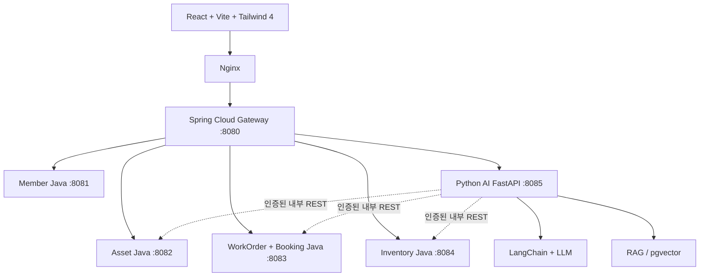
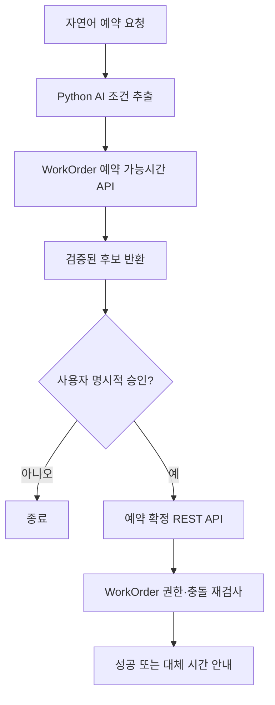

# FixOps — 통합 시스템 설계 초안 v0.3

> **Python AI 전환 + 자연어 예약 연계 + Tailwind CSS 통일**  
> 개발 기간: 4주(20영업일) · 개발 인원: 5명  
> 기본 시연: 아파트 유지보수 · 선택 산업: `BUILDING` / `FACTORY`  
> 상태: 기술 전환·협업 구조 협의용

## 0. 변경 이력(v0.2 → v0.3)

| 항목 | v0.2 | v0.3 |
|---|---|---|
| AI 프레임워크 | Java Spring AI | Python FastAPI + LangChain |
| AI 도구 | Java `@Tool` | Python Tool Calling |
| RAG | Spring AI + pgvector | Python 문서 처리·임베딩 + pgvector |
| 예약 | 수동 일정 등록·조회 | AI 가능시간 조회·추천·사용자 승인 후 예약 연계 추가 |
| 프론트 스타일 | 스타일 혼합 허용 가능 | **Tailwind CSS 4 일원화**, SCSS 신규 금지 |
| Java MSA | Member, Asset, WorkOrder, Inventory | 동일 |

## 1. 목표 및 범위

FixOps는 아파트 동·호수·공용설비 또는 공장 구역·생산설비에서 발생하는 고장 접수, 작업 배정, 방문·점검 일정 예약, 유지보수 부품 재고 관리를 통합한다. Python AI Service는 매뉴얼 RAG와 업무 데이터 조회 및 자연어 예약을 지원한다.

**P0:** 인증, 산업 선택, 위치·설비 CRUD, 고장 신고·배정·완료, 기본 예약·충돌 검사, 부품 입고·사용 차감, FastAPI 채팅, RAG, 업무 조회 Tool, Docker 통합.

**P1:** SSE·대화 이력·추가 UI 개선. **P2:** Python ML 예지보전, IoT, 다중 Agent, 자동 발주.

## 2. 기술 아키텍처



| 서비스 | DB | 독점적 소유 영역 |
|---|---|---|
| Member | member_db | 회원·조직·역할·산업 유형·세대 연결 |
| Asset | asset_db | 위치 계층·설비·설비 유형 |
| WorkOrder | workorder_db | 고장 신고·작업 이력·예약·예약 확정 |
| Inventory | inventory_db | 부품·재고·사용 원장 |
| AI(FastAPI) | ai_db | 매뉴얼 인덱스·대화·Tool 실행 이력(선택) |


## 공통 기술 및 데이터 규약

- Java 21, Spring Boot, Spring Data JPA, Spring Security, PostgreSQL 16, Flyway
- React 19 + Vite, Axios, Docker Compose, Nginx, GitHub Actions
- Gateway에서 외부 요청 라우팅; 서비스별 DB 및 접근 계정 분리
- 서로 다른 서비스 DB에 물리적 외래 키 생성 금지. 서비스 내부 API로 소유 데이터 조회
- 시간: PostgreSQL `TIMESTAMPTZ` ↔ Java `Instant` ↔ REST ISO 8601 UTC (`Z`)
- JWT RS256: Member Service 개인키 발급, Gateway 공개키 검증; 서비스별 인가 재검증
- 외부 주입 `X-Member-Id`, `X-User-Role`, `X-Organization-Id` 같은 신원 헤더는 신뢰하지 않고 제거/재생성. 내부 서비스 호출도 별도 서비스 인증 필요
- API 실패 시 4xx/5xx 상태코드와 공통 오류 응답; 멱등성 키와 재시도 정책 명시

- Python은 timezone-aware `datetime` 사용. AI 테이블 마이그레이션은 Alembic, Java 테이블은 Flyway로 관리

## 3. 핵심 데이터 모델

| DB | 테이블 | 주요 컬럼 |
|---|---|---|
| member | organization | id, name, industry_type |
| member | member | id, organization_id, email, role |
| member | resident_unit | id, member_id, location_id(논리 참조) |
| asset | location | id, organization_id, parent_id, location_type, code |
| asset | asset_category | id, industry_type, name |
| asset | asset | id, location_id, category_id, asset_code, status |
| workorder | work_order | id, organization_id, asset_id(nullable), location_id, assigned_to, status |
| workorder | work_order_history | id, work_order_id, previous_status, new_status |
| workorder | maintenance_schedule | id, work_order_id, technician_id, start_at, end_at, status |
| inventory | part | id, organization_id, sku, name, safety_stock |
| inventory | stock_balance | id, part_id, quantity, version |
| inventory | stock_movement | id, part_id, quantity_delta, idempotency_key |
| inventory | part_usage | id, work_order_id, part_id, quantity, operation_key |
| ai | knowledge_document | id, organization_id, asset_category_id, filename |
| ai | document_chunk | id, document_id, content, embedding, page_number |
| ai | ai_conversation/ai_message | 대화·메시지 식별 및 이력 |

아파트 위치는 단지→동→호수, 공장은 공장→구역→라인으로 같은 `location` 계층을 사용한다. 세대 고장 신고는 `asset_id = null` 가능하다.

## 4. 자연어 예약 프로세스



- AI는 임의 시간 확정 금지. 실제 가능 여부는 WorkOrder가 계산
- 사용자가 승인한 예약 후보만 확정 API로 전달; 생성 시 중복 검사 재실행
- 예약은 작업자별 시간 중복 방지부터 구현하며, 동시 요청에 대해서도 DB 제약/잠금으로 검증
- 예약 생성·수정은 AI 내부의 무제한 Tool 실행이 아니라 명시적 사용자 승인 액션으로 제한

## 5. API 계약

| Method | API | 기능 |
|---|---|---|
| POST | `/api/members/login` | 로그인 |
| GET | `/api/members/me` | 현재 사용자 |
| GET/POST | `/api/assets` | 설비 조회/등록 |
| GET/POST | `/api/locations` | 위치 조회/등록 |
| POST | `/api/work-orders` | 고장 신고 |
| POST | `/api/work-orders/{id}/assign` | 작업자 배정 |
| POST | `/api/work-orders/{id}/complete` | 작업 완료 |
| GET | `/api/schedules/availability` | 예약 가능시간 조회 |
| POST | `/api/schedules` | 실제 예약 생성 |
| GET/POST | `/api/inventory/parts` | 부품 조회/등록 |
| POST | `/api/inventory/receipts` | 입고 |
| POST | `/api/inventory/usages` | 부품 사용 차감 |
| POST | `/api/ai/chat` | AI 채팅 |
| POST | `/api/ai/documents` | 문서 업로드 |
| POST | `/api/ai/booking/suggestions` | AI 예약 후보 추천 |
| POST | `/api/ai/booking/confirm` | 사용자 확인 후 예약 생성 위임 |

## 6. Python AI 디렉터리(소유 책임)

```text
ai-service/
├── app/
│   ├── main.py                     # 공통 AI 통합
│   ├── api/chat.py                 # 채팅 API
│   ├── api/booking.py              # 예약 흐름
│   ├── core/llm.py                 # 모델 연결
│   ├── core/security.py            # RS256 JWT 검증
│   ├── context/user_context.py     # 권한·산업 컨텍스트
│   ├── rag/indexer.py              # 매뉴얼 인덱싱
│   ├── rag/retriever.py            # 매뉴얼 검색
│   ├── tools/asset.py              # 설비 정보 Tool
│   ├── tools/workorder.py          # 작업 이력 Tool
│   ├── tools/booking.py            # 예약 조회·후보 Tool
│   ├── tools/inventory.py          # 부품 조회 Tool
│   └── clients/                   # Java REST 클라이언트
├── tests/
├── alembic/
└── Dockerfile
```

MCP는 **v0.3에서는 아직 필수 구성요소로 채택하지 않음**. 다음 v0.4에서 추가 검토한다.

## 7. 프론트엔드: Tailwind CSS 4 단일 체계

- `src/styles/index.css`에 `@import "tailwindcss"` 및 `@theme` 토큰을 통합
- 컴포넌트 스타일은 Tailwind 유틸리티·공통 React UI 컴포넌트로 구현
- SCSS, CSS Modules 신규 도입 금지. 전역 CSS는 Tailwind 진입점과 최소 리셋/기본 규칙만 허용
- 공통 UI: Button, Input, Modal, Table, StatusBadge, FormField, Header, Sidebar
- 기능별 UI: 로그인·산업 선택·설비·고장/작업·예약 캘린더·재고·AI 채팅

```css
@import "tailwindcss";
@theme {
  --color-fixops-primary: #0d9488;
  --color-fixops-background: #f8fafc;
  --color-fixops-text: #0f172a;
  --color-fixops-border: #e2e8f0;
}
```

## 8. 5인 공동 AI 개발 임시 분담

| 담당 | Java·React | Python AI 기여 |
|---|---|---|
| 팀장 | Gateway·공통 프론트·Docker | FastAPI·LLM·도구 통합 |
| A | Member·산업 선택 | JWT·권한·산업 컨텍스트 |
| B | Asset | 문서 RAG·Asset Tool |
| C | WorkOrder·예약 | 작업·예약 Tool |
| D | Inventory | 부품·재고 Tool |

> 이 표는 v0.3 단계 분장이다. **v0.4에서 팀장이 Member를 통합 소유하고 A/B/C/D가 재배치**된다.

## 9. 4주 WBS

| 주차 | 백엔드·업무 | Python AI | React/Tailwind | 검수 기준 |
|---|---|---|---|---|
| 1주차 | 인증·설비·작업·재고 API 골격 | FastAPI, 인증·Tool 계약 | 토큰·레이아웃 | LLM 및 기본 API 호출 |
| 2주차 | 신고·배정·예약·입고·차감 | RAG·읽기 Tool·예약 후보 | 각 기능 페이지 | 개별 기능 성공 |
| 3주차 | 서비스 실제 연동 | RAG·Tool·자연어 예약 통합 | 화면과 API 연결 | E2E 시나리오, 기능 동결 |
| 4주차 | 재고 정합성·예약 충돌·보안 | 문서 출처·조직 격리·오류 | 반응형·QA | 최종 시연·발표 |

## 10. 시연·검증 항목

- 아파트(105동 1203호) 또는 공장 설비 등록 → 고장 접수 → 작업자 배정
- AI 점검 매뉴얼 출처 표시 및 실제 작업 이력·부품 정보 조회
- AI가 예약 후보 안내 → 사용자가 승인 → WorkOrder가 중복 재검사 후 확정
- 부품 사용 → Inventory 원자적 차감·원장 → 작업 완료
- 조직 간 데이터 격리, 예약 충돌, 재고 중복 차감·음수 재고 차단

## 11. 다음 버전 과제

단일 MCP Server 도입 여부, 도구별 소유권, 팀장의 Member 직접 개발 및 나머지 4인 균형 분배를 확정한다.
