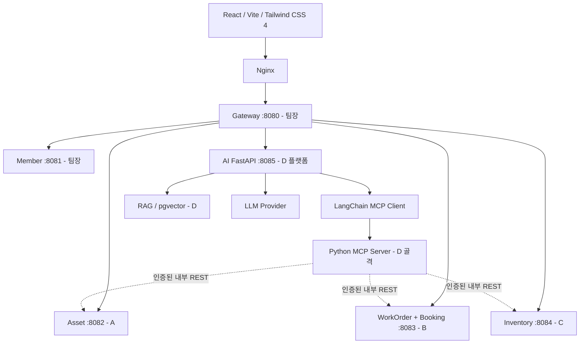
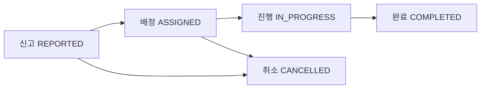

# FixOps — 통합 시스템 설계 초안 v0.4

> **최신 합의 반영: 팀장 Member·산업 선택 / 5인 공동 Python AI·MCP / Tailwind CSS 4**  
> 개발 기간: 4주(20영업일) · 개발 인원: 5명(팀장 + A/B/C/D)  
> 기본 시연: 아파트 유지보수 · 산업 선택: `BUILDING` / `FACTORY`  
> 상태: 개발 착수 전 팀원 협의·API 계약 확정용 (최종 확정 아님)

## 0. 버전 변경(v0.3 → v0.4)

| 주제 | v0.3 | v0.4 |
|---|---|---|
| Java 업무 책임 | 팀장 공통, A Member, B Asset, C WorkOrder, D Inventory | **팀장 Member·Gateway**, A Asset, B WorkOrder·예약, C Inventory, D Python AI 플랫폼 |
| AI Tool | Python LangChain Tool | **단일 Python MCP Server + LangChain MCP Client** |
| AI 직접 기여 | 5인 분산 | **팀장 보안, A Asset, B WorkOrder·Booking, C Inventory, D LLM·RAG·MCP 플랫폼** |
| 예약 | AI 후보 추천·승인 확정 | 동일. **예약 DB는 WorkOrder 소유**, MCP는 기본 조회 전용 |
| CSS | Tailwind CSS 4 단일 체계 | 동일, 공통 UI 소유권 팀장 |
| 기간 | 4주 | 4주, D15 기능 동결 |

## 1. 목적 및 MVP 경계

설비 유지보수(신고·배정·예약·수리 완료)를 중심으로, 수리 부품의 재고·사용 기록과 AI 매뉴얼 검색·업무 조회·자연어 예약 추천을 연결한다.

- **건물 모드:** 아파트 단지 → 동 → 호수, 공용설비 및 세대 고장 신고
- **공장 모드:** 공장 → 구역 → 라인, 생산설비 정비 신고
- **P0:** 인증·산업 선택·설비 CRUD·고장·작업·예약·재고 차감·RAG·MCP 조회 Tool·Docker 통합
- **P1:** AI 예약 자연어 후보 추천 + 사용자 확인 후 예약 확정 (3주차 여유 따라 완성 목표)
- **P2 제외:** Python ML 예지보전, IoT, 다중 Agent, 자동 발주·자동 작업 승인, SSE 고도화, 대화 이력 고도화

## 2. 서비스 및 개발 소유권



| 서비스 | 책임 | DB | 담당 |
|---|---|---|---|
| Gateway | JWT 검증·라우팅·헤더 정리 | 없음 | 팀장 |
| Member | 회원·조직·산업 유형·입주민 세대 연계·Refresh | member_db | 팀장 |
| Asset | `location` 계층·설비·설비 상태 | asset_db | A |
| WorkOrder | 신고·배정·이력·점검/방문 예약·충돌 검증 | workorder_db | B |
| Inventory | 부품·재고·입고·부품 사용·수량 정합성 | inventory_db | C |
| AI | FastAPI 채팅·LangChain·RAG·MCP Client | ai_db | D (공동 개발) |
| MCP Server | MCP Tool 노출·정책·Java API 브리지 | 업무 DB 미소유 | D 플랫폼 + 팀장/A/B/C 기여 |


## 공통 기술 및 데이터 규약

- Java 21, Spring Boot, Spring Data JPA, Spring Security, PostgreSQL 16, Flyway
- React 19 + Vite, Axios, Docker Compose, Nginx, GitHub Actions
- Gateway에서 외부 요청 라우팅; 서비스별 DB 및 접근 계정 분리
- 서로 다른 서비스 DB에 물리적 외래 키 생성 금지. 서비스 내부 API로 소유 데이터 조회
- 시간: PostgreSQL `TIMESTAMPTZ` ↔ Java `Instant` ↔ REST ISO 8601 UTC (`Z`)
- JWT RS256: Member Service 개인키 발급, Gateway 공개키 검증; 서비스별 인가 재검증
- 외부 주입 `X-Member-Id`, `X-User-Role`, `X-Organization-Id` 같은 신원 헤더는 신뢰하지 않고 제거/재생성. 내부 서비스 호출도 별도 서비스 인증 필요
- API 실패 시 4xx/5xx 상태코드와 공통 오류 응답; 멱등성 키와 재시도 정책 명시

- **MCP는 인증/인가를 대체하지 않는다.** MCP Server 도구 호출 시 서비스 자격증명과 실제 사용자 범위를 확인하고 Java 업무 API에서도 재검증
- 사용자 JWT 전달 방식과 서비스 자격증명은 1주차 API 계약에서 정한다. 원격 MCP는 인증된 HTTP 기반 전송을 사용하고, 무분별한 내부 공개 금지

## 3. 물리 DB 개요 및 소유권

| DB | 테이블 | 주요 컬럼·제약 |
|---|---|---|
| member_db | organization | id, name, `industry_type` BUILDING/FACTORY |
| member_db | member | id, organization_id, email UNIQUE, password_hash, role |
| member_db | resident_unit | id, member_id, location_id(Asset 논리 참조), status |
| member_db | refresh_session | id, member_id, token_hash, revoked_at, expires_at |
| asset_db | location | id, organization_id, parent_id, type, code, name |
| asset_db | asset_category | id, industry_type, name |
| asset_db | asset | id, organization_id, location_id, category_id, asset_code, status |
| workorder_db | work_order | id, organization_id, asset_id nullable, location_id, reported_by, assigned_to, status |
| workorder_db | work_order_history | id, work_order_id, changed_by, previous_status, new_status |
| workorder_db | maintenance_schedule | id, work_order_id, technician_id, start_at, end_at, status |
| inventory_db | part | id, organization_id, sku, name, safety_stock |
| inventory_db | stock_balance | id, part_id UNIQUE, quantity CHECK >= 0, version |
| inventory_db | part_usage | id, work_order_id, part_id, quantity, operation_key UNIQUE |
| inventory_db | stock_movement | id, part_id, delta, idempotency_key UNIQUE, created_at |
| ai_db | knowledge_document | UUID id, organization_id, industry_type, filename, status |
| ai_db | document_chunk | UUID id, document_id, content, embedding, page_number |
| ai_db | ai_conversation/ai_message | UUID id, organization_id, member_id, role/content |

재고 차감과 원장 저장은 Inventory 단일 트랜잭션에서 실행한다. 완료 요청-재고 차감의 분산 실패에는 operationKey를 이용해 결과 확인·재처리한다. 예약 시간 충돌도 동시 요청에서 검사한다.

## 4. 업무 상태 및 핵심 흐름



**아파트 대표 시연:** 105동 1203호 누수 신고 → 관리자 담당자 배정 → 방문 일정 조회·예약 → 기술자 AI 매뉴얼 및 이력 검색 → 부품 재고 확인·사용 차감 → 작업 완료 → 대시보드 이력 확인.

**공장 모드 검증:** 공장 구역·라인과 모터를 등록하고 동일한 흐름으로 작동하는지 확인. 조직 생성 후 산업 변경은 MVP에서 제한.

## 5. API 계약(외부)

| Method | API | 소유·기능 |
|---|---|---|
| POST | `/api/members/login` | Member 로그인 |
| POST | `/api/members/refresh` | Member 토큰 갱신 |
| GET | `/api/members/me` | Member 본인 정보 |
| GET | `/api/organizations/current` | 조직·산업 유형 조회 |
| GET/POST | `/api/locations` | Asset 위치 계층 |
| GET/POST | `/api/assets` | Asset 설비 |
| POST | `/api/work-orders` | WorkOrder 고장 신고 |
| POST | `/api/work-orders/{id}/assign` | WorkOrder 배정 |
| POST | `/api/work-orders/{id}/start` | WorkOrder 작업 시작 |
| POST | `/api/work-orders/{id}/complete` | WorkOrder 완료 |
| GET | `/api/schedules/availability` | WorkOrder 가능 시간 |
| GET/POST | `/api/schedules` | WorkOrder 일정 조회·생성 |
| GET/POST | `/api/inventory/parts` | Inventory 부품 목록·등록 |
| POST | `/api/inventory/receipts` | Inventory 입고 |
| POST | `/api/inventory/usages` | Inventory 부품 사용 확정 |
| POST | `/api/ai/chat` | AI 채팅·RAG·Tool 실행 |
| POST | `/api/ai/documents` | AI 매뉴얼 업로드 |
| POST | `/api/ai/booking/suggestions` | AI 예약 후보 추천 |
| POST | `/api/ai/booking/confirm` | 사용자 확인 후 예약 위임(P1) |

**Java 내부 조회 API**는 `/internal/...` 경로로 별도 제공하고 외부 Gateway에 공개하지 않는다.

## 6. MCP 도구·코드 소유권

| 담당 | Python 직접 구현 | Java API 연동 | 검증 |
|---|---|---|---|
| 팀장 | `security.py`, `user_context.py`, `industry_context.py` | Member, JWT, 조직·세대 접근 범위 | 타 조직·타 세대 차단 |
| A | `tools/asset.py`, `clients/asset_client.py` | Asset 설비·위치 조회 | 권한 있는 설비만 조회 |
| B | `tools/workorder.py`, `tools/booking.py`, `clients/workorder_client.py` | 작업 이력·예약 가능 시간 | 실제 일정·중복 검사 |
| C | `tools/inventory.py`, `clients/inventory_client.py` | 재고·부족 수량 | 원본 재고 일치·오류 응답 |
| D | `main.py`, `api/chat.py`, `core/llm.py`, `rag/*`, `mcp/{server,client,registry}.py` | Tool 등록·RAG·LLM | 여러 Tool 호출·근거 표시 |

**MCP Tool 목록:**
- A: `get_asset_info`, `search_assets`
- B: `get_workorder_history`, `get_available_slots`, `get_booking_details`
- C: `get_part_stock`, `get_low_stock_parts`, `search_parts`
- 팀장: 사용자 조직/산업 컨텍스트 검증 인터페이스(모델이 임의로 변경하는 Tool 아님)
- D: MCP 서버·클라이언트 연결, LangChain 등록, 매뉴얼 RAG, 채팅

**예약 변경 경계:** MCP는 조회·후보 추천만 필수. 실제 예약 확정은 사용자의 명시적 승인을 받은 뒤 일반 WorkOrder API로 수행한다. AI가 임의로 예약 생성할 수 없도록 한다.

## 7. Python AI 디렉터리

```text
ai-service/
├── app/
│   ├── main.py                      # D
│   ├── api/chat.py                  # D
│   ├── api/booking.py               # B+D, 계약은 B 소유
│   ├── core/llm.py                  # D
│   ├── core/security.py             # 팀장
│   ├── context/user_context.py      # 팀장
│   ├── context/industry_context.py  # 팀장
│   ├── rag/indexer.py               # D
│   ├── rag/retriever.py             # D
│   ├── tools/asset.py               # A
│   ├── tools/workorder.py           # B
│   ├── tools/booking.py             # B
│   ├── tools/inventory.py           # C
│   ├── clients/asset_client.py      # A
│   ├── clients/workorder_client.py  # B
│   ├── clients/inventory_client.py  # C
│   └── mcp/
│       ├── server.py               # D
│       ├── client.py               # D
│       └── registry.py             # D
├── tests/
├── alembic/
├── pyproject.toml
└── Dockerfile
```

> 단일 MCP Server는 AI Service와 논리적으로 별개 프로세스로 배포할 수 있으며, 같은 저장소에서 개발 가능하다. transport·사용자 인증·서비스 인증을 통합 테스트한다.

## 8. React + Tailwind CSS 4 개발 표준

| 영역 | 담당 | 규칙 |
|---|---|---|
| 디자인 토큰, Button/Input/Modal/Table, Layout | 팀장 | `src/styles/index.css`의 `@theme` |
| 로그인·조직·산업 설정 | 팀장 | 공통 UI 컴포넌트 |
| Asset·Location·대시보드 | A | Tailwind 유틸리티만 |
| 고장·작업·예약 입력/확정 | B | 캘린더 UI는 A 지원 |
| 부품·재고·이력 | C | 공통 테이블·모달 |
| AI 채팅·매뉴얼 출처 | D | 채팅 프레임 공유 |

SCSS·CSS Modules 신규 도입 금지. Vite 기반 프론트는 공통 Axios 인스턴스·인증 가드를 사용한다.

## 9. 업무량 균형 전략

| 담당 | 주력 업무 | 업무량 보정 |
|---|---|---|
| 팀장 | Member·산업 선택·Gateway·인프라·AI 보안 | EMS 인증·Gateway 코드 재사용, RAG 직접 구현 제외 |
| A | Asset·Location·Asset MCP Tool | 예약 캘린더 표시 UI와 대시보드 지원 |
| B | WorkOrder·예약·Booking MCP Tool | 예약 로직 소유, 캘린더 UI 일부 A에게 위임 |
| C | Inventory·Inventory MCP Tool | 단일 재고 위치·발주 제외, AI 샘플 데이터/검증 보조 |
| D | FastAPI·RAG·MCP·LLM 통합 | Tool 비즈니스 로직은 A/B/C에 위임, SSE는 P1 |

5인 모두 Python AI 관련 Pull Request와 정상·권한/실패 테스트를 1건 이상 제출한다.

## 10. 4주(20일) WBS

| 기간 | 팀장 | A | B | C | D | 통합 기준 |
|---|---|---|---|---|---|---|
| D1~D5 | Member·Gateway·AI 보안 규격 | Location/Asset CRUD | WorkOrder/예약 API 골격 | Part/Stock CRUD | FastAPI·LLM·MCP 기본 | JWT·API·Tool DTO 확정 |
| D6~D10 | 인증·산업 설정·공통 UI | 설비 화면·예약 캘린더 기본 | 신고·배정·예약 API/Tool | 입고·차감·Tool | RAG 색인·채팅 UI | 업무·AI 개별 동작 |
| D11~D15 | 인증·MCP 권한 E2E | Asset Tool 연결 | 예약 후보·작업/예약 Tool | Inventory Tool·정합성 | LangChain·MCP·RAG 통합 | 전체 시연 성공·기능 동결 |
| D16~D20 | CI·보안·릴리스 | 설비·캘린더 QA | 예약 충돌·상태 전이 QA | 재고 동시성·멱등성 QA | 문서 출처·Tool·LLM QA | Docker 전체 기동·발표 |

**마일스톤:** D3 Java↔Python 인증된 내부 API 호출 기술 검증 / D5 계약 확정 / D10 기능별 독립 테스트 / D15 E2E 통합 및 기능 동결 / D20 발표.

## 11. 테스트·보안 체크리스트

- [ ] 로그인·Refresh Token 회전·권한·조직 격리
- [ ] 아파트 세대별 민원 열람 제한
- [ ] 공장 모드의 산업별 카테고리 정상 노출
- [ ] WorkOrder 상태 전이 및 변경 이력
- [ ] 작업자 동시 예약 충돌 방지
- [ ] 부품 재고 음수·중복 차감 방지
- [ ] Python JWT 검증과 MCP 서버 인증·Java 내부 API 인가
- [ ] MCP Tool 결과가 실제 Java 서비스 데이터와 일치
- [ ] RAG 결과에 실제 문서 출처 표시
- [ ] 악성 프롬프트로 도구 권한 우회 불가
- [ ] `docker compose up`으로 전체 기동, CI 통과
- [ ] 최종 시연: 신고→예약→AI RAG·MCP→부품 사용→완료

## 12. 미확정 사항

1. LLM Provider(OpenAI/Gemini), 임베딩 모델 차원 및 데이터 보관 정책
2. MCP 전송 방식·서비스 인증·사용자 신원 전달의 구체 규약
3. 아파트 입주민 가입·세대 인증 방식과 조직 소속 변경 정책
4. 예약 확정 UX(후보 ID·유효기간·확정 토큰)와 재시도 계약
5. RAG에 사용할 라이선스 확인 문서와 검증 질문 세트
6. D15 이전 P1 자연어 예약 확정 구현 가능 여부

## 13. 버전 계보

- **v0.1:** 단독 FixOps, Spring AI, 설비·작업·기본 점검 중심
- **v0.2:** 아파트·공장 선택, 위치/세대, 부품 재고·예약 통합, 5인 AI 공동 개발
- **v0.3:** Python FastAPI + LangChain 전환, AI 자연어 예약, Tailwind CSS 4 통일
- **v0.4:** 단일 MCP Server·Client 도입, 팀장 Member·산업 선택 직접 구현, 4인 역할 재조정
