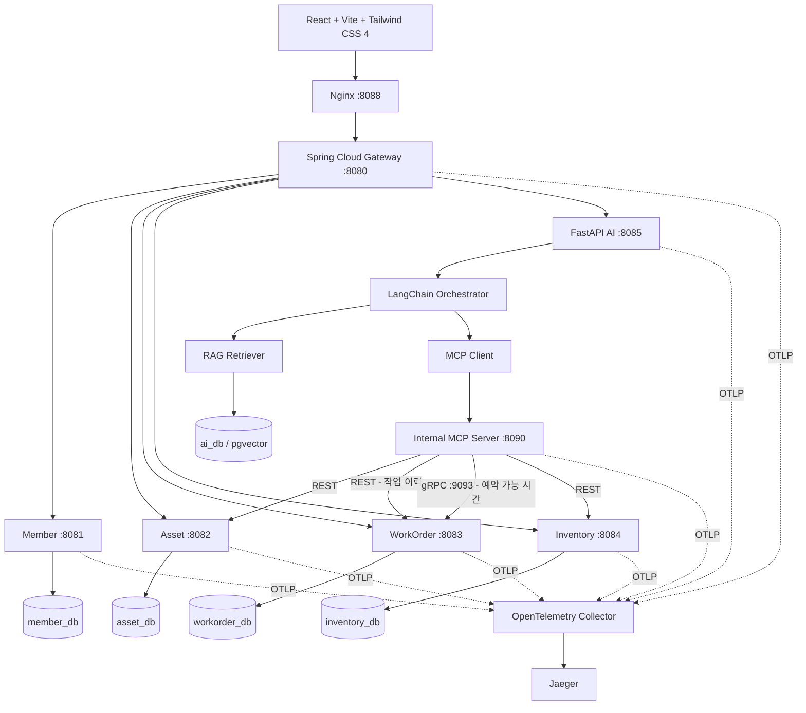
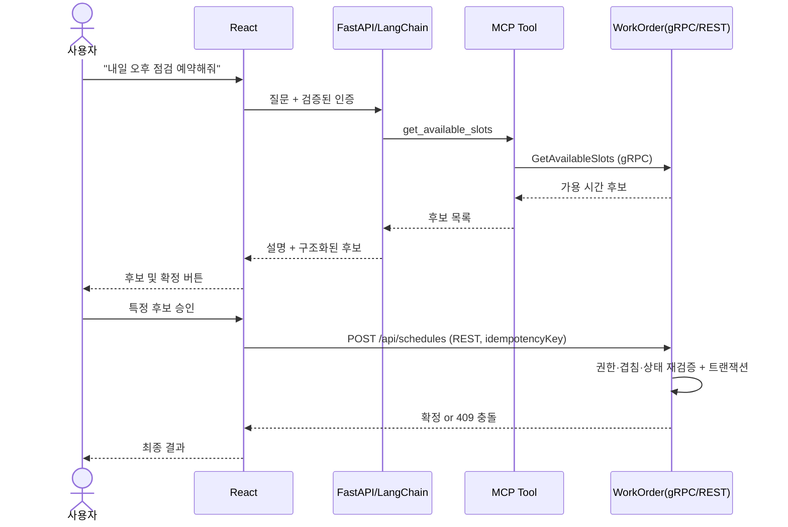
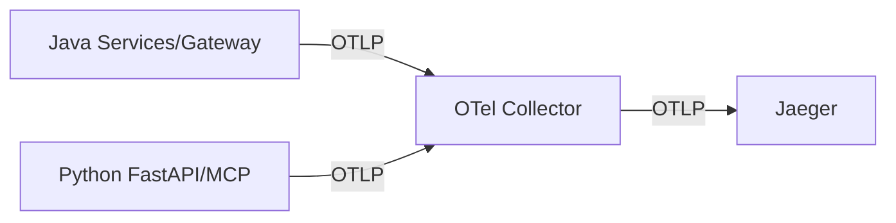

# FixOps — 통합 시스템 상세 설계 초안 v0.5

> **AI 기반 시설·설비 유지보수 관리 플랫폼**  
> 작성 기준: 2026-11-17 · 개발 기간: 4주(20영업일) · 개발 인원: 5명  
> **상태:** 구현 착수 전 팀 협의안 · **이전 버전:** v0.4

## 0. v0.4 → v0.5 변경 이력

| 항목 | v0.4 | v0.5 반영 |
|---|---|---|
| 공통 업무 | Member·Asset·WorkOrder·Inventory | 유지 |
| 산업 유형 | BUILDING / FACTORY | 유지, 생성 후 변경 제한 |
| AI | Python FastAPI·LangChain·RAG | 유지 |
| MCP | Python 단일 MCP Server | 유지, 보안·통신 계약 상세화 |
| 예약 | AI 조회·추천 및 사용자 승인 | 유지, 예약 가능 시간 조회 gRPC 시범 적용 |
| gRPC | 미포함 | **WorkOrder `GetAvailableSlots` 단일 Unary RPC** |
| 관측성 | 일반 로그 | **OpenTelemetry Collector + Jaeger** |
| 메시징 | 도입 검토 | **RabbitMQ P2 / 후순위** |
| 프론트 | React/Vite/Tailwind CSS 4 | 유지, SCSS·CSS Modules 제외 |
| 팀 분장 | 팀장 Member / A Asset / B WorkOrder / C Inventory / D Python AI | 유지; 5명 모두 Python AI 코드 직접 기여 |
| 품질 | 기능·통합 테스트 | OpenAPI·Protobuf 계약, 예약/재고 동시성, Trace 검증 강화 |

---

## 1. 프로젝트 개요

### 1.1 목표

FixOps는 **아파트와 공장의 고장 신고 → 작업자 배정 → 점검·방문 예약 → 수리·부품 사용 → 완료·이력 관리**를 제공하는 통합 유지보수 시스템이다. Python AI가 매뉴얼 RAG와 업무 조회 MCP Tool을 이용해 설비 정보, 과거 고장 이력, 예약 가능 시간, 부품 재고를 설명한다.

- **BUILDING:** 아파트 단지, 동, 호수, 공용 설비, 입주민 민원, 방문 예약.
- **FACTORY:** 공장, 구역, 생산라인, 모터·펌프 등 설비, 정비 작업, 일정 관리.
- 산업별로 별도 서비스를 만들지 않고 `organization.industry_type`과 위치·카테고리·매뉴얼 데이터로 차이를 표현한다.
- 세대 내 누수처럼 특정 등록 설비와 연결되지 않는 신고를 위해 `work_order.asset_id`는 nullable이다.

### 1.2 4주 MVP 범위

**P0 필수**: 인증·권한·조직, 위치·설비, 고장 신고·배정·완료, 예약·충돌 방지, 부품 입고·사용·차감, AI 채팅, RAG, Asset/WorkOrder/Inventory MCP Tool, 사용자 승인 기반 AI 예약, Tailwind 통일, Docker Compose, 조직별 데이터 격리, 핵심 E2E.

**P1 기술 강화**: WorkOrder 조회 gRPC 단일 경로, OpenTelemetry+Jaeger, Testcontainers 확대, AI SSE·대화 이력(여력 시).

**P2 제외·후속**: RabbitMQ, Redis, Prometheus/Grafana, WebSocket 알림, 예지보전 Python ML, IoT, 다중 Agent, Kubernetes, 전체 gRPC 전환, 자동 부품 발주.

**개발 우선순위 원칙:** P1 기술 검증은 D5까지 수행하되, P0 핵심 시나리오 완료를 저해하면 REST/기본 로그로 되돌릴 수 있어야 한다.

---

## 2. 기술 스택

| 구역 | 권장 기술 |
|---|---|
| FE | React 19, Vite, React Router, Axios, Tailwind CSS 4 |
| Java | Java 21, Spring Boot 3.4.x, Spring Data JPA, Validation, Spring Security |
| Gateway | Spring Cloud Gateway |
| 계정 인증 | JWT RS256(PEM 개인키는 Member 전용), Refresh Token 서버 관리 |
| DB | PostgreSQL 16, 서비스별 논리 DB / 소유권 분리 |
| Java Migration | Flyway |
| Python AI | Python 3.12, FastAPI, Pydantic, LangChain, httpx |
| RAG | PDF 추출·청크·Embedding·pgvector |
| MCP | Python 단일 서버 + Python MCP Client, Streamable HTTP |
| gRPC | Protocol Buffers, Java 서버 + Python 클라이언트, Unary 1개 |
| AI Migration | Alembic |
| Trace | OpenTelemetry SDK/계측, OTLP Collector, Jaeger |
| Test | JUnit 5, pytest, Testcontainers, API 계약 테스트 |
| 운영 | Nginx, Docker Compose, GitHub Actions |

> 프레임워크·라이브러리의 **정확한 버전 조합은 D2~D3에 호환성 검증 후 잠금**한다. 특히 Spring Boot 3.4.x에서 사용하는 gRPC Java 의존성은 별도 확인한다.

---

## 3. 전체 아키텍처 및 서비스 경계



### 3.1 서비스·포트·데이터 소유

| 구성 | 담당 | 포트(컨테이너 내부) | 데이터 |
|---|---|---:|---|
| Gateway | 팀장 | 8080 | 없음 |
| Member Service | 팀장 | 8081 | `member_db` |
| Asset Service | A | 8082 | `asset_db` |
| WorkOrder Service | B | 8083(REST), 9093(gRPC) | `workorder_db` |
| Inventory Service | C | 8084 | `inventory_db` |
| Python AI Service | D 통합 | 8085 | `ai_db` |
| Python MCP Server | D 통합 | 8090 | 원본 업무 데이터 없음 |
| Nginx | 팀장 | 8088(외부 진입) | 없음 |
| OTEL Collector | 팀장+D | 내부 OTLP | trace 전달 |
| Jaeger | 팀장+D | 개발 UI 16686 | trace 조회 |

- MCP Server는 **내부 AI 도구 어댑터**이며 신규 업무 도메인 서버가 아니다.
- 운영/시연 외부 진입점은 Nginx로 제한한다. Java 서비스, AI, MCP, gRPC 포트는 직접 외부 노출하지 않는다.
- 각 서비스의 DB 간 FK를 만들지 않는다. 서비스 간 `assetId`, `locationId`, `workOrderId` 등은 논리적 참조다.

---

## 4. 계정 생성·조직·권한 모델

### 4.1 역할 및 계정 정책

| 역할 | 업무 범위 |
|---|---|
| `ADMIN` | **자기 조직**의 회원·설비·작업·예약·재고 관리 |
| `TECHNICIAN` | 배정된 작업·일정 조회, 작업 수행, 허용된 부품 사용 |
| `USER` | 고장 신고, 본인 신고·예약 및 승인된 세대 관련 정보 조회 |

**회원가입 시 사용자가 ADMIN/TECHNICIAN을 임의 지정할 수 없다.**

1. 일반 회원가입·이메일 인증 → 전역 `member` 생성(조직 소속 없음).
2. 신규 조직 생성 신청 또는 기존 조직 초대/가입 신청.
3. 신규 조직의 최초 ADMIN은 제한된 조직 개설 절차에서 발급. 기존 조직의 ADMIN은 관리자 승인·초대만으로 발급.
4. TECHNICIAN은 관리자의 초대·승인으로 부여.
5. 일반 USER의 세대 소속은 검증된 `resident_unit` 승인 후 활성화.
6. 조직 관리자는 역할 변경·권한 회수를 할 수 있으며 감사 로그를 남긴다.
7. **마지막 활성 ADMIN의 강등·탈퇴를 차단**한다.

### 4.2 핵심 Member ERD

```mermaid
erDiagram
  MEMBER ||--o{ ORGANIZATION_MEMBER : has
  ORGANIZATION ||--o{ ORGANIZATION_MEMBER : contains
  ORGANIZATION ||--o{ INVITATION : sends
  ORGANIZATION_MEMBER ||--o{ RESIDENT_UNIT : assigned
  ORGANIZATION_MEMBER ||--o{ ROLE_CHANGE_LOG : history
  MEMBER ||--o{ REFRESH_SESSION : sessions
  MEMBER { bigint id PK; varchar email UK; varchar password_hash; varchar status; timestamptz created_at }
  ORGANIZATION { bigint id PK; varchar name; varchar industry_type; varchar status }
  ORGANIZATION_MEMBER { bigint id PK; bigint organization_id FK; bigint member_id FK; varchar role; varchar status }
  INVITATION { bigint id PK; bigint organization_id FK; varchar email; varchar role; varchar token_hash; timestamptz expires_at }
  RESIDENT_UNIT { bigint id PK; bigint organization_member_id FK; bigint location_id; varchar status }
  ROLE_CHANGE_LOG { bigint id PK; bigint organization_member_id FK; bigint changed_by; varchar previous_role; varchar new_role }
  REFRESH_SESSION { bigint id PK; bigint member_id FK; varchar token_hash; timestamptz expires_at }
```

`organization_member`는 `(organization_id,member_id)` 유니크. `resident_unit.location_id`는 Asset의 논리 ID이므로 해당 조직의 세대 위치인지 API 검증한다.

### 4.3 권한 판정 규칙

- 계정 상태(`ACTIVE`, `SUSPENDED` 등)와 조직 소속 상태(`PENDING`, `ACTIVE`, `REVOKED` 등)를 분리한다.
- JWT에 `sub`, `org_id`, `membership_id`, `role`, `iss`, `iat`, `exp` 포함. **이 값은 인증된 현재 소속을 기반으로 서버에서 발급**한다.
- Gateway는 JWT 검증 및 외부에서 넘어온 사용자 신원 헤더 제거. 최종 **리소스 소유권·조직 범위 판단은 실제 업무 Java 서비스**가 수행한다.
- 조직 변경·역할 변경 뒤 기존 토큰의 권한이 남을 수 있으므로 Refresh Session 회수, Access Token 단기 만료(권장 15분), 민감 API 소속 상태 재확인을 실시한다.
- MCP와 gRPC는 외부 입력 문자열만으로 사용자 역할·조직을 신뢰하지 않는다. **서비스 호출자 신원과 최종 사용자 위임 권한을 모두 검증**한다.
- USER는 타 세대의 비공개 신고를 조회할 수 없고, TECHNICIAN은 본인 배정 작업 범위에 한해 접근한다.

### 4.4 가입·역할 API

| Method | API | 주체 |
|---|---|---|
| POST | `/api/members/signup` | 공개(역할 지정 불가) |
| POST | `/api/organizations` | 인증 사용자, 조직 개설 정책 적용 |
| POST | `/api/organizations/{id}/join-requests` | 인증 사용자 |
| POST | `/api/organizations/{id}/invitations` | 해당 조직 ADMIN |
| POST | `/api/invitations/accept` | 초대 대상 |
| PATCH | `/api/organizations/{id}/members/{memberId}/approve` | 해당 조직 ADMIN |
| PATCH | `/api/organizations/{id}/members/{memberId}/role` | 해당 조직 ADMIN |
| PATCH | `/api/organizations/{id}/members/{memberId}/revoke` | 해당 조직 ADMIN |

---

## 5. 서비스별 업무 DB·핵심 엔티티

### 5.1 Asset (`asset_db`)

- `location(id, organization_id, parent_id, location_type, code, name)` — 단지→동→호수 / 공장→구역→라인.
- `asset_category(id, industry_type, name)`.
- `asset(id, organization_id, location_id, category_id, asset_code, name, status, description, created_at)`.
- 조직별 코드 중복 방지, 위치·카테고리 소속 검사.

### 5.2 WorkOrder (`workorder_db`)

- `work_order(id, organization_id, asset_id NULL, location_id, reported_by, assigned_to, title, description, priority, status, created_at, completed_at)`.
- `work_order_history(id, work_order_id, changed_by, previous_status, new_status, description, created_at)`.
- `maintenance_schedule(id, work_order_id, technician_id, start_at, end_at, status)`.
- `booking_idempotency(id, organization_id, request_key, request_hash, response_snapshot, created_at)`.
- 상태: `REPORTED → ASSIGNED → IN_PROGRESS → COMPLETED`, 별도 `CANCELLED`.
- 같은 작업자 동일 시간 예약 충돌을 DB에서도 차단한다.

### 5.3 Inventory (`inventory_db`)

- `part(id, organization_id, sku, name, category, unit, safety_stock)`.
- `stock_balance(id, part_id, quantity, version)`.
- `stock_movement(id, part_id, quantity_delta, movement_type, reference_id, idempotency_key, created_at)`.
- `part_usage(id, work_order_id, part_id, quantity, operation_key, created_at)`.
- 단일 창고 MVP. 재고 차감·원장 저장은 단일 DB 트랜잭션. `operation_key` 유니크.

### 5.4 AI (`ai_db`, pgvector)

- `knowledge_document(id UUID, organization_id, industry_type, asset_category_id, filename, storage_path, status, created_at)`.
- `document_chunk(id UUID, document_id, content, page_number, embedding)`.
- `ai_conversation(id UUID, organization_id, member_id, created_at)` — 대화 이력 저장은 P1.
- `ai_message(id UUID, conversation_id, role, content, created_at)` — P1.
- `ai_tool_execution(id UUID, conversation_id NULL, tool_name, status, duration_ms, created_at)` — 추적 최소 메타데이터.
- 문서 검색 단계에서 조직·권한 필터 적용; LLM에게 인가 판단을 위임하지 않는다.

### 5.5 시간 규격

`PostgreSQL TIMESTAMPTZ ↔ Java Instant ↔ Python timezone-aware datetime ↔ JSON ISO 8601 UTC Z`.

예약의 사용자 입력은 **조직 타임존**으로 해석하고 UTC로 저장한다. 데모 타임존은 `Asia/Seoul`이다.

---

## 6. 서비스 간 통신 계약

| 호출 | 프로토콜 | 인증·인가 담당 |
|---|---|---|
| Browser → Nginx → Gateway | HTTPS / REST JSON | Gateway JWT + Java 서비스 최종 인가 |
| Gateway → AI | 내부 HTTP / JSON | AI가 사용자 신원 및 컨텍스트 검증 |
| AI → MCP | MCP Streamable HTTP | 서비스 신원·사용자 컨텍스트 검증 |
| MCP → Asset | REST | Asset 조직·리소스 인가 |
| MCP → WorkOrder 이력 | REST | WorkOrder 조직·리소스 인가 |
| **MCP → WorkOrder 가용 시간** | **gRPC Unary** | gRPC 호출자·위임 사용자 검증 |
| MCP → Inventory | REST | Inventory 조직·작업 인가 |
| 각 서비스 → OTEL Collector | OTLP | 내부 관측성 네트워크 |
| OTEL Collector → Jaeger | OTLP | 추적 수집 |

### 6.1 REST 공통 경로

`/api/members/**`, `/api/organizations/**`, `/api/locations/**`, `/api/assets/**`, `/api/work-orders/**`, `/api/schedules/**`, `/api/inventory/**`, `/api/ai/**`.

```json
{
  "success": true,
  "data": {},
  "timestamp": "2026-11-17T01:00:00Z"
}
```

```json
{
  "success": false,
  "error": {"code": "BOOKING_CONFLICT", "message": "해당 시간에 예약할 수 없습니다."},
  "traceId": "example-trace-id",
  "timestamp": "2026-11-17T01:00:00Z"
}
```

HTTP 상태코드는 400·401·403·404·409·422·429·500·503 등 실제 실패를 반영한다. JSON `success=false`를 200으로 반환하지 않는다. Java/Python DTO는 OpenAPI 계약으로 검증한다.

### 6.2 내부 호출 보안

- 외부로 Java/MCP/gRPC 포트 노출 금지. 내부망만으로는 충분한 인증이 되지 않으므로 서비스 간 인증을 추가한다.
- MCP 및 gRPC 요청은 **서비스 신원 확인 + 검증된 최종 사용자 위임 정보**를 사용한다. 개발용으로 인증된 사용자 JWT 전달 방식을 채택할 수 있지만, 수신 서비스에서 발급자·서명·audience·만료·권한을 검증해야 한다.
- 사용자가 보내는 `X-Member-Id`, `X-User-Role`, `X-Organization-Id`를 권한의 원천으로 신뢰하지 않는다.
- Tool 입력값의 `organization_id`, `role` 등은 인증 컨텍스트를 덮어쓸 수 없다.
- 요청 타임아웃, 명시적 예외, Trace Context 전파를 공통 적용한다.

---

## 7. gRPC 단일 기술 검증 — WorkOrder 예약 가능 시간

### 7.1 채택 근거와 적용 경계

- `MCP schedule Tool → Python gRPC Client → Java WorkOrder gRPC Server`.
- 대상은 **읽기 전용 `GetAvailableSlots` 한 개**.
- `POST /api/schedules` 예약 생성은 **REST 유지**. gRPC 오류가 발생하면 계약이 동일한 REST 가용 시간 조회로 대체 가능하도록 설계한다.
- Java Spring Boot 3.4.x와 gRPC 라이브러리 호환성은 D3에 확인한다.

### 7.2 Protobuf 계약 예시

`contracts/proto/fixops/schedule/v1/schedule.proto`

```proto
syntax = "proto3";
package fixops.schedule.v1;

option java_package = "com.fixops.workorder.grpc.v1";
option java_multiple_files = true;

service ScheduleQueryService {
  rpc GetAvailableSlots(AvailabilityRequest)
      returns (AvailabilityResponse);
}

message AvailabilityRequest {
  int64 asset_id = 1;
  string date = 2;               // YYYY-MM-DD; 조직 타임존 기준
  int32 duration_minutes = 3;
}

message AvailabilityResponse {
  repeated AvailableSlot slots = 1;
  string checked_at = 2;          // UTC ISO 8601
}

message AvailableSlot {
  string start_at = 1;            // UTC ISO 8601
  string end_at = 2;
  int64 technician_id = 3;
}
```

위 응답의 `technician_id` 공개 여부는 사용자 권한에 따라 제한하거나 익명 슬롯 ID로 대체해야 한다. 일반 입주민에게 모든 작업자의 내부 식별자를 공개할 필요는 없다.

### 7.3 호출 정책

- 기본 deadline: 2초(계측 후 조정).
- gRPC Metadata로 W3C Trace Context와 인증된 위임 컨텍스트 전달.
- `UNAUTHENTICATED` → 401; `PERMISSION_DENIED` → 403; `INVALID_ARGUMENT` → 400; `DEADLINE_EXCEEDED`·`UNAVAILABLE` → 503.
- 정상적으로 예약 가능 슬롯이 없는 경우 빈 배열 반환.
- 재시도는 멱등성이 확인된 조회에 한정하고, 예약 생성은 무작정 자동 재시도하지 않는다.

### 7.4 완료 조건

1. `.proto`로 Java 서버와 Python Stub 생성.
2. 실제 `workorder_db`에 기반한 가용 시간 조회.
3. 타 조직/무권한 조회 차단.
4. 타임아웃·서비스 미기동 오류 처리.
5. Jaeger에서 해당 RPC Span 확인.

---

## 8. Python AI·MCP·RAG 상세

### 8.1 AI 디렉터리 및 책임

```text
ai-service/
  app/
    main.py                       # D
    api/chat.py                   # D
    api/booking.py                # B + D
    core/llm.py                   # D
    core/security.py              # 팀장
    context/user_context.py       # 팀장
    context/industry_context.py   # 팀장
    rag/indexer.py                # D
    rag/retriever.py              # D
    agent/orchestrator.py         # D
    mcp/client.py                 # D
    clients/schedule_grpc_client.py # B + D
  tests/
  alembic/
mcp-server/
  app/
    server.py                     # D
    tools/asset.py                # A
    tools/workorder.py            # B
    tools/booking.py              # B
    tools/inventory.py            # C
    clients/asset_client.py       # A
    clients/workorder_client.py   # B
    clients/inventory_client.py   # C
  tests/
```

### 8.2 MCP Tool 목록

| Tool | 담당 | 원본 서비스 | 변경 여부 |
|---|---|---|---|
| `get_asset_info` | A | Asset REST | 조회 |
| `search_assets` | A | Asset REST | 조회 |
| `get_workorder_history` | B | WorkOrder REST | 조회 |
| `get_available_slots` | B | WorkOrder gRPC | 조회 |
| `get_booking_details` | B | WorkOrder REST | 조회 |
| `get_part_stock` | C | Inventory REST | 조회 |
| `get_low_stock_parts` | C | Inventory REST | 조회 |
| `search_parts` | C | Inventory REST | 조회 |

MCP Server는 **단일 인스턴스**로 시작하며 Streamable HTTP를 사용한다. Tool 호출의 최종 인가는 Java 업무 서비스가 다시 확인한다.

### 8.3 RAG 처리


- 시범 문서 최소 3종. 문서 업로드·색인 실패 상태를 기록한다.
- 조직·산업 유형·공개 범위 필터는 **검색 단계에서** 적용한다.
- 문서 내용의 지시문은 시스템 지시를 대체할 수 없는 비신뢰 입력으로 취급한다.
- 근거를 찾지 못하면 임의 매뉴얼 내용을 만들어내지 않는다.

### 8.4 AI 채팅 API

| Method | Endpoint | 우선순위 |
|---|---|---|
| POST | `/api/ai/chat` | P0 |
| POST | `/api/ai/booking/suggestions` | P0 |
| POST | `/api/ai/documents` | P0(관리자) |
| GET | `/api/ai/documents` | P0 |
| POST | `/api/ai/chat/stream` | P1 |
| GET | `/api/ai/conversations` | P1 |

---

## 9. AI 예약 설계 및 동시성

### 9.1 예약 시퀀스



LLM이 도구를 통해 예약을 **추천**할 수 있지만, 사용자 동의 없는 자동 예약 생성은 MVP에서 제외한다. 사용자의 승인 이후 React가 WorkOrder 예약 생성 API를 호출한다.

### 9.2 PostgreSQL 충돌 제약 예시

```sql
CREATE EXTENSION IF NOT EXISTS btree_gist;

ALTER TABLE maintenance_schedule
  ADD CONSTRAINT valid_schedule_range CHECK (start_at < end_at);

ALTER TABLE maintenance_schedule
  ADD CONSTRAINT no_technician_overlap
  EXCLUDE USING gist (
    technician_id WITH =,
    tstzrange(start_at, end_at, '[)') WITH &&
  )
  WHERE (status IN ('CONFIRMED', 'IN_PROGRESS'));
```

- 운영 시 작업자 ID, 조직 범위, 스케줄 상태 및 기존 데이터 유효성을 점검한다.
- 시간대 중복 확인은 API 사전 검사와 별개로 DB 제약에서 최종 방어한다.
- 동일 `idempotency_key` 재요청은 최초 결과를 재사용하거나 입력 불일치를 명확히 거부한다.
- 실제 예약 충돌 시 HTTP 409 반환 및 후보 재조회 안내.

---

## 10. Inventory 동시성·정합성

- `part(organization_id,sku)` 유니크.
- `stock_balance.quantity >= 0` 유지.
- 동일 `operation_key`를 가진 부품 차감 요청은 한 번만 처리.
- 차감과 `stock_movement` 원장 기록은 단일 트랜잭션.
- JPA `@Version` 낙관적 잠금 또는 조건부 UPDATE 중 하나로 동시성 처리.
- 부품 사용 취소는 기존 이동 내역 삭제가 아니라 보정 이동 기록.
- AI MCP Inventory Tool은 조회 전용. 실제 차감은 권한과 작업 상태를 검증하는 Inventory API에서 수행.

---

## 11. OpenTelemetry + Jaeger 관측성

### 11.1 배포 구성



**서비스 식별명**: `fixops-gateway`, `fixops-member`, `fixops-asset`, `fixops-workorder`, `fixops-inventory`, `fixops-ai`, `fixops-mcp`.

### 11.2 계측 범위

- Gateway 요청·라우팅.
- AI Chat 요청 / LangChain 실행 / LLM 호출 지연.
- RAG 검색 및 pgvector 조회.
- MCP Tool 실행.
- Asset·WorkOrder·Inventory REST 호출.
- WorkOrder 예약 가용 시간 gRPC 호출.
- 주요 DB 및 예약 확정 API.

### 11.3 Trace Context

- HTTP: W3C `traceparent`·`tracestate`.
- gRPC: Metadata 전파 및 서버 Span 연결.
- MCP Streamable HTTP: 요청 Trace Context 연동.
- 모든 구간의 Trace 연결 여부는 실제 Jaeger 화면에서 확인하며, 프레임워크 자동 계측만 믿고 완료로 처리하지 않는다.

### 11.4 개인정보 보호

Trace·로그에 비밀번호, JWT 원문, LLM API Key, 개인 연락처, 입주민 민원 원문, 문서 전체 내용, 프롬프트 전문을 저장하지 않는다. Tool명·오류 코드·처리 시간·Trace ID 중심으로 기록한다.

---

## 12. Frontend / Tailwind CSS 4 단일화

```text
frontend/src/
  app/
  api/
  components/
    ui/{Button,Input,Select,Modal,Table,StatusBadge,ConfirmDialog}.jsx
    layout/{Header,Sidebar,AppLayout}.jsx
  features/
    member/
    asset/
    workorder/
    inventory/
    ai/
    dashboard/
  styles/index.css
```

- Tailwind CSS 4 `@theme` 및 CSS 변수를 사용해 색상·폰트·간격·반경 관리.
- SCSS·CSS Modules 추가 금지. Tailwind 진입용 `index.css`는 유지.
- 공통 UI는 팀장이 제공하고 A/B/C/D는 각자 화면을 만든다.
- `ProtectedRoute`는 화면 표시만 관리하며 권한은 서버에서 최종 검증.
- 일반 USER·TECHNICIAN·ADMIN 역할별 메뉴와 데이터 노출 범위를 맞춘다.

---

## 13. Docker·설정·CI

### 13.1 Compose 필수 구성

`nginx`, `frontend`, `gateway`, `member`, `asset`, `workorder`, `inventory`, `ai`, `mcp`, `postgres`, `otel-collector`, `jaeger`.

개발용 PostgreSQL 인스턴스는 하나여도 서비스별 논리 DB/접속 계정은 분리한다. `ai_db`에서 `vector` 확장을 활성화한다.

**환경변수 예시**: `POSTGRES_PASSWORD`, `JWT_PRIVATE_KEY_PATH`(Member만), `JWT_PUBLIC_KEY_PATH`, `LLM_API_KEY`, `AI_DB_URL`, `MCP_SERVER_URL`, `WORKORDER_GRPC_TARGET`, `OTEL_SERVICE_NAME`, `OTEL_EXPORTER_OTLP_ENDPOINT`, `INTERNAL_SERVICE_CREDENTIAL`.

비밀키는 Git에 커밋하지 않는다. 로컬 키 경로, 컨테이너 마운트 및 공개키 배포 방식을 표준화한다.

### 13.2 CI 검사

| 구간 | 최소 작업 |
|---|---|
| Java | `gradle test`, build, Flyway 및 API 통합 테스트 |
| Python | Ruff, pytest, import 및 MCP Tool 계약 검사 |
| Protobuf | `.proto` 컴파일 / Java·Python Stub 생성 확인 |
| Frontend | `npm ci`, ESLint, Vite build |
| Infra | `docker compose config`, Healthcheck 확인 |
| E2E | 계정·조직 → 설비 → 작업 → 예약 → 재고 → AI 경로 |

### 13.3 브랜치

`main`, `develop`, `feature/member`, `feature/asset`, `feature/workorder`, `feature/inventory`, `feature/ai-core`, `feature/ai-security`, `feature/ai-mcp-asset`, `feature/ai-mcp-workorder`, `feature/ai-mcp-inventory`, `feature/grpc-schedule`, `feature/observability`.

공통 `.proto`, OpenAPI, 인증·컨텍스트 계약은 **팀장 리뷰 후 변경**하고, 계약 변경 시 관련 소비자 테스트를 동시에 업데이트한다.

---

## 14. 5인 공동 AI 개발 상세 업무분장

| 담당 | Java 업무 및 공통 | Python AI·MCP 기여 | React/Tailwind | 추가 기술·검증 |
|---|---|---|---|---|
| **팀장** | Member, 조직·산업 선택, JWT, Gateway, Docker, CI | Python JWT·조직 Context·MCP 권한 정책 | 로그인·조직 설정·공통 UI | OpenAPI, Trace 기본 전파, 통합 E2E |
| **A** | Asset·Location, 설비 카테고리·CRUD | Asset MCP Tools 및 REST Client | 위치·설비 관리, 예약 캘린더 표시 지원 | Asset 통합·권한 테스트 |
| **B** | WorkOrder·상태·예약·충돌 방지 | WorkOrder/Booking MCP Tools, 예약 gRPC 조회 | 고장 신고·작업 관리·예약 확정 | Protobuf, gRPC Java 서버, 예약 충돌 테스트 |
| **C** | Inventory·부품·입고·차감 | Inventory MCP Tools 및 REST Client | 부품·재고·사용 이력 | 재고 정합성·멱등성 Testcontainers |
| **D** | AI 서비스 플랫폼·RAG | FastAPI, LangChain, MCP Client/Server, 오케스트레이션, pgvector | AI 점검센터·근거 표시 | Python gRPC Client, OTEL·Jaeger 연동 |

**업무량 균형 장치**

- 팀장은 Python 전체 AI를 구현하지 않고 **보안·조직 컨텍스트**를 소유한다.
- A는 B의 예약 캘린더 **표시 UI만** 지원하며 예약 로직·DB 소유권은 B에게 남긴다.
- B는 작업·예약과 gRPC로 부담이 높으므로 **gRPC 단일 Unary RPC로 제한**한다.
- C는 재고 Tool 전체와 Testcontainers 동시성 테스트를 직접 책임진다.
- D는 LangChain/MCP 공통 기반·RAG를 맡고, 도메인 Tool 구현은 A/B/C에게 위임한다.
- 5명 각각 Python AI 관련 PR 및 정상/권한·오류 테스트 최소 1건 제출한다.

---

## 15. 20영업일 상세 WBS

| 일자 | 공통 마일스톤 | 팀장 | A | B | C | D |
|---|---|---|---|---|---|---|
| **D1** | 요구사항·역할 확정 | 조직/인증 정책 | 위치/설비 ERD | 작업/예약 ERD | 재고 ERD | Tool·RAG 설계 |
| **D2** | 골격 구성 | Gateway·Member·Tailwind·Compose | Asset 프로젝트/CRUD | WorkOrder 프로젝트 | Inventory 프로젝트 | FastAPI·MCP 골격 |
| **D3** | 기술 연결 검증 | JWT 및 내부 인가 규약 | Asset API 명세 | gRPC 라이브러리 검증 | 재고 트랜잭션 설계 | LLM·Java REST 연동 |
| **D4** | 계약 초안 | OpenAPI·Trace 공통 기반 | Asset 조회 API | `.proto`·예약 규칙 | 재고 원장 API | pgvector·OTEL 기동 |
| **D5** | **계약 동결·Spike** | 통합 리뷰 | Asset Mock Tool | gRPC Python↔Java 호출 | Inventory Mock Tool | MCP+Trace+gRPC 통합 검증 |
| **D6–D7** | 핵심 CRUD | 회원·조직·초대 | 위치·설비 CRUD | 신고·배정·상태 | 부품·입고 | 문서 파싱·임베딩 |
| **D8–D9** | 도메인·AI 연결 | Gateway/권한·공통 UI | 설비 화면·Asset Tool | 예약 API·Booking Tool | 차감·재고 Tool | RAG·채팅 UI·MCP 등록 |
| **D10** | **개별 기능 완료** | 인증 통합 | 설비 CRUD 테스트 | 예약·gRPC 실제 DB | 재고 사용 테스트 | RAG 및 Tool 독립 테스트 |
| **D11** | 전체 인증 연결 | 조직·토큰 일원화 | Asset Tool 실제 연결 | 예약 권한 통합 | Inventory Tool 실제 연결 | MCP 사용자 컨텍스트 연결 |
| **D12** | AI 업무 통합 | 보안 점검 | Asset 데이터 검증 | gRPC 예약 후보 AI 연계 | 재고 결과 검증 | LangChain Tool Calling |
| **D13** | 핵심 E2E | 전체 요청 Trace 확인 | 설비·위치 E2E | 승인→예약 생성 E2E | 재고 차감 E2E | RAG+도구 종합 응답 |
| **D14** | 산업별 시나리오 | BUILDING/FACTORY 격리 | 아파트·공장 설비 | 예약 충돌 수정 | 동시성 수정 | AI 권한·출처 검증 |
| **D15** | **P0 기능 동결** | 통합 테스트 승인 | Asset 완료 | WorkOrder/예약 완료 | Inventory 완료 | AI/MCP/RAG 완료 |
| **D16** | 회귀 테스트 | 인증·계정·권한 | 설비 조직 격리 | 예약 중복 | 재고 음수·멱등성 | AI 문서 격리 |
| **D17** | 장애 검증 | Gateway·JWT | Asset 장애 응답 | gRPC timeout/REST 대체 | 재고 동시 요청 | MCP·LLM timeout |
| **D18** | UI·배포 검수 | Docker 클린 빌드 | 설비 UI | 예약 UI | 재고 UI | AI UI·Jaeger Trace |
| **D19** | 문서·발표 | README·CI·아키텍처 | Asset ERD/API | 예약·gRPC 계약 | 재고 제약 설명 | RAG·MCP·Trace 발표 |
| **D20** | **최종 시연** | 통합 리드 | 설비 시연 | 작업·예약 시연 | 부품·재고 시연 | AI·Jaeger 시연 |

### 단계별 통과 기준

- **D5:** JWT 기본 인증, LLM 호출, MCP Tool 호출, gRPC Stub·Unary RPC 연결, Collector→Jaeger Trace 확인.
- **D10:** 각 업무 기능 독립 동작, RAG 문서 검색, 실제 또는 Mock MCP Tool 호출.
- **D15:** 조직별 접근, 예약 확정·충돌, 부품 사용, RAG+MCP, gRPC 조회, 통합 E2E 통과.
- **D20:** 테스트/문서/시연 완료 및 신규 기능 추가 중단.

---

## 16. 테스트 매트릭스

| 영역 | 필수 사례 | 기대 결과 |
|---|---|---|
| 가입·승인 | 가입 시 임의 ADMIN 요청 | 서버에서 거부·무시 |
| 조직 격리 | A 조직 계정으로 B 조직 Asset 조회 | 403/404 정책에 맞게 차단 |
| 세대 접근 | 105동 입주민이 다른 세대 민원 조회 | 차단 |
| 작업 권한 | 미배정 TECHNICIAN 완료 처리 | 차단 |
| 예약 | 같은 작업자 겹치는 예약 동시 제출 | 하나만 성공, 나머지 409 |
| 예약 멱등성 | 같은 요청 키로 재전송 | 중복 예약 없이 동일 결과 |
| 재고 | 재고 5개, 동시 4개씩 차감 | 음수 방지 |
| 재고 멱등성 | 동일 operationKey 재전송 | 차감 1회 |
| MCP | 타 조직 ID를 Tool 인자에 삽입 | 검증된 컨텍스트 우선, 접근 차단 |
| RAG | 타 조직 매뉴얼 검색 시도 | 타 조직 청크 미포함 |
| gRPC | 서버 중단·deadline 초과 | 명확한 오류 또는 검증된 REST 대체 |
| Tracing | AI → MCP → WorkOrder | Jaeger Trace 연결 |
| Docker | 초기 데이터로 `compose up` | 모든 P0 서비스 Healthcheck 통과 |

---

## 17. 위험 관리 및 의사결정 게이트

| 위험 | 우선순위 | 대응·후퇴 기준 |
|---|---|---|
| 팀장 Member·Gateway·UI 집중 | 높음 | EMS 인증 구조 참고, UI 최소 공통 범위 확정, D에게 AI 공통 위임 |
| D의 RAG·MCP·Tracing 집중 | 높음 | A/B/C가 도메인 Tool·Client 직접 구현, 최소 매뉴얼 3종 |
| B의 WorkOrder·예약·gRPC 병목 | 높음 | gRPC 조회 1개만, D5까지 Spike 실패 시 REST 유지 |
| 인증된 사용자 컨텍스트 유실 | 매우 높음 | end-to-end 위임 신원 검증; 실패 시 Tool 차단 |
| 조직 간 RAG 유출 | 매우 높음 | 검색 시 조직/문서 접근 필터 + 테스트 |
| 예약 경합 | 높음 | PostgreSQL Exclusion Constraint·409·멱등성 |
| 재고 경합 | 높음 | DB 트랜잭션·조건부 차감·멱등성 |
| OTEL 계측 과다 | 중간 | 핵심 AI→MCP→WorkOrder 단일 Trace 우선 |
| LLM 비용·응답 불안정 | 중간 | 호출 수·토큰 제한·타임아웃·출처 중심 답변 |
| 프론트 스타일 불일치 | 중간 | 1주차 Tailwind 토큰·공통 컴포넌트 확정 |
| 통합 시기 지연 | 매우 높음 | D10 개별 연동, D15 기능 동결, 4주차 버그만 수정 |

**게이트 의사결정:**

- **D5:** gRPC 미동작 → REST 가용 시간 조회로 후퇴. Jaeger 통합 실패 → 기본 로그+Trace ID를 유지하고 추적은 P1로 연기.
- **D10:** RAG·MCP 지연 → 문서 3종·조회 Tool 3개로 축소. 예약 자연어 확정 자동화는 추가하지 않는다.
- **D15:** 업무/권한/E2E 미완 → SSE, 대화 이력, 고급 시각화 즉시 제외.

---

## 18. 최종 발표용 E2E 시나리오

1. ADMIN이 BUILDING 조직을 개설하고 Member·산업 유형을 확인한다.
2. 105동과 공용 급수펌프를 등록한다.
3. 입주민 USER가 누수 신고를 생성한다(등록 설비 없이 `asset_id=null` 가능).
4. 관리자가 TECHNICIAN에게 작업을 배정한다.
5. 사용자가 AI에 예약 가능한 시간을 자연어로 묻는다.
6. LangChain → MCP `get_available_slots` → WorkOrder gRPC → `workorder_db` 조회.
7. AI가 실제 가능한 후보 시간을 표시한다.
8. 사용자가 UI에서 후보를 명시적으로 승인하고 WorkOrder REST로 예약한다.
9. 작업자가 매뉴얼 RAG와 과거 수리 이력을 질문한다.
10. AI가 Asset/WorkOrder/Inventory Tool과 관련 문서 근거를 종합한다.
11. 작업자가 사용 부품을 등록하고 Inventory가 안전하게 1회 차감한다.
12. WorkOrder를 COMPLETED로 변경하고 이력·대시보드에 반영한다.
13. Jaeger에서 Gateway → AI → MCP → gRPC/REST 요청을 조회한다.
14. 별도 FACTORY 조직에서 모터 설비 예제를 등록하여 산업별 공통 구조와 조직 격리를 확인한다.

---

## 19. 최종 완료 기준 및 잔여 협의 사항

### 19.1 완료 체크리스트

- [ ] 5명이 각자의 Python AI·MCP 관련 PR과 테스트를 제출했다.
- [ ] 회원가입·조직·초대·RBAC 및 조직/세대 격리가 통과했다.
- [ ] Asset·Location CRUD가 정상 동작한다.
- [ ] WorkOrder 신고·배정·완료 및 예약 충돌 방지가 동작한다.
- [ ] Inventory 입고·사용·차감·멱등성이 동작한다.
- [ ] FastAPI 채팅·RAG·출처 표시가 동작한다.
- [ ] MCP 도메인 Tool들이 실제 Java 데이터를 조회한다.
- [ ] WorkOrder 예약 가능 시간 gRPC RPC가 실제 DB로 동작한다(P1).
- [ ] Java·Python·MCP Trace가 Jaeger에 연결된다(P1).
- [ ] React/Tailwind 화면 및 Docker Compose E2E를 완료했다.
- [ ] RabbitMQ는 MVP 필수에 포함되지 않았다.

### 19.2 구현 착수 전 확정할 계약

1. 단일 LLM Provider와 Embedding 모델.
2. gRPC Java 라이브러리·Stub 빌드 방식.
3. Java 서비스가 검증하는 사용자 위임 방식(사용자 토큰 + 내부 서비스 인증 계약).
4. MCP Tool 데이터 반환 DTO와 오류 코드.
5. 조직 최초 관리자 생성 절차 및 이메일 인증 수준.
6. 예약 후보에서 공개하는 작업자 정보 수준.
7. 문서 업로드 파일 저장 경로·권한.
8. Trace 샘플링과 개인정보 제외 규칙.

---

## 20. 최종 설계 결론

**FixOps v0.5는 Java Spring Boot 기반 4개 업무 서비스와 Python FastAPI·LangChain·RAG·MCP를 통합하고, WorkOrder 예약 조회 1개 경로에서 gRPC를 검증하며 OpenTelemetry·Jaeger로 분산 호출을 관찰하는 5인 공동 개발 프로젝트다.**

프로젝트의 우선 목표는 기술을 최대한 많이 채택하는 것이 아니라, **조직별 권한이 보장되는 설비·작업·예약·재고의 실제 업무 흐름을 완성하고 그 위에서 AI가 근거를 갖고 동작하게 만드는 것**이다.

**v0.5 권장 최종 결정:** REST 기본 / MCP 단일 서버 / gRPC 1개 시범 / OTel·Jaeger P1 / RabbitMQ P2 / Tailwind CSS 4 통일 / D15 기능 동결.
